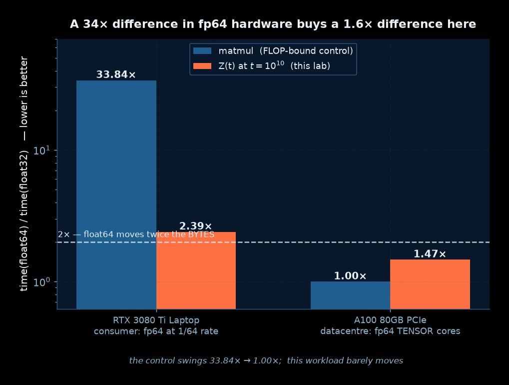
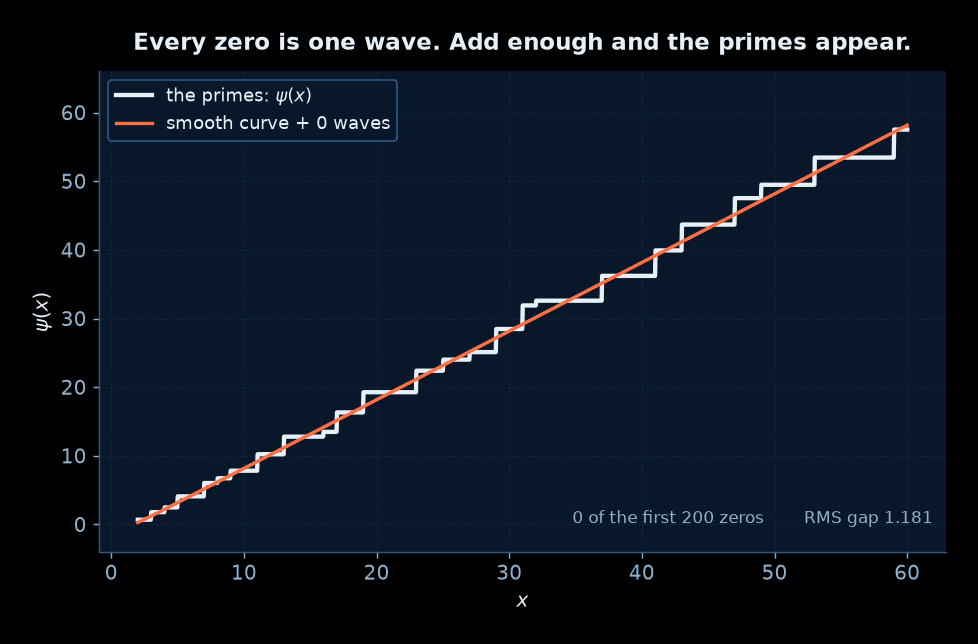
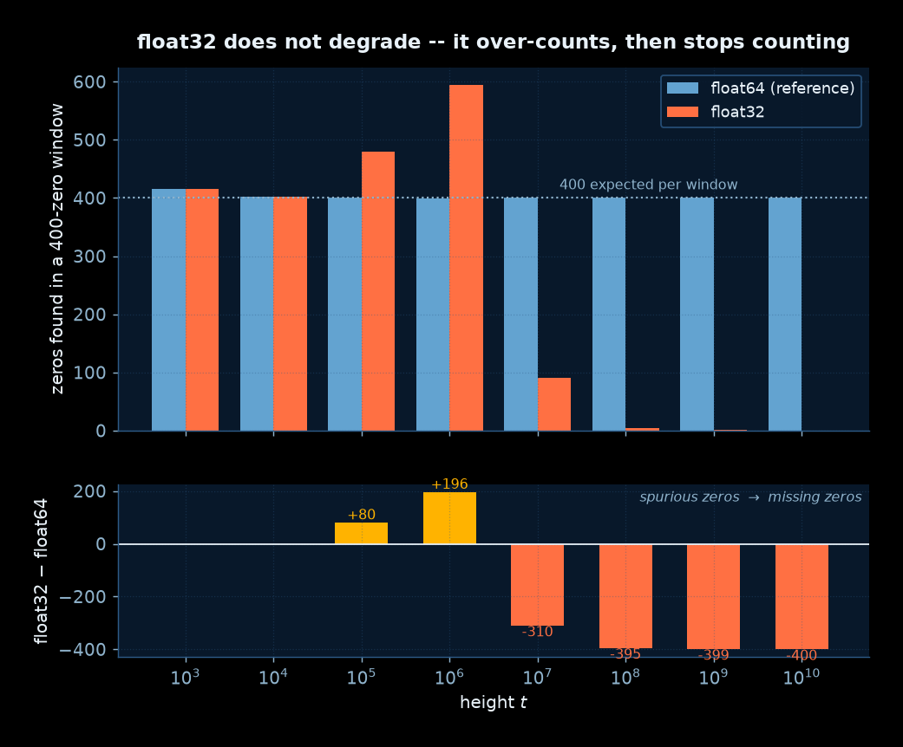
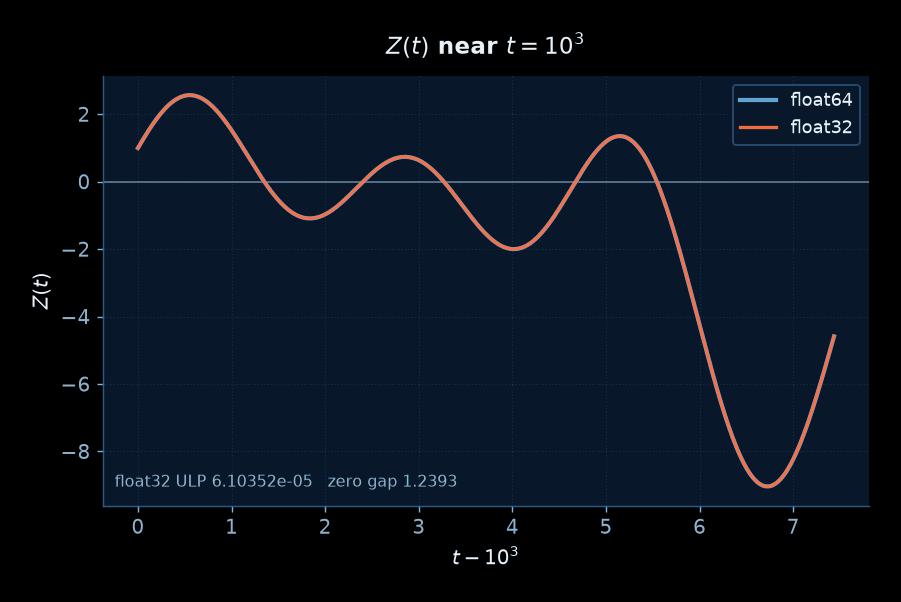
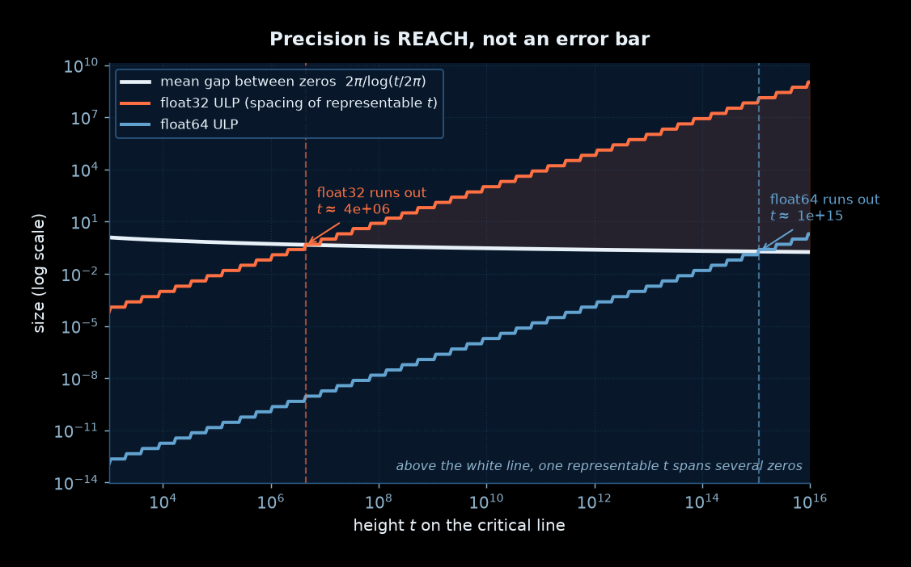
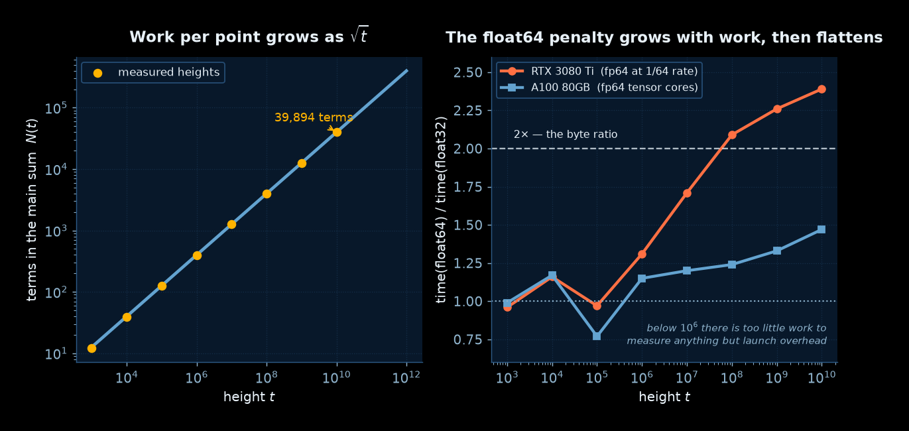

# Riemann Zeros at Scale: When Precision Becomes Reach

**Baseline:** float64 is the reference arm — it finds 400 zeros in a
400-zero window at every height from `t = 1e3` to `t = 1e10`, and a
matmul on the same card is the FLOP-bound control.
**Budget:** 8 heights (`1e3` … `1e10`), 20,000 grid points per window,
windows sized to 400 mean zero spacings; every timing best-of-3.

> **Credit.** The mathematics here is **Ashwin Rao's** Riemann Hypothesis
> notebook, which is where the Riemann–Siegel formulation used below
> comes from. This lab is not a reproduction of it. His notebook asks
> *where are the zeros*; this one asks the systems question underneath —
> **what does it cost to look, and what breaks first as you look higher.**

---

## The one-sentence version

On a card where float64 matmul is **exactly as fast as float32**, this
workload still pays a float64 penalty — because its cost is **bytes
moved, not arithmetic performed**.



Two GPUs whose float64 *matmul* capability differs by **34×**. If this
workload were FLOP-bound, its penalty would differ by 34× too. It
differs by **1.6×**.

---

## Why this is a DeepSpeed-course lab and not a number theory one

Every other topic here shrinks something: ZeRO shards what the model
*is*, token compression shrinks what it *looks at*, STAR memory bounds
what it *retains*. This lab is about the resource none of those touch
and the one most people reach for first — **precision**.

It is the cheapest possible setting in which to see a fact that costs a
great deal to learn on a 70B model: **the dtype you pick is not a
quality knob, it is a reachability knob**, and the profile that tells
you whether halving it will help is not the one printed on the box.

There is no `deepspeed` launcher here, deliberately. See
[Why no DeepSpeed](#why-there-is-no-deepspeed-launcher).

---

## The function, in brief

The Riemann–Siegel **Z function** is real-valued with
|Z(t)| = |ζ(½ + it)|. So the zeros of ζ on the critical line are exactly
the **sign changes of Z** — which turns "find the zeros" into "evaluate
on a grid and look for crossings", an embarrassingly parallel workload.

```
Z(t) = 2 · Σ  n^(-1/2) · cos(θ(t) − t·log n)   +   remainder
          n=1..N(t)

N(t) = ⌊√(t / 2π)⌋          terms per evaluation
```

Two consequences set up everything below:

| | |
|---|---|
| **Work per point** | grows as `√t` — 398 terms at `1e6`, **39,894** at `1e10` |
| **Gap between zeros** | `2π/log(t/2π)` — shrinks only **logarithmically** |

One grows like a square root, the other shrinks like a reciprocal log.
That mismatch is the whole lab.

### How accurate this Z actually is

`zeta_core.py` truncates the Riemann–Siegel expansion after the **first**
remainder correction `C₀`, so its error is `O(t^-3/4)` **by design** —
not arbitrary precision. Measured against `mpmath.siegelz`:

| t | error |
|---:|---:|
| 50 | 1.6 × 10⁻³ |
| 10³ | 1.2 × 10⁻⁴ |
| 10⁶ | 1.2 × 10⁻⁶ |

`error × t^(3/4)` stays between 0.017 and 0.041 across that whole range,
which is the signature of a correct `C₀`. Drop the term and it degrades
to `O(t^-1/4)`; `tests/test_riemann_scaling.py` asserts the **scaling**
rather than a flat tolerance, because a fixed bound either demands a
different algorithm or, loosened until it passes, asserts nothing.

This matters for reading the tables below: Z is accurate to ~10⁻⁴ at the
heights measured, while Z itself swings over a range of order 1–50 there.
That is ample to locate sign changes, and it is **not** enough to claim a
zero's position to many digits. This lab counts crossings; it does not
publish zero locations.

---

## Why anyone cares about these zeros

> **This neither proves nor verifies the Riemann Hypothesis.** RH has been
> open since 1859 and is a $1M Millennium Prize problem. Finding zeros on
> the line is *evidence*; no finite amount settles a claim about infinitely
> many. Counting sign changes also only finds zeros that are **on** the
> line — showing none hide **off** it needs Turing's method, which this lab
> does not implement. Zero-finding is a **workload** here, used to measure
> what precision costs.

The zeros are about **how many primes are below x**. That is a staircase:
flat, then a jump at every prime. Primes near x thin out like `1/ln x`,
which gives a smooth prediction, and the Prime Number Theorem (proved,
1896) says the two agree in the long run.

**Riemann's leap was that the gap between them is not noise.** There is an
*exact* formula in which every zero contributes exactly one **wave**:

```
  the primes  =  smooth curve  −  Σ (one wave per zero)
```

Write a zero as `ρ = σ + i·t`: the real part `σ` sets that wave's
**amplitude**, the imaginary part `t` its **frequency**. Every zero is known
to have `0 < σ < 1`, and **RH claims every `σ` is exactly ½**.

So RH is the *optimistic* statement, the opposite of its usual paraphrase.
All `σ = ½` means every wave is ~`√x` tall and the error in the prime count
is as small as it could be. One zero at `σ = 0.9` would give a wave of size
`x^0.9` that drowns the rest — primes would be **less** regular, not more.

Run backwards, that claim is a picture. Take the zeros `zeta_core.py` finds,
feed them to the formula, watch the smooth line grow steps:



| waves | RMS gap to the true staircase |
|---:|---:|
| 0 | 1.181 |
| 34 | 0.547 |
| 200 | 0.287 |

```bash
uv run make_figures.py --only primes      # no GPU, a few seconds
```

Uses `ψ(x)`, which counts each prime as `log p` rather than 1 — same
information, far tidier formula, and it still jumps at exactly the primes.

**None of this needs a GPU**, and that is the honest framing: the GPU earns
its place in Finding 3, which is a claim *about GPUs*.

---

## Finding 1 — float32 does not get noisy, it goes blind

The expectation going in was that float32 would accumulate rounding
error and get gradually less accurate. It does not.



| height | fp64 | fp32 | diff |
|---:|---:|---:|---:|
| `1e3` | 416 | 416 | 0 |
| `1e4` | 402 | 402 | 0 |
| `1e5` | 400 | 480 | **+80** |
| `1e6` | 399 | 595 | **+196** |
| `1e7` | 400 | 90 | −310 |
| `1e8` | 400 | 5 | −395 |
| `1e9` | 401 | 2 | −399 |
| `1e10` | 400 | **0** | −400 |

Three things in that table are worth more than the headline:

**It is exact, then wrong in the wrong direction, then gone.** float32
matches float64 *perfectly* to `1e4`. Then it **over-counts** — +196
spurious zeros at `1e6`, sign changes manufactured by cancellation in a
sum whose terms are far larger than their total. Only after that does it
collapse. **A lab that checked up to `1e4` would have published "float32
is fine here", and been right about the range it tested and wrong about
everything else.**

**The collapse is representability, not rounding.** At `t = 1e10` the
float32 ULP — the gap between adjacent representable numbers — is
**1024**, while the mean gap between zeros is **0.2965**. Every one of
the 20,000 grid points in the window rounds to the *same* float32 value.
The function is evaluated at one height, 20,000 times.

**Both cards agree bit-for-bit.** All eight rows are identical on an RTX
3080 Ti and an A100 — different architectures, different torch builds.
A stochastic rounding effect would not reproduce like that. A
deterministic representability limit does.

The animation is what made the mechanism obvious — in the last frame
float32 is not a noisy curve, it is a **flat line**:



---

## Finding 2 — precision is REACH, not an error bar

The useful way to think about a dtype here is not "how much error does
it add" but "**how high can it count at all**".



A float's ULP grows with magnitude; the gap between zeros shrinks
logarithmically. Where the lines cross, the dtype runs out of distinct
numbers to put between zeros:

| dtype | runs out near | at `t = 1e10` |
|---|---|---|
| float32 | `t ≈ 4 × 10⁶` | ULP 1024 vs gap 0.2965 — **0 points per zero** |
| float64 | `t ≈ 1 × 10¹⁵` | 155,000 points per zero |

Below one point per zero the height is unreachable **no matter how good
the algorithm is**. No amount of care in the summation buys it back.

Run the table yourself with no GPU and no downloads:

```bash
uv run benchmark_zeta.py --plan
```

---

## Finding 3 — the fp64 penalty is set by bytes, not by ALUs

This is the measurement the lab was built for, and the prediction it
tested was **wrong in a way worth keeping**.

Going in: a consumer GPU does float64 at 1/64 the float32 rate, so a
float64 workload should be catastrophically slower. Measured on an RTX
3080 Ti: **2.39×**, not 64×. So the hypothesis became "this workload is
bandwidth-bound, therefore the penalty should stay near 2× — the byte
ratio — even on a card with excellent float64."

That is falsifiable, so it was tested on a rented A100:

| | RTX 3080 Ti | A100 80GB |
|---|---:|---:|
| **matmul** fp32 | 12.33 TFLOP/s | 18.29 TFLOP/s |
| **matmul** fp64 | 0.364 TFLOP/s | **18.28 TFLOP/s** |
| **matmul** penalty *(control)* | **33.84×** | **1.00×** |
| **Z(t)** penalty at `t=1e10` | **2.39×** | **1.47×** |



The A100's float64 matmul measured **18.282 TFLOP/s**. That card's
*non-tensor* float64 peak is 9.7 TFLOP/s — so the measurement **exceeds
what is possible without the fp64 tensor cores**. That is not an
inference; you cannot beat the non-tensor peak by using non-tensor
units. cuBLAS used DMMA, and on this card float64 matmul is **free**
relative to float32.

And this workload *still* pays 1.47×.

So the honest conclusion, which is narrower than "bandwidth-bound":

> The float64 penalty here tracks **the 2× byte ratio**, not float64 ALU
> provisioning. The control swings **33.84× → 1.00×** across the two
> cards; this workload moves **2.39× → 1.47×**.

Neither figure is exactly 2.00×, and the lab does not claim they should
be. The 3080 Ti sits slightly above (a small real ALU contribution at
1/64 rate); the A100 sits below (some of the time is precision-
independent launch and masking overhead). What is established is the
*insensitivity*: a 34× change in the relevant hardware moved the outcome
by 1.6×.

### The falsifier, written before the A100 was rented

> **FAILS if** the A100's Z(t) penalty lands near its matmul penalty —
> i.e. if better float64 hardware buys a proportionate speed-up.
> Matmul 1.00× vs Z(t) 1.47×. **HOLDS.**

### What this means if you are picking hardware

Paying for float64 throughput buys nothing here. The thing to buy is
**memory bandwidth** — and before buying either, measure, because the
spec sheet's float64 ratio describes the control, not your workload.

---

## Why there is no DeepSpeed launcher

This lab skips the `deepspeed` launcher and carries `launcher="python"`
in `runpod/runpod_ctl.py`, as the other labs do whose work is an
algorithm or a policy rather than a model.

The entire workload is one `(points × N)` elementwise cosine and a
reduction. There is no optimizer, no gradient, and no model state to
shard — ZeRO shards optimizer state, gradients and parameters, and this
has none of the three. A single card saturates on memory bandwidth long
before a second would help. Wrapping it in a distributed launcher would
be the cargo cult `CLAUDE.md` warns about, pointed at a lab that cannot
benefit.

The SLURM script is therefore named `run_slurm.sh`, not
`run_deepspeed.sh`, and says so in its header.

---

## Hardware

| | |
|---|---|
| **Minimum** | 1 × 16 GB GPU — the grid is small; it is the *term count* that grows |
| **Measured on** | RTX 3080 Ti Laptop (16 GB) and A100 80GB PCIe (RunPod) |
| **Runtime** | ~3 min for the full 8-height sweep |
| **Downloads** | none — the data is generated |
| **No GPU?** | `--plan` gives the full reach table on CPU and exits 0 |

---

## Environment & Local Testing

```bash
cd 02_intermediate/06_riemann_scaling
uv sync

# No GPU needed — the precision reach table, then exit
uv run benchmark_zeta.py --plan

# Full sweep (needs CUDA)
uv run benchmark_zeta.py --max-heights 8 --output-dir results

# Cheap smoke test: 3 heights
uv run benchmark_zeta.py --max-heights 3

# Rebuild every figure (CPU; uses this lab's env for zeta_core)
uv run make_figures.py
```

CPU-only readers are stopped by `require_gpu()` *before* torch is
imported, with a message saying what they can still run. `ALLOW_CPU=1`
overrides it. Verify both:

```bash
CUDA_VISIBLE_DEVICES="" uv run benchmark_zeta.py ; echo "exit=$?"   # non-zero
ALLOW_CPU=1 CUDA_VISIBLE_DEVICES="" uv run benchmark_zeta.py        # gets past
```

### On SLURM (CoreWeave)

```bash
sbatch run_slurm.sh
squeue -u $USER
tail -f logs/riemann_<jobid>.out
```

### On RunPod

```bash
uv run runpod/runpod_ctl.py run 02_intermediate/06_riemann_scaling \
    --gpu "NVIDIA A100 80GB PCIe" --collect --yes --max-hours 2
uv run runpod/runpod_ctl.py fetch <topic> --wait --terminate --pod <id>
uv run runpod/runpod_ctl.py pods          # confirm nothing is billing
```

> **The pod's `results/*.json` does not survive.** The harness collects
> **stdout**, then destroys the machine. The first A100 run here computed
> the matmul control, wrote it to JSON, and lost it. Anything a rented
> pod measures must be **printed**.

---

## Files

| file | role |
|---|---|
| `zeta_core.py` | Z(t), θ(t), spacing, reach — **no experiment logic**, so the benchmark, figures and tests share one implementation |
| `benchmark_zeta.py` | entry point: reach table, zero counts, timings, matmul control |
| `make_figures.py` | every figure and both animations, from measured numbers |
| `run_slurm.sh` | SLURM batch script (not `run_deepspeed.sh` — see above) |
| `results/` | the A100 run log as collected (`.txt`, because the repo gitignores `*.log`) and the local JSON |

---

## What a qualified result looks like

If you re-run this on other hardware, these are the claims worth
checking, in the order they are cheap to check:

1. **Zero counts must be bit-identical** to the table above. They are a
   property of float32, not of the card. If yours differ, something in
   the grid or the remainder term changed — not the hardware.
2. **The matmul control must be measured on your card**, not quoted from
   here. It is the only thing that makes the Z(t) number readable, and
   it is the number that varies most between GPUs.
3. **Report the spread.** A single timed matmul on a laptop GPU varied
   **2.2×** between runs (5.378 / 11.08 / 12.088 TFLOP/s) while float64
   held at 0.366 — so the *ratio* wandered 15×–33× while neither
   absolute moved much. Best-of-3 brings it to ±4%. Quote the absolutes.
4. **Check TF32.** On Ampere and later, torch may satisfy a float32
   matmul on tensor cores at a 10-bit mantissa. The script reports the
   flag and re-measures with it off; without that, the control is a
   comparison between two precisions with only one of them named.

---

## References

- Rao, A. *The Riemann Hypothesis* — the notebook this lab builds on,
  and the source of the Riemann–Siegel formulation used here.
- Riemann, B. (1859). *Über die Anzahl der Primzahlen unter einer
  gegebenen Grösse.*
- Siegel, C. L. (1932). *Über Riemanns Nachlaß zur analytischen
  Zahlentheorie.* — the Riemann–Siegel formula as implemented.
- Odlyzko, A. M. (1987). *On the distribution of spacings between zeros
  of the zeta function.* Math. Comp. 48. — zero spacing statistics.
- Edwards, H. M. (1974). *Riemann's Zeta Function.* — θ(t) asymptotics
  and the remainder terms.
- NVIDIA. *A100 Tensor Core GPU Architecture* — the FP64 tensor core
  (DMMA) path the control measurement lands on.
