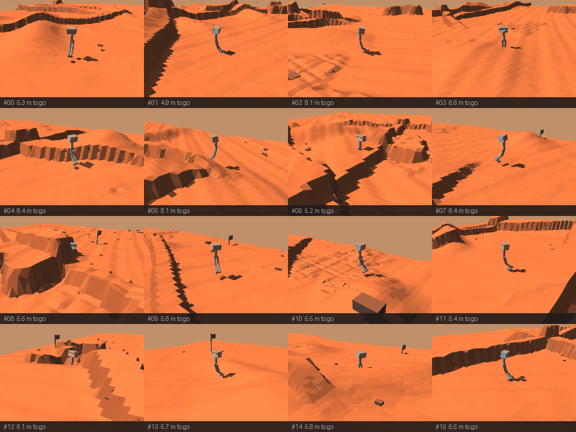
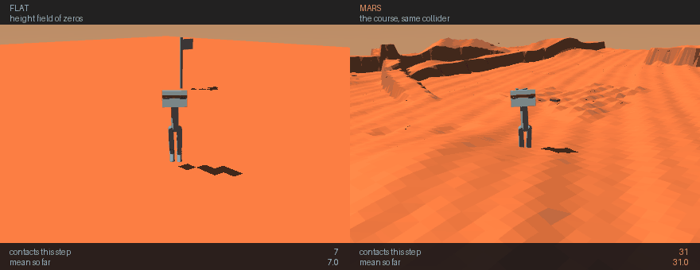

# Lab 6 — Mars on GPU physics: does it pay?

Lab 5 ended needing samples. The obvious next move is GPU physics: MJX
and MuJoCo Warp both advertise tens of thousands of environments
stepping at once, and the published numbers are large enough that
renting a card looks like a formality.

This lab rents nothing until it has measured. The answer, on this
model, is **no** — and the ablation that explains why overturned the
explanation this lab started with.

**Baseline:** lab 5's own 16-process CPU worker pool, already proven
bit-identical to the serial loop, measured at **9,337 steps/s** on a
20-core box. Not one CPU environment (5,630 steps/s) — comparing a GPU
against a single-threaded baseline is the comparison that makes every
GPU look good and the one nobody actually faces.

**Budget:** 60 timed steps per backend per environment count, after
warm-up and JIT; ablation variants are the **median of 3** repeats with
the spread reported; env counts 64 → 4096. Hardware: one RTX 3080 Ti
Laptop (16 GB), 20 CPU cores.

**Falsifier, written before the run:** *GPU physics is worth renting a
card for if a GPU backend steps this model at ≥ 5× the CPU worker
pool.* Result: **1.50×. FAILS.**

---

## What the lab measured

```
  [1] baselines (CPU)
      1 env, serial             5,630 steps/s
      64 envs / 16 workers      9,337 steps/s     1.66x

  [2] MJX
         64 envs                 1,036 steps/s     0.11x 16-worker pool
        256 envs                 1,341 steps/s     0.14x 16-worker pool
       1024 envs                   343 steps/s     0.04x 16-worker pool
       4096 envs            FAILED — process killed by signal 6 (allocator abort)

  [3] Warp
         64 envs                 2,304 steps/s     0.25x 16-worker pool
        256 envs                 7,383 steps/s     0.79x 16-worker pool
       1024 envs                11,979 steps/s     1.28x 16-worker pool
       4096 envs                14,011 steps/s     1.50x 16-worker pool
```

Two readings, and the second is the one worth carrying:

- **MJX loses outright on this model**, by an order of magnitude, and
  then dies. At 4096 environments XLA's allocator does not raise a
  catchable exception — it hits a `Check failed` and calls `abort()`,
  taking the interpreter with it. Each measurement therefore runs in
  its own process, which turns that crash into a row in the table
  instead of a lost run.
- **Warp wins, and the win is too small to rent for.** It needs 1024
  environments merely to draw level with sixteen CPU processes.

## Why — and the explanation this lab had to withdraw

The first pass concluded that the height-field collider costs 8.6× of
all GPU throughput. **That number was wrong**, and the way it was wrong
is the lesson: it compared a MuJoCo `plane` geom against a height
field. Those are two different collision routines, so the comparison
measured the collider *type* and attributed the result to *terrain*.

Re-run with the collider held fixed — a height field of zeros against a
height field with relief, same geom type, same resolution:

| variant | steps/s (median of 3) | spread | contacts/step |
|---|---|---|---|
| rocks 0 | 13,111 | 1.2% | 23.0 |
| rocks 75 | 12,992 | 3.1% | 23.0 |
| hfield 45² | 12,384 | 0.5% | 33.7 |
| hfield 180² | 12,686 | 3.2% | 23.0 |
| **hfield FLAT** | **14,001** | 1.0% | **4.2** |

**Mars terrain generates 5.5× the contacts of flat ground and costs
1.10× the throughput for them**, against a 3.2% run-to-run spread. The
rocks cost nothing measurable. Quadrupling the field's resolution costs
nothing measurable.

So the terrain is exonerated. Warp is not slow here *because the ground
is complicated* — it is slow because the scene is small (14 degrees of
freedom, 89 geoms) and a 20-core CPU is already good at that. Nothing
in this ablation explains away the gap to the published benchmarks, and
this lab does not claim one; what it establishes is which three
explanations are **ruled out**.

## Scope check: a bigger robot (lab 8)

Everything above is measured on the **biped** (14 DoF). Lab 8 built
bodies twice that size, so the verdict was re-tested:

| body | DoF | CPU pool | Warp @ 4096 | vs pool | physics share | ceiling |
|---|---|---|---|---|---|---|
| biped | 14 | 8,341/s | 13,870/s | 1.66x | 49% | 2.0x |
| spider8 | 30 | 2,579/s | 5,311/s | **2.06x** | **56%** | **2.3x** |

> **Corrected.** The first version of this table reported spider8's
> physics share as 21%, from dividing its TRAINING rate by the
> BIPED's PHYSICS rate -- `amdahl_share` was not passing morphology
> through. Spider8's physics is 3.2x SLOWER than the biped's (30 DoF
> vs 14), and physics is the majority of its step, not a fifth.

The GPU advantage grows with the body, so lab 6's original number was
scoped rather than universal. With physics at 56% and a 2.06x
speedup, the end-to-end gain is ~1.40x -- real, but far short of the
5x bar fixed before any measurement, and not worth renting eight
cards for when the same wall-clock is available locally.

    uv run bench_backends.py --morphology spider8

## Amdahl: why 1.50× would not have been enough anyway

Physics is not the whole training step. Measured on lab 5's own
`v3_flat_blind` run, at that run's own configuration (16 workers, 64
envs, flat), across 3 repeats:

| | steps/s |
|---|---|
| training, end to end (its recorded wall clock) | 5,344 |
| physics alone (the same pool, measured here) | 16,018 |

Physics is **33–34%** of a training step across 3 repeats on an idle
box. An *infinitely fast* physics engine would therefore give at most
**1.5× end to end**. (On a busy box the share reads ~24% and the
ceiling 1.3×; the direction is the same, but quote the figure with the
condition.)

That is why the bar was set at 5× on the physics before any
measurement was taken, and why a 1.50× physics win is not a reason to
rent anything.

## The animations

**Sixteen Mars rollouts at once** (`render_swarm.py`) — sixteen
independent episodes on sixteen generated maps, each with its own
robot, route and outcome, on one shared clock.



Honest caveat, stated in the script too: the episodes are simulated one
at a time and composited, not stepped concurrently. Frame *k* of every
tile is step *k* of that episode, so the grid is synchronised in
simulation time — but it is **not** evidence of parallel throughput,
and it is not offered as such. (It is also the only way it runs:
sixteen live MuJoCo renderers means sixteen OpenGL contexts, which
corrupts the heap under GLFW.)

**The ablation, drawn** (`render_ablation.py`) — the same robot, same
policy, same seed on a flat height field and on the Mars course, with
the live contact count under each panel.



Walking over a full episode, Mars generates **10.8×** the contacts of
flat ground (mean 11.5 vs 1.1, peak 31 vs 7). That is a different
quantity from the benchmark's 5.5× — that one is measured on a robot
settling under gravity for 300 steps — so the two are scoped where they
are reported and neither replicates the other. Both say the same thing
qualitatively, and the throughput table says it buys almost nothing.

## Running it

```bash
cd 07_physical_ai/06_mars_mjx
uv sync

uv run probe_mjx.py                    # feasibility gate: will MJX take our terrain?
uv run bench_backends.py               # the whole thing, ~6 min
uv run bench_backends.py --ablate-only # just the why
uv run bench_backends.py --skip-mjx    # if MJX's allocator is unhappy

uv run render_swarm.py --tiles 16 --rough     # the montage
uv run render_ablation.py                     # flat vs Mars
```

With no GPU the script still runs, and **says so before any number**:

```
  devices: jax:cpu, warp:cpu
  NOTE: no GPU visible. The 'GPU' backends below will run on the CPU and
        their numbers are NOT a GPU measurement — treat this run as a
        smoke test of the harness, not as evidence about hardware.
```

That banner exists because Warp falls back to the CPU silently and
reports throughput perfectly happily. Those numbers look exactly like
GPU numbers and are not. `nvidia-smi` cannot answer this — the
question is whether JAX and Warp can *see* the card, which they fail
independently — so each backend is asked directly.

The logic test needs no GPU at all:

```bash
uv run tests/test_mars_mjx.py          # from the repo root
```

### On RunPod

The harness rents a pod, runs the benchmark, copies the results back
and **destroys the pod**, all driven from your machine:

```bash
cd runpod
uv run runpod_ctl.py run 07_physical_ai/06_mars_mjx \
    --dry-run --collect --wait --terminate --yes
```

- `--dry-run` first: proves the pod boots, `uv sync` resolves and
  every stage of the benchmark runs, at 64 envs / 10 steps. Cheap.
- `--collect` copies `runs/bench.json` back before teardown.
- `--wait --terminate` is what stops the billing. **Confirm it
  actually died**, every time:

```bash
uv run runpod_ctl.py pods            # should not list the pod
```

`--wait-seconds` defaults to 1800, which is ample here — this lab
downloads no models. The pod never receives `RUNPOD_API_KEY`;
termination is driven locally in a `finally`, with a keyless in-pod
watchdog as backstop. See `SECURITY.md`.

Drop `--dry-run` for the real run (~6 min of GPU time). Rent a pod
with **real CPU cores**, not just a big card: the baseline is a
16-process pool, and a 4-core pod would manufacture a GPU win out of a
thin allocation.

### On CoreWeave

```bash
sbatch run_deepspeed.sh              # 1 GPU, 20 CPUs, 45 min
squeue -u $USER
tail -f logs/mars_mjx_*.out
```

## Environment & Local Testing

| | |
|---|---|
| **Hardware** | 1 GPU, ≥ 16 GB. MJX OOMs at 1024+ envs on 16 GB; Warp does not. |
| **CPU** | **20 cores matter more than the card.** The baseline is a 16-process pool; starving it manufactures a GPU win out of a thin allocation. |
| **Downloads** | none — the terrain is generated |
| **Runtime** | ~6 min for the benchmark, ~8 min for both animations |
| **Deps** | `mujoco`, `mujoco-mjx`, `jax[cuda12]`, `mujoco-warp`, `torch==2.11.0` (the animations replay a lab 5 policy) |

**There is no `deepspeed` call in this lab, deliberately.** It is the
twelfth `launcher="python"` example in the course and nothing here
trains — no parameters, no gradients, nothing for ZeRO to shard. The
lab's subject is precisely whether the hardware DeepSpeed usually runs
on helps at all here, and the measured answer is that it does not.

## What this lab is really for

The transferable part is not the numbers, which are specific to one
model on one card. It is the order of operations:

1. Write the bar **before** measuring, in a form that can lose.
2. Measure against the baseline you would actually use, not the one
   that flatters the new thing.
3. When the result disagrees with published benchmarks, ablate one
   property at a time rather than theorising.
4. Check that each ablation knob really moves the model
   (`tests/test_mars_mjx.py`) — three of this lab's four ablation
   results are negative, which is exactly the shape a broken knob
   produces.
5. Divide by Amdahl before believing any component speedup.

Step 3 is what caught the withdrawn 8.6×. Step 4 is what makes the
three negative results worth anything.

## References

- Todorov, Erez & Tassa, [MuJoCo: A physics engine for model-based control](https://doi.org/10.1109/IROS.2012.6386109),
  IROS 2012 — the simulator this topic runs on
- Makoviychuk et al., [Isaac Gym: High Performance GPU-Based Physics Simulation](https://arxiv.org/abs/2108.10470),
  2021 — physics and policy both resident on the GPU, no CPU round trip
- Freeman et al., [Brax: A Differentiable Physics Engine for Large Scale Rigid Body Simulation](https://arxiv.org/abs/2106.13281),
  2021 — the JAX lineage MJX belongs to
- Rudin et al., [Learning to Walk in Minutes Using Massively Parallel Deep RL](https://arxiv.org/abs/2109.11978),
  CoRL 2021 — thousands of parallel environments on one GPU
- Amdahl, [Validity of the single processor approach to achieving large scale computing capabilities](https://doi.org/10.1145/1465482.1465560),
  AFIPS 1967 — why a 1.50x physics win caps the whole step at 1.5x

GPU physics for RL is thoroughly established and the papers above are why people
expect it to pay. This lab's contribution is a **negative procurement result with
the bar written down first** — at least 5x the CPU worker pool or it is not worth
renting — measured at **1.50x**, with three findings that generalise: baseline
against the POOL and not one environment; a backend that `abort()`s is a data
point, so each measurement runs in its own process; and Warp falls back to CPU
**silently**, reporting throughput that looks like GPU throughput.
