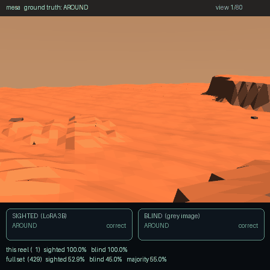
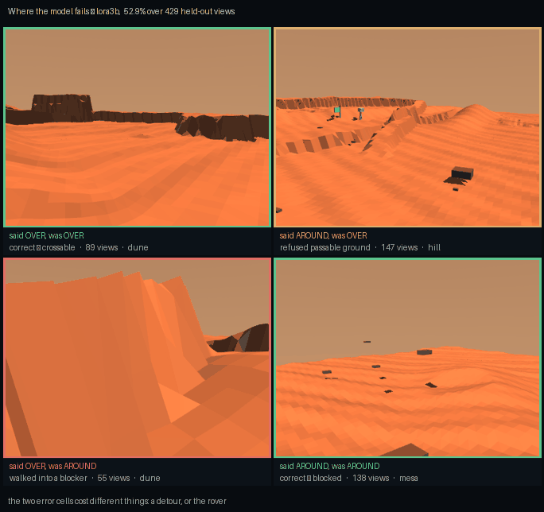

# Lab 7 — Terrain VLM: does seeing beat walking into it?

Lab 5 part 3 measured something uncomfortable. Its robot told climbable
landforms from impassable ones about **3:1** — and so did a policy fed
six constant zeros. The discrimination came from having a **body**, not
from perception: you learn a scarp is impassable by walking into one.

This lab gives a model eyes and asks whether that helps. The answer, at
this budget, is **no**.

**Baseline:** three of them, because one would not be readable. The
**majority class** (always answer OVER) scores 55.0%. The **blind
control** — identical model, identical training, identical token count,
a uniform grey image instead of terrain — scores 45.0%. And lab 5's
robot, discriminating by contact alone, scores about **75%**.

**Budget:** Qwen2.5-VL-3B, LoRA r=16 on attention projections (7.4 M
trainable, 0.196%), 2 epochs over 1657 training views, 208 optimizer
steps, ~23 min on one RTX 3080 Ti Laptop (11.5 GB of 16 GB). Evaluated
on 429 held-out views from **surfaces never seen in training**.

**Falsifier, written before the run:** *a model that sees the terrain
should beat lab 5's contact-only 3:1 discrimination.* Result:
**52.9%. FAILS.**

---

## The result

| arm | accuracy | 95% CI |
|---|---|---|
| zero-shot Qwen2.5-VL-3B | 45.0% | [40.3%, 49.7%] |
| **blind control** (LoRA, grey image) | 45.0% | [40.3%, 49.7%] |
| **sighted** (LoRA, real terrain) | **52.9%** | [48.2%, 57.6%] |
| majority class (always OVER) | 55.0% | — |
| lab 5's robot, by contact | ~75% | — |

Two tests, because the two questions are different:

- **Does the camera contribute anything?** Yes. Sighted beats blind on
  the same 429 paired items — 89 flipped right, 55 flipped wrong,
  **McNemar exact p = 0.0058**. Vision is doing measurable work.
- **Is the result any good?** No. Against always answering OVER,
  **p = 0.82**. The sighted model does not beat a one-line heuristic,
  and is nowhere near the robot that learns the same distinction by
  bumping into things.

Both of those are true at once, and reporting only the first would be
the kind of claim this course exists to avoid.

## The control worked, and here is how you can tell

The blind arm answered **AROUND for all 429 items** — one constant,
no variation. That is exactly what a model with no information must
do under greedy decoding, and seeing it is what licenses the
comparison. A blind control that produced varied answers would mean
information was leaking through the pipeline.

It also produced a coincidence worth naming, because it briefly looked
like a bug: the zero-shot model is *also* a constant-AROUND predictor,
so the two arms scored identically down to the per-landform
breakdown. Identical numbers from two different models is normally a
sign that one of them never ran. Here it is two different models
arriving at the same degenerate strategy.



Each frame is one held-out view. Left badge is the sighted arm, right
is the blind control. The footer carries two different quantities on
purpose: *this reel* is the running tally over the ~80 frames shown,
which wanders by several points; *full set* is the published result
over all 429.

## Where the model loses



The largest cell is not a correct one: **147 views (34.3%) are ground
the robot could have walked over, refused**, against 55 (12.8%) in the
opposite corner. The two errors cost different things — a detour, or
the rover — and an accuracy figure prices them the same.

| landform | sighted | what the truth is |
|---|---|---|
| hill | 46.2% | almost always OVER |
| dune | 34.6% | mostly OVER |
| mesa | 71.3% | always AROUND |
| scarp | 72.2% | almost always AROUND |

The model is biased toward AROUND: it does well on the blockers and
badly on the crossable ground. It has learned "Martian terrain looks
impassable" rather than the distinction between a smooth shoulder and
a sharp one.

**The information is there to be extracted.** A classifier given only
the landform's *name* scores **92.3%**, and the geometry that defines
the label separates the classes cleanly. This is a model failing to
read a signal it was shown, not an unlearnable task — which is what
makes the untested full fine-tune the interesting question rather than
a formality.

## Why this is the first lab in `07_physical_ai` that uses DeepSpeed

Because it is the first one where sharding is load-bearing, and that
was checked rather than assumed. `uv run verify_arch.py`, weights plus
optimizer, per card:

| Qwen2.5-VL-7B | 1 card | 2 | 4 | 8 |
|---|---|---|---|---|
| LoRA r=16 | **15.3 GB** | 7.6 | 3.8 | 1.9 |
| full fine-tune | 119.7 GB | 59.9 | 29.9 | **15.0 GB** |

LoRA already fits one card, so running it under ZeRO-3 would shard
15.3 GB that needed no sharding. The LoRA arm therefore runs **plain
python, no launcher**, and `ds_config.json` is reserved for the full
fine-tune — the only regime here that cannot be run any other way.

That restraint is inherited from measurements, not taste. Lab 5 found
the GPU **1.7× slower** for its policy update; lab 6 found GPU physics
at **1.50×** against a 5× bar and recommended not renting. Reaching for
ZeRO because this is a DeepSpeed course would be the same error
pointing the other way.

The capacity table is arithmetic over a config, so it is checked
against the code: `--build` instantiates the real module tree on
torch's **meta device** (no weights, no download) and compares.
Derived 3.816 B against an implementation that reports 3.755 B, **+1.6%**
— close enough to size with, and reported rather than quietly absorbed.

**Measured against the table:** the 3B LoRA arm used **11.5 GB** in
practice where the table predicts 7.3 GB. The ~4 GB gap is
activations, which the table excludes and ZeRO-3 does not shard. That
is the caveat the table carries, now with a number on it.

## What is still untested

The **full fine-tune of Qwen2.5-VL-7B under ZeRO-3 across 8 GPUs**. It
is implemented, registered and syntactically exercised, but it has
**not been run** — it needs hardware this was developed on
(one 16 GB laptop card) and cannot provide. Nothing in this README
reports a number from it, and nothing should until someone runs it.

The question it would answer is the one the LoRA result raises: the
signal is present and a 3B adapter does not extract it, so does
capacity fix that, or is the failure in the task framing?

## Running it

```bash
cd 07_physical_ai/07_terrain_vlm
uv sync

# No GPU needed, and worth doing first — a bad label makes every
# number downstream meaningless.
uv run make_dataset.py --check        # 5 properties of the labels
uv run verify_arch.py                 # where ZeRO-3 becomes necessary
uv run verify_arch.py --build         # check that table against the code

# The dataset is GENERATED, not downloaded. ~8 min of CPU.
uv run make_dataset.py --seeds 400

# One GPU, no DeepSpeed. Control first.
uv run python train_vlm.py --lora --blind --name blind
uv run python train_vlm.py --lora          --name lora3b

uv run evaluate.py --zero-shot
uv run evaluate.py --run blind --blind
uv run evaluate.py --run lora3b

uv run render_verdicts.py             # sighted vs blind; no GPU needed
uv run render_confusion.py            # where it fails; no GPU needed

# The ZeRO-3 arm. Needs 8 cards. NOT YET VERIFIED ON HARDWARE.
uv run deepspeed --num_gpus=8 train_vlm.py --name full7b \
    --model Qwen/Qwen2.5-VL-7B-Instruct --deepspeed ds_config.json
```

With no GPU, every script prints what you *can* run and exits
non-zero. The logic test needs no GPU at all:

```bash
uv run tests/test_terrain_vlm.py      # from the repo root
```

### On RunPod

```bash
cd runpod
uv run runpod_ctl.py run 07_physical_ai/07_terrain_vlm \
    --dry-run --collect --wait --terminate --yes
uv run runpod_ctl.py pods             # confirm it actually died
```

`--dry-run` first: it proves the pod boots, `uv sync` resolves and
every stage runs, at 3 steps. `--wait --terminate` is what stops the
billing, and `pods` is how you confirm it. The pod never receives
`RUNPOD_API_KEY`; termination is driven locally in a `finally`, with a
keyless in-pod watchdog as backstop. See `SECURITY.md`.

### On CoreWeave

```bash
sbatch run_deepspeed.sh               # 8 GPUs, 32 CPUs, 4 h
DRY_RUN=1 bash run_deepspeed.sh       # cheap path, skips the full arm
```

## Environment & Local Testing

| | |
|---|---|
| **Hardware** | 1 × 16 GB runs everything published here (measured: 11.5 GB). The untested full arm needs 8 × 24 GB. |
| **Downloads** | Qwen2.5-VL-3B, ~7 GB. The dataset is generated, not downloaded. |
| **Runtime** | ~8 min dataset (CPU), ~23 min per arm, ~3 min per evaluation |
| **Deps** | `transformers==5.16.1`, `peft==0.20.0`, `torch==2.11.0`, `torchvision` — all four pinned, the last two to the `cu128` index |

Three things that cost time and are worth knowing:

- **`AutoModelForVision2Seq` does not exist in transformers 5.x.** It
  is `AutoModelForImageTextToText` now. This is the *vanished symbol*
  class of API drift — it fails at import, before anything runs, so
  `compileall` never sees it. Both names are tried and the one that
  resolved is printed.
- **torchvision is mandatory, and must come from the same index as
  torch.** transformers routes Qwen2.5-VL's processor through
  `Qwen2VLVideoProcessor`, which hard-requires it even for still
  images. A torchvision from PyPI against a `cu128` torch fails with
  `operator torchvision::nms does not exist`, which reads like a torch
  bug and is not one.
- **Supervise the answer, not the prompt.** Masking only padding left
  the model learning to reproduce a 30-token instruction identical on
  every example. Training loss 15.7. Masking everything before the
  answer: **0.467**.

## What transfers

| | |
|---|---|
| **A control, built in from the start** | the blind arm is not a robustness check, it is what makes 52.9% readable at all |
| **Two tests, because two questions** | "did vision help" (yes, p=0.006) and "is it any good" (no, p=0.82) have different answers |
| **Labels from geometry, never from the generator's own names** | predicting the name the generator chose measures nothing |
| **Split by surface, not by sample** | two views of one surface share its landforms; a sample split leaks the answer |
| **Check whether the hardware is needed** | the capacity table is why ZeRO-3 is here, and why LoRA runs without it |
| **Never report the arm you did not run** | the 7B ZeRO-3 arm has no number on this page |
