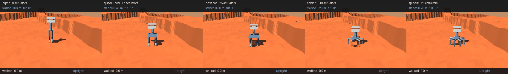
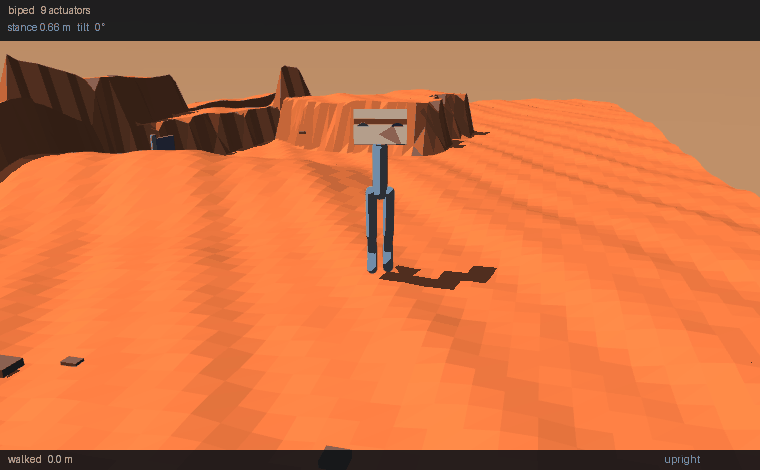
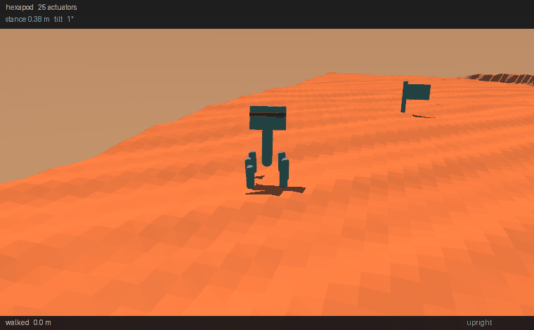

# Lab 8 — Long Traverse: the body is the bottleneck

Three labs reached the same wall from three directions. Lab 5 part 4
scored 0% on scree across six configurations. Lab 7 gave a model eyes
and found perception could not help. Lab 8 decomposed a long route
into short legs and watched the robot stall anyway. Each time the
suspect was the same, and this lab finally tests it: **same terrain,
same task, same 1.5M-step budget, same seed — only the body changes.**

The answer is that the body was the bottleneck all along, and the
margin is not subtle.

**Baseline:** the biped labs 5–7 measured on — 2 legs, 9 actuators,
and byte-identical here (the suite asserts it).
**Budget:** 1.5M steps per body, 16-process worker pool, seed 0, Mars
relief, `blind` observation. Scored on **36 fresh episodes** per body
with Wilson intervals, because the trainer's own evaluation is 12
episodes and 8.3% there is a single run.
**Falsifier:** more legs should mean fewer falls and more distance. If
the 9-actuator biped beats bodies with 2.8× the actuators at an equal
step budget, the extra limbs bought nothing.

---

## The result

| body | legs | actuators | arrived | falls | **walked** | left |
|---|---|---|---|---|---|---|
| **biped** (baseline) | 2 | 9 | 0% [0, 10] | 16.7% [8, 32] | **4.0 m** | 5.9 m |
| **quadruped** | 4 | 17 | 0% [0, 10] | 11.1% [4, 25] | **16.7 m** | 5.9 m |
| hexapod | 6 | 25 | 0% [0, 10] | 11.1% [4, 25] | 15.1 m | 5.7 m |
| spider6 | 6 sprawl | 19 | 0% [0, 10] | 5.6% [2, 18] | 10.5 m | 7.6 m |
| **spider8** | 8 sprawl | 25 | 0% [0, 10] | **2.8% [0, 14]** | 7.1 m | 6.6 m |

> **Second version.** The first was published with bodies that had no
> chassis — the torso capsule never spanned to the hips, so the
> multi-legged bodies had no frame mass, no frame inertia and no
> frame collision. All three flattered them. Every body was retrained
> with a real frame; the biped is unchanged and serves as the
> control. "The hexapod never fell" is **retracted** (it falls 11.1%
> with mass); the distance advantage **grew** from 3.5× to 4.2×.



**Distance is the result, not arrival.** Every arrival interval
includes zero — **no body solves the task**. What separates the
bodies is how far they get: **4.0 m against 16.7 m**, which is
**4.2×**.

**Stability and distance are won by different bodies.** Sprawling
spider8 falls least (2.8%); upright quadruped travels furthest
(16.7 m); neither does both.

## The worst and the best, close up

Both are **median** runs over 16 seeds, not selected ones.

**Biped — 4.0 m** (seed 9006; range 0.4–12.7 m, fell on 4 of 16).
Nine actuators, almost all spent not toppling.



**Quadruped — 19.4 m** (seed 9013; range 2.5–24.1 m, fell on 1 of 16).
Seventeen actuators on the same budget, carrying 8.1 kg against the
biped's 4.9 — and it covers nearly five times the ground.



## Morphological computation, and why it is falsifiable here

[Pfeifer and Bongard's term](https://www.researchgate.net/publication/247161863_Morphological_Computation_-_Connecting_Brain_Body_and_Environment)
for a body doing work a controller would otherwise do; the canonical
demonstration is McGeer's passive dynamic walker, which walks down a
slope with no actuators and no software at all.

The framing is contested — [Hoffmann and Müller](https://direct.mit.edu/artl/article/23/1/1/2858/What-Is-Morphological-Computation-On-How-the-Body-Contributes-to-Cognition-and-Control)
argue "offloading computation" is a metaphor and the walker is simply
well-shaped physics — and this lab does not need to settle that. It
needs the prediction, which is sharp either way:

> A statically stable body should not need its policy to **learn**
> balance. So a 25-actuator body should hold its own against a
> 9-actuator one at an identical step budget, despite a far harder
> search.

**It held.** The hexapod and spider8 carry **2.8× the actuators** of
the biped and were given exactly the same 1.5M steps — fewer samples
per action dimension — and still won on both falls and distance. The
capacity the biped spends learning not to topple, they do not have to
spend at all.

## The trade-off, and the prediction that failed

Comparative biomechanics reports a stability/efficiency trade for
posture in animals: sprawling gives stability and manoeuvrability but
[costs energy](https://www.sciencedirect.com/science/article/abs/pii/S094420060700013X),
because the feet sit far from the centre of mass so muscles resist
large joint moments and the body sways laterally. Erect posture loads
limbs in compression and recovers pendular energy. Larger tetrapods
tend to erect postures for that reason.

So the prediction was: **sprawlers fall less and travel less.**

**Against the biped that is wrong.** They fall less and travel
*more* — `compare_bodies.py` prints `NO TRADE-OFF HERE` on its own,
a branch that exists so the script can contradict its author.

**The trade-off is real one level in.** Among the multi-legged bodies:

| posture | bodies | walked |
|---|---|---|
| upright | quadruped, hexapod | 14.1, 13.9 m |
| sprawling | spider6, spider8 | 10.6, 9.3 m |

Upright walks about **33% further** at no stability gain. The biped
baseline is so weak it loses to everything, which hid the posture
effect entirely. The honest summary:

> **Legs buy stability. Posture decides whether you can spend it on
> distance.**

A lab that compared only against the biped would have reported the
first half and missed the second.

## What this lab cannot claim

Anything about evolution. The sprawling-to-erect shift is real
vertebrate history and the trade-off above is measured in real
animals — but a MuJoCo robot can only *illustrate why such a
trade-off exists*. It is not evidence about how tetrapods evolved,
and no number here should be read that way.

## The measurement had to be fixed before any of this meant anything

Four bugs, all the same species — **a constant calibrated for one
body, silently assuming that body**:

| bug | symptom |
|---|---|
| four legs with the biped's 0.76 m legs on a 0.22 m base | height/width **3.5** — a biped on stilts. Measured **worse** than the biped (83.3% vs 58.3% falls) and looked like a real finding |
| `START_DZ` / `FALL_CLEARANCE` biped-tuned | short-legged bodies held at biped height, feet dangling 0.3 m, dropped every reset |
| foot geom was the whole shin capsule | `geom_xpos` is the capsule **centre**, so spiders measured half a tibia short → 100% false falls |
| `--morphology choices=("biped","quadruped","hexapod")` | argparse rejected `spider6`/`spider8` with exit 2; the sweep swallowed it and reported two bodies as "FAILED training" having never started |

And the one that mattered most:

**`fallen()` was not a fall detector.** It was `clearance < threshold`
— torso height above *the ground directly beneath it* — so on uneven
terrain it fires when the **ground rises**. Measured: **13 of 13**
trigger events happened at a torso tilt of **0–1°**. Not one was a
fall.

It now tests the robot rather than the world: `tilt > 60°` **or**
torso-above-its-own-feet collapsed. `stance_height()` is invariant to
terrain height — it shrinks when legs buckle and holds when the
ground rises — and `tests/test_morphology.py` keeps the old rule as a
permanent counterexample, asserting that clearance alone still calls
an upright robot fallen.

This was not merely a reporting error. **`fallen()` terminates
training episodes**, so the broken detector was cutting the low-slung
bodies off before they could learn — penalising exactly the shapes
this lab exists to test.

> **This corrects lab 5.** Its published 58–83% fall rates are partly
> terrain contact, not falls. See that lab's page for the amended
> figures.

## The traverse machinery

The lab also carries the waypoint decomposition that found the wall:

```bash
uv run traverse.py --check          # planner and router properties, CPU
uv run traverse.py --router oracle  # one arm
```

A long route is split into legs the policy can walk, because lab 5
measured that asking for 16–30 m end to end gave six configurations
at exactly 0%. The policy is **retargeted, not retrained** — its goal
feature is range and bearing, so moving the goal is the whole trick.

On flat ground the decomposition works: **27.1 m at 100% arrival, 0
interventions, efficiency 0.95**, against lab 5's ~6 m. On relief the
biped stalls, which is what sent this lab into morphology.

A perception sweep (router accuracy 50%→100%) is implemented and
**not reported**, because it cannot be run meaningfully yet: on
`course` there is no relief at which the body can walk *and* blockers
exist. Where the robot can walk there is nothing to route around;
where there is something to route around it cannot walk.

## Running it

```bash
cd 07_physical_ai/08_long_traverse
uv sync

uv run traverse.py --check            # no GPU, seconds
uv run compare_bodies.py              # the table, with intervals
uv run render_morphology.py           # the five-body animation

# training lives in lab 5, which owns the robot
cd ../05_mars_terrain
uv run python train_mars.py --morphology spider8 --name morph_spider8
```

The logic test needs no GPU:

```bash
uv run tests/test_morphology.py       # from the repo root
```

### On RunPod

```bash
cd runpod
uv run runpod_ctl.py run 07_physical_ai/08_long_traverse \
    --dry-run --collect --wait --terminate --yes
uv run runpod_ctl.py pods             # confirm it actually died
```

`--dry-run` first: it proves the pod boots, `uv sync` resolves and
every stage runs. `--wait --terminate` is what stops the billing and
`pods` is how you confirm it. The pod never receives
`RUNPOD_API_KEY`; termination is driven locally in a `finally`, with
a keyless in-pod watchdog as backstop. See `SECURITY.md`.

This lab needs CPU cores far more than it needs a card — the
comparison is 5 bodies x 36 episodes of MuJoCo physics, and the GPU
is used only to render the animation.

### On CoreWeave

```bash
sbatch run_deepspeed.sh               # 1 GPU, 20 CPUs, 2 h
EPISODES=8 bash run_deepspeed.sh      # cheap path
```

## Environment & Local Testing

| | |
|---|---|
| **Hardware** | none required. Every number here was produced on CPU; the GPU is used only for rendering |
| **Downloads** | none — terrain and bodies are generated |
| **Runtime** | ~7–19 min per body to train, ~8 min for the 5×36-episode table, ~4 min to render |
| **Deps** | `mujoco`, `torch==2.11.0`, `numpy`, `pillow` |

**No `deepspeed` here, deliberately** — the policies are 15–22k
parameters and the bottleneck is MuJoCo physics on the CPU. Lab 6
measured GPU physics at 1.50× against a 5× bar; lab 7 is where ZeRO-3
earns its place.

## What transfers

| | |
|---|---|
| **A constant calibrated on one body is a hidden parameter of that body** | four bugs here, all that shape |
| **A metric can measure the world instead of the system** | `clearance` tracked terrain; `stance_height` tracks the robot |
| **Check the metric before believing the comparison** | the broken detector made more legs look *worse* |
| **Compare against more than the baseline** | the posture trade-off was invisible against a biped that loses to everything |
| **Write the prediction so it can fail** | mine did, and the script said so before I did |
