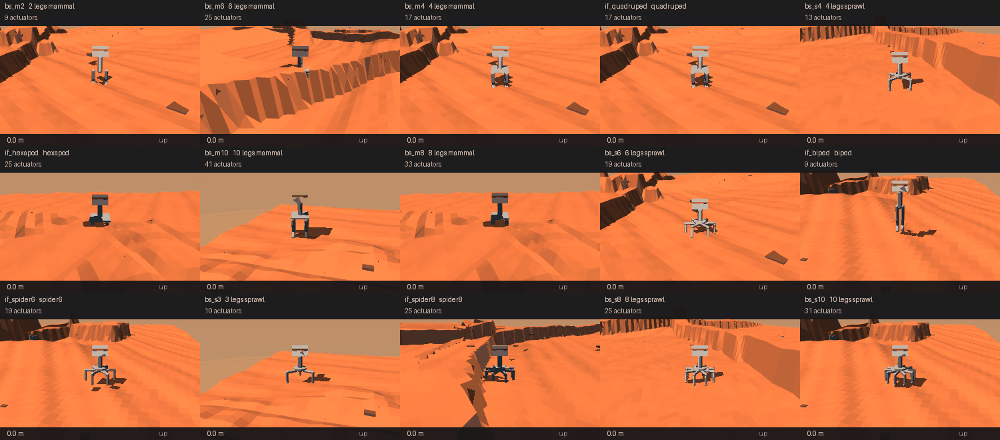
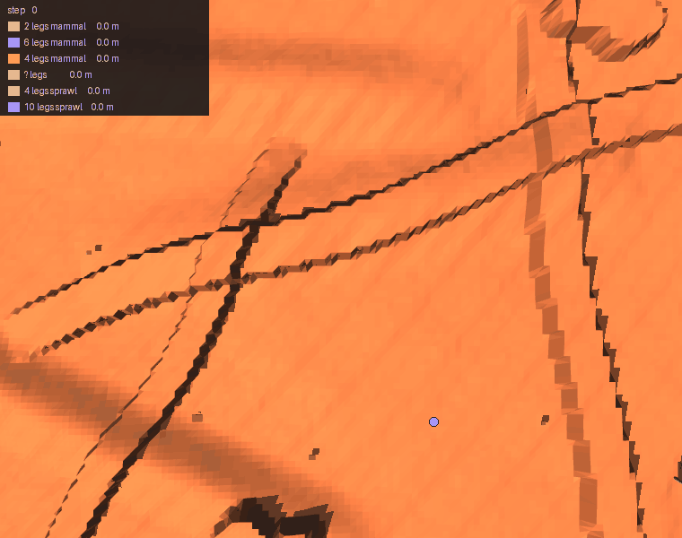
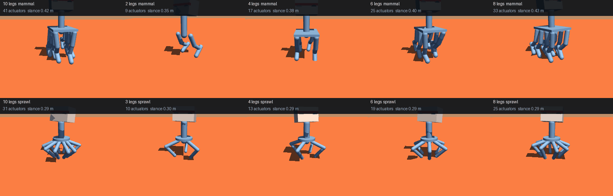

# Lab 9 — Body Search: proportion beats leg count

Lab 8 compared five bodies somebody typed out and concluded that more
legs is better. This lab turns a body into **parameters** and searches
the space instead — and the winner is a **two-legged** robot.

Not the same two-legged robot. The hand-written biped is tall and
narrow; the one the search found is short and wide. Same leg count,
same nine actuators, **2.6× the displacement and a third fewer falls.**

**Baseline:** the five hand-written bodies from lab 8, retrained here
under this lab's physics so the comparison is internal (`if_*` runs).
**Budget:** 1.5M steps per body, 16-process pool, seed 0, Mars relief,
`blind` observation, `implicitfast`. Scored on **36 fresh episodes**
with Wilson intervals.
**Falsifier:** if leg count explains the result, bodies should rank by
leg count and proportion should not matter. It does not, and it does.

---

## The result

| body | legs | posture | act | **displaced** | eff | path | falls |
|---|---|---|---|---|---|---|---|
| **bs_m2** | 2 | mammal | 9 | **3.7 m** | **0.22** | 17.0 m | 13.9% |
| bs_m6 | 6 | mammal | 25 | 2.7 m | 0.17 | 16.0 m | 2.8% |
| bs_m4 | 4 | mammal | 17 | 2.5 m | 0.17 | 14.7 m | 5.6% |
| bs_s4 | 4 | sprawl | 13 | 2.3 m | 0.19 | 12.2 m | 11.1% |
| if_quadruped | 4 | mammal | 17 | 2.3 m | 0.18 | 13.2 m | 8.3% |
| if_hexapod | 6 | mammal | 25 | 2.1 m | 0.14 | 14.6 m | 5.6% |
| bs_m10 | 10 | mammal | 41 | 1.9 m | 0.14 | 13.4 m | 2.8% |
| bs_m8 | 8 | mammal | 33 | 1.7 m | 0.14 | 12.4 m | 5.6% |
| bs_s6 | 6 | sprawl | 19 | 1.5 m | 0.15 | 10.6 m | 8.3% |
| **if_biped** | 2 | mammal | 9 | **1.4 m** | **0.08** | 17.7 m | 19.4% |
| if_spider6 | 6 | sprawl | 19 | 1.4 m | 0.14 | 9.4 m | 8.3% |
| bs_s3 | 3 | sprawl | 10 | 1.3 m | 0.13 | 10.7 m | 2.8% |
| bs_s8 | 8 | sprawl | 25 | 1.3 m | 0.13 | 9.4 m | 2.8% |
| **if_spider8** | 8 | sprawl | 25 | 1.3 m | 0.13 | 10.3 m | **0.0%** |
| bs_s10 | 10 | sprawl | 31 | 1.0 m | 0.12 | 8.0 m | 8.3% |



## Proportion, not leg count

`bs_m2` and `if_biped` are both two-legged with nine actuators. The
only difference is shape:

| | leg length | stance width | height / width |
|---|---|---|---|
| if_biped | 0.76 m | 0.14 m | **5.4** |
| bs_m2 | 0.44 m | 0.34 m | **1.3** |

Short and wide beats tall and narrow by **2.6× in displacement**, at
a third fewer falls, with the same number of legs and motors.

**This is where lab 8's conclusion was confounded.** Every
multi-legged body built there also happened to be squatter and wider
than its biped, so leg count and proportion moved together and only
leg count got the credit. Separate them and most of the effect goes
to proportion. Lab 8's measurements stand — its own bodies, its own
physics, and its 4.2× survives re-measurement on displacement at
4.4× — but the *interpretation* was too simple.

## The metric that nearly published a lie

The first ranking used **distance walked** and crowned `if_biped` at
17.7 m. It ends **1.4 m from where it started**.

Path length counts every centimetre the torso moves, so a robot
thrashing on the spot banks it as fast as one travelling. The fix is
**displacement** — straight line, start to end — with
`efficiency = displacement / path` beside it:

| body | path | displacement | efficiency |
|---|---|---|---|
| if_biped | 16.8 m | 1.4 m | **0.09** |
| bs_m2 | 14.3 m | 3.3 m | 0.23 |

Lab 8 used path length too, so it was checked rather than assumed:
re-measured on displacement its bodies rank identically (efficiencies
0.13–0.17, a narrow band) and the headline survives. The metrics only
diverge here, under this lab's integrator, where the biped's
efficiency collapses to 0.08 while others reach 0.22.

**Nothing travels in a straight line.** Every efficiency is 0.08–0.22:
the best body still wanders roughly five metres for every one it
gains. Reading these as walking performance would be generous.



Overhead with trails, the distinction is the picture — a thrashing
body draws a knot, a travelling one draws a line. Simulated
separately and composited on one map; nothing interacts.

## A body is parameters

`robot.make_layout` takes leg count, posture, limb scale, fore-aft
spread, lateral width and mid-leg splay, and returns a layout. Every
hand-written body in labs 5–8 is reproducible from it **exactly, leg
for leg** — `tests/test_bodyspec.py` asserts that, and the first
version failed it by dropping the hexapod's widened middle pair (real
insect geometry: mid-legs splay so swing legs miss front and hind).



It also refuses nonsense loudly — one leg, an odd count for a mammal
layout, an unknown posture — rather than building a lopsided robot
that would train, walk badly, and be scored as a finding.

That enables shapes nobody would type out, including the one that
answers a question lab 8 raised:

**Three legs is the minimum to stand and cannot walk.** `bs_s3` falls
at 2.8% standing-steady but travels only 1.3 m. Lift one leg of three
and the remaining two form a **line**, not a polygon — so a tripod
has no statically stable gait and must topple and catch itself every
step. Four is the real minimum, which is why falls hit zero there.

## Free speed: the integrator, not the hardware

The search needs many trainings, so it needs training to be cheap.
Lab 6's corrected figures put physics at 49–56% of a step, so physics
was the target — and the shipped model used `integrator="RK4"`, which
evaluates the dynamics **four times per step**.

[MuJoCo recommends `implicitfast`](https://mujoco.readthedocs.io/en/stable/modeling.html)
for contact-rich models and reserves RK4 for energy-conserving ones;
RK4 can inject contact vibration. Measured on spider8:

| option | steps/s | speedup | divergence from RK4 |
|---|---|---|---|
| RK4 (shipped) | 1,165 | 1.00× | — |
| **implicitfast** | **4,577** | **3.93×** | 0.014 m |
| Euler | 4,492 | 3.85× | 0.014 m |
| RK4, no self-collision | 1,159 | 0.99× | 0.000 m |

End to end, training got **1.7–2.6× faster** — *more than the ~1.40×
eight rented GPUs would have bought* (lab 6). The free fix beat the
rental.

**But it is a different world, and open-loop drift said otherwise.**
0.014 m of divergence looked adoptable; the same trained policy then
walked 7.9 m under `implicitfast` against 5.9 m under RK4 and stopped
falling. Contact dynamics amplify small differences, so every body
here was retrained under the new integrator and **these numbers are
not comparable with labs 5–8**. The `if_*` re-baselines exist so the
comparison stays inside this lab.

Self-collision removal, the other candidate, does nothing (0.99×).
Worth reporting: it was the hypothesis that felt most promising.

## Running it

```bash
cd 07_physical_ai/09_body_search
uv sync

uv run ../../tests/test_bodyspec.py      # no GPU: the generator's promise
uv run search_bodies.py --stage count --plan   # what it would run, free
uv run speed_physics.py                  # why implicitfast
uv run profile_training.py               # where a training step goes

uv run search_bodies.py --stage count    # ~90 min, resumable
uv run rank_bodies.py --episodes 36      # the table, with intervals
uv run render_search.py                  # the ranked grid
uv run render_zoo.py                     # the shapes, turning
uv run render_race.py                    # trails from one start
```

Training lives in lab 5, which owns the robot:

```bash
cd ../05_mars_terrain
uv run python train_mars.py --body-spec '{"n_legs": 6, "posture": "sprawl"}' \
    --integrator implicitfast --name my_body
```

### On RunPod

```bash
cd runpod
uv run runpod_ctl.py run 07_physical_ai/09_body_search \
    --dry-run --collect --wait --terminate --yes
uv run runpod_ctl.py pods             # confirm it actually died
```

`--dry-run` first: it proves the pod boots, `uv sync` resolves and
the stages run. `--wait --terminate` is what stops the billing and
`pods` is how you confirm it. The pod never receives
`RUNPOD_API_KEY`; termination is driven locally in a `finally`, with
a keyless in-pod watchdog as backstop. See `SECURITY.md`.

This lab wants **CPU cores, not a card** — the search is 15 bodies of
MuJoCo physics and the GPU only renders the animations. That is the
lab's own finding: an integrator change beat eight rented GPUs.

### On CoreWeave

```bash
sbatch run_deepspeed.sh               # 1 GPU, 20 CPUs, 6 h
EPISODES=8 bash run_deepspeed.sh      # cheap path
```

## Environment & Local Testing

| | |
|---|---|
| **Hardware** | none required. Every number here is CPU; the GPU renders animations only |
| **Downloads** | none — terrain and bodies are generated |
| **Runtime** | ~9 min per body, ~90 min for the search, ~15 min to rank, ~20 min to render |
| **Deps** | `mujoco`, `torch==2.11.0`, `numpy`, `pillow` |

**No `deepspeed` here, deliberately** — the policies are 15–45k
parameters and the bottleneck is MuJoCo physics on the CPU. Lab 6
measured GPU physics at 2.06× against a 5× bar; the integrator gave
more, for free.

## What transfers

| | |
|---|---|
| **Path length is not progress** | the leader ended 1.4 m from its start |
| **Hand-picked comparisons confound variables** | leg count and proportion moved together until a search separated them |
| **Check a speedup changes nothing, with the real system** | 0.014 m of open-loop drift hid a 34% behavioural change |
| **A generator must reproduce what it generalises** | exact, leg for leg, or it is a second implementation |
| **The cheap fix can beat the expensive one** | an XML attribute beat eight rented GPUs |

## References

- Sims, [Evolving Virtual Creatures](https://doi.org/10.1145/192161.192167), SIGGRAPH 1994 —
  morphology and controller evolved together, the origin of this question
- Gupta et al., [Embodied intelligence via learning and evolution](https://doi.org/10.1038/s41467-021-25874-z),
  Nature Communications 2021 — DERL, evolving morphologies that learn locomotion
- Ha, [Reinforcement Learning for Improving Agent Design](https://arxiv.org/abs/1810.03779),
  Artificial Life 2019 — learn the body jointly with the policy
- Pfeifer & Bongard, *How the Body Shapes the Way We Think*, MIT Press 2006 —
  morphological computation, the frame lab 8 argues in
- Schulman et al., [PPO](https://arxiv.org/abs/1707.06347), 2017 ·
  [GAE](https://arxiv.org/abs/1506.02438), 2015
- Agarwal et al., [Deep RL at the Edge of the Statistical Precipice](https://arxiv.org/abs/2108.13264),
  NeurIPS 2021 — why a handful of seeds and a mean are not enough
- Henderson et al., [Deep Reinforcement Learning that Matters](https://arxiv.org/abs/1709.06560), 2018

Body-and-controller co-design is thirty years old and this lab does a small, fixed
search rather than evolution. What it contributes is a **correction to its own
predecessor**: lab 8 concluded that more legs walk further, which was a true
measurement of the five bodies it happened to test and a false explanation. Search
over proportions as well as leg count and a **short, wide biped beats every
multi-legged body**. The extra legs were standing in for a better shape.
