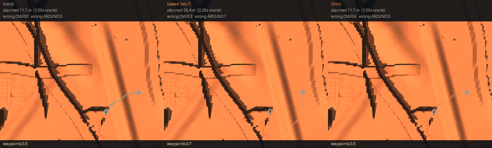

# Lab 10 — Does Perception Pay?

Lab 7 built a model that reads terrain and could not say whether it
was useful. Lab 8 tried to find out and could not run the experiment.
This lab finally runs it.

The answer is **no** — and the realistic version is **worse than
nothing**.

**Baseline:** the `blind` arm — no perception, every landform
believed crossable, which is exactly what lab 5's robot did.
**Budget:** lab 9's best body (`bs_m2`), 16 belief-sensitive seeds,
routes 10–16 m, waypoints every 2.5 m, `implicitfast`. Waypoint rates
carry Wilson intervals.
**Falsifier:** if perception pays, the oracle beats blind with
separated intervals. It does not.

---

## The result

| arm | waypoints | arrived | detour |
|---|---|---|---|
| oracle (perfect) | 33% [23, 45] | **25%** | 1.09× |
| p90 | 28% [18, 41] | 19% | 1.06× |
| p80 | 30% [19, 44] | 19% | 1.05× |
| p70 | 28% [17, 43] | 19% | 1.05× |
| p60 | 28% [17, 42] | 19% | 1.07× |
| **biased** (lab 7's real shape) | 28% [16, 44] | **12%** | **1.27×** |
| **blind** (baseline) | **36% [25, 48]** | **25%** | 1.00× |

**Perfect perception ties no perception.** Both reach 25% arrival;
every interval overlaps. `perception_sweep.py` prints
`INTERVALS OVERLAP: perception does not measurably pay at this
budget` on its own — a branch that exists so the script can refuse
the result its author wanted.

**Realistic perception is worse than none.** The `biased` arm models
lab 7's measured failure — 72% correct on blockers, 40% on open
ground — and halves arrival to 12% while inflating routes 27%. A
model that cries wolf sends the rover on detours costing more than
the obstacles would have.



Same terrain, same start and goal, same body; only the belief
differs. The oracle and the blind router **plan the identical 11.7 m
route**, because on this task the truth and "nothing blocks me"
agree. The biased router's seven false AROUNDs inflate the plan to
**26.4 m — 2.26×** — and it reaches 3 of 7 waypoints instead of 3 of 3.

## Why it does not pay

The detour column is the mechanism. The oracle's careful 1.09×
avoidance buys nothing because **75% of runs stall regardless of
arm**. Route quality cannot matter to a robot that cannot execute a
route. Locomotion is still the binding constraint, four labs after
lab 8 first said so.

**Scope, and it matters:** with 75% stalling this test may simply
lack the power to detect a perception effect. The finding is
*perception does not pay at this robot's capability* — not
*perception never pays*.

## Three blockers had to clear first

The experiment was impossible in lab 8 and each obstacle was caught
by a check rather than discovered afterwards:

| blocker | fix |
|---|---|
| robot stalls before reaching decisions | lab 9's body plus the faster integrator |
| task demands 10× the robot's range | size the route band to measured capability |
| **chosen A–B pairs contained no decision** | select for belief-sensitivity |

That third one nearly produced a beautiful, meaningless curve.
Randomly chosen endpoints gave oracle, blind and paranoid beliefs the
**identical 10.5 m route** — the pair never passed a blocker, so
belief could not matter and all seven arms would have scored the same
by construction. It is lab 4 and lab 5's route-ratio lesson one level
up: a task must be *selected* for containing a decision, not assumed
to contain one.

Tasks are now kept only when believing everything impassable costs at
least 1.5 m against believing nothing does. Measured over 20 seeds:
mean gap **10.8 m**, and on **12 of 16** a fully paranoid belief walls
the robot in entirely.

## Training on the test terrain made it worse

The obvious fix for a domain mismatch is to train where you test. It
backfired:

| body | trained on | falls | arrived |
|---|---|---|---|
| bs_m2 | course | 25.0% | **16.7%** |
| tv_m2 | **traverse** | 41.7% | 0.0% |
| bs_m4 | course | 0.0% | 8.3% |
| tv_m4 | **traverse** | 50.0% | 0.0% |

The `traverse` preset is harder to learn on — bigger arena, more
blockers, longer routes — and a policy trained on the easier `course`
terrain **transfers** better than one trained directly on the hard
one. A curriculum effect, and the reason the sweep uses
course-trained bodies.

## A trap worth knowing

The task pool was a single `task_pool.pkl` regardless of
`MARS_POOL_SCALE`, so building a pool for this lab's preset would
have **silently overwritten the pool labs 5–9 train on**. No error;
every later run would quietly use different terrain while reporting
the same lab. Pools are now one file per scale, with `course` keeping
its original path so nothing needs rebuilding.

## Running it

```bash
cd 07_physical_ai/10_perception_pays
uv sync

uv run perception_sweep.py --check     # is the task decidable? no robot
uv run perception_sweep.py --seeds 16  # the sweep, ~25 min, CPU
uv run render_beliefs.py               # the three-belief animation
```

### On RunPod

```bash
cd runpod
uv run runpod_ctl.py run 07_physical_ai/10_perception_pays \
    --dry-run --collect --wait --terminate --yes
uv run runpod_ctl.py pods             # confirm it actually died
```

`--dry-run` first; `--wait --terminate` stops the billing and `pods`
confirms it. The pod never receives `RUNPOD_API_KEY`. See
`SECURITY.md`. This lab wants CPU cores — the GPU only renders.

### On CoreWeave

```bash
sbatch run_deepspeed.sh
SEEDS=4 bash run_deepspeed.sh          # cheap path
```

## Environment & Local Testing

| | |
|---|---|
| **Hardware** | none required; CPU throughout, GPU for the animation only |
| **Downloads** | none — terrain and bodies are generated |
| **Runtime** | ~25 min for the sweep, ~4 min to render |
| **Deps** | `mujoco`, `torch==2.11.0`, `numpy`, `pillow` |

**No `deepspeed` here, deliberately** — nothing trains in this lab.
It replays lab 9's policies and varies a router.

## What transfers

| | |
|---|---|
| **A task must be selected for containing a decision** | three beliefs planned the same route until it was |
| **Bad information can be worse than none** | biased perception halved arrival against blind |
| **A null result needs a working control** | blind ties oracle, so the ceiling and the floor are the same number |
| **Report power, not just significance** | 75% stalling may mask any effect, and the page says so |
| **Train where it is easier, test where it is hard** | course-trained transferred; traverse-trained collapsed |

## References

- Lee et al., [Learning quadrupedal locomotion over challenging terrain](https://arxiv.org/abs/2010.11251),
  Science Robotics 2020 — privileged teacher, proprioceptive student
- Siekmann et al., [Blind Bipedal Stair Traversal via Sim-to-Real RL](https://arxiv.org/abs/2105.08328),
  RSS 2021 — robust stair climbing on Cassie from proprioception **alone**
- Miki et al., [Learning robust perceptive locomotion](https://arxiv.org/abs/2201.08117),
  Science Robotics 2022 — the case that exteroception DOES pay, and the foil for this lab
- Agarwal et al., [Legged locomotion in challenging terrains using egocentric vision](https://arxiv.org/abs/2211.07638),
  CoRL 2022
- Kumar et al., [RMA: Rapid Motor Adaptation](https://arxiv.org/abs/2107.04034), 2021
- Schulman et al., [PPO](https://arxiv.org/abs/1707.06347), 2017 ·
  [GAE](https://arxiv.org/abs/1506.02438), 2015
- Agarwal et al., [Deep RL at the Edge of the Statistical Precipice](https://arxiv.org/abs/2108.13264),
  NeurIPS 2021 — why a handful of seeds and a mean are not enough
- Henderson et al., [Deep Reinforcement Learning that Matters](https://arxiv.org/abs/1709.06560), 2018

Whether perception pays for a legged robot is an open and actively argued question:
Siekmann et al. climb stairs blind, Miki et al. show exteroception helping in the
wild. This lab's contribution is an **oracle arm** — perfect, noise-free terrain
knowledge, better than any sensor could supply — which **ties** the blind baseline,
while the realistic noisy version is **worse than none**. Testing only the noisy
version would have read as a sensor-quality problem. It is not. The result is scoped
to this body, this task and this budget, and topic 8 lab 7 is the counterpoint where
the same question on a falling vehicle gives the opposite answer.
