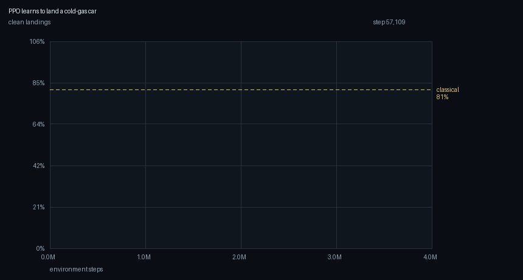
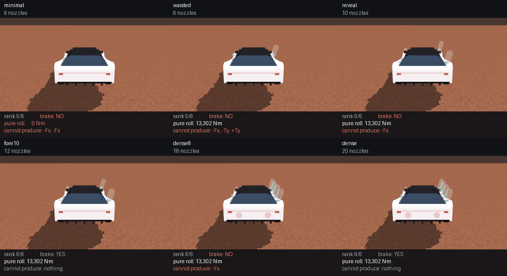

# Aerial Stabilization

**Baseline:** a classical PD attitude controller with a thrust allocator —
no learning — scored on the same held-out throws.
**Budget:** 4M environment steps per rig, 16-process pool, seed 0, `implicitfast`,
~12 minutes each on 20 CPU cores. No GPU.
**Falsifier:** if thruster COUNT is what matters, clean-landing rate is
monotone in nozzle count and `waisted` ties `minimal`. It is not, and it does not.

A 2-tonne car is thrown into the air tumbling. It has about three seconds
of flight, ten cold-gas nozzles, and a tank that holds eight seconds of
hover. It has to arrive on its wheels.

## Where this comes from

Tesla revealed the Roadster on 15 October 2026 at SpaceX's McGregor site:
the car drove inverted along a ramp held by fan suction, then made a
thruster-powered hop with a mid-air rotation and landed on its wheels.
Reported: roughly **10 nozzles**, **~600 L** of compressed gas in
carbon-fibre overwrapped pressure vessels.

It was **one clip**. No repeatability, no sustained flight, no independent
measurement. Everything below except those three numbers is a stated
engineering assumption — this is a physics sandbox motivated by the reveal,
not a reconstruction of anyone's hardware.

## The arithmetic that sizes everything

COPVs of that class run to about 10,000 psi (689 bar). At 689 bar and 293 K,
nitrogen is emphatically not an ideal gas:

| | density | mass in 600 L |
|---|---|---|
| ideal gas, `p/(RT)` | 792 kg/m³ | **475 kg** |
| real gas, `p/(ZRT)`, Z = 1.95 | 406 kg/m³ | **244 kg** |

The ideal figure is denser than **liquid** nitrogen (807 kg/m³), which
should have been the tell. At a cold-gas specific impulse of 73 s
(vₑ = 716 m/s, a quarter of a monopropellant), 244 kg is **161 kN·s** —
about **8.2 seconds of hover**.

That one number decides the lab. Propellant is not a resource that
degrades gracefully; it is a clock. A quadrotor can dither its attitude all
day, and this vehicle cannot.

## The result

| | clean landings | sink | tilt | gas used |
|---|---|---|---|---|
| classical PD + allocator | 81% | 0.10 m/s | 1.0° | 112 kg |
| **PPO, 4M steps** | **92%** [74, 98] | **0.02 m/s** | 1.2° | **35 kg** |

PPO beats the textbook controller on landing rate — and uses **a third of
the propellant** doing it. That second number is the interesting one. The
classical controller holds a commanded descent rate the whole way down,
which means firing continuously. The learned policy coasts: it arrests the
tumble, then falls, then catches itself late.


Every frame is MuJoCo rendering the same state the policy just acted on —
there is no separate animation path. The nozzle strip at the bottom is the
policy's actual output.

## The plateau



The curve is the lesson:

| steps | crashes | landings | what it had learned |
|---|---|---|---|
| 0 | 99% | 0% | nothing |
| 400k | 54% | 1% | how to stop tumbling |
| 700k–1.6M | **0%** | **0%** | **how to never land** |
| 1.9M | 1% | 16% | that the ground is survivable |
| 4M | 1% | 92% | the task |

For **1.2 million steps** the policy sat at a *zero percent crash rate* and
a zero percent landing rate. It had discovered hovering. Not a bug — the
correct answer to the question actually asked. The first reward paid +2.0
per second for being upright, +0.2 for being alive, and −10 for running out
of clock, so a guaranteed hover banked +62 while attempting a landing risked
−60.

Two things fixed it, and only one of them is a weight:

- **Timeout repriced from −10 to −40.** A car still in the air when the
  clock stops has failed, not drawn.
- **Potential-based shaping** on altitude, Φ = −2.5·h + 3·cosθ. Ng, Harada
  & Russell's result is that adding γΦ(s′) − Φ(s) leaves the optimal policy
  *provably unchanged* while still telling the agent which way is down.
  That guarantee is the reason to use this shape instead of a hand-added
  "descend!" bonus, which changes what optimal means and can be collected
  by diving into the ground.

The first attempt used a weight of 0.9 and failed differently: a metre of
descent paid less than a tenth of what staying level paid, so landings went
1.0% → 0.5% → 0.2% → 0.0% over 550k steps while crashes fell from 98% to 2%.
The policy had learned the first half of the task and was being paid to stop.

## Placement beats count

The rigs, and what each can do **before any training** — read off the 6×N
control effectiveness matrix, no simulator involved:

| rig | nozzles | rank | pure roll | pure pitch | 360° in |
|---|---|---|---|---|---|
| minimal | 6 | 5/6 | **0 N·m** | 0 N·m | never |
| waisted | 6 | 5/6 | 12,959 N·m | **0 N·m** | 0.91 s |
| sixlift | 8 | 5/6 | **0 N·m** | 0 N·m | never |
| narrow | 10 | 6/6 | 5,948 N·m | 21,964 N·m | 1.34 s |
| reveal | 10 | 6/6 | 12,959 N·m | 21,964 N·m | 0.91 s |
| wide | 14 | 6/6 | 12,959 N·m | 21,964 N·m | 0.91 s |
| dense | 20 | 6/6 | 12,959 N·m | 21,150 N·m | 0.91 s |



**Doubling the nozzle count from 10 to 20 buys exactly zero extra roll
authority.** Halving the track at the same count halves it. Roll torque is
`τₓ = r_y F_z − r_z F_y`, so it depends on the *lateral lever arm*, and
`dense` has the same track as `reveal`.

Every rig is built at **equal installed thrust** — a 20-nozzle rig has
nozzles half the size. Without that control, "more nozzles is better" would
only be "more thrust is better", which needs no experiment.

Two rigs are rank-deficient, and rank is not a soft constraint. `waisted`
has six nozzles in the right pattern at the wrong place: full roll
authority, and **no pitch torque at any command**. No policy can learn
around that.

### Why up-firing nozzles

A pure couple — torque with no net force — needs something pushing *down*
while something else pushes up. With lift nozzles only, every roll command
also throws the car upward and the controller fights its own input.
`minimal` and `sixlift` have no pure couple at all; their fastest 360° roll
is *never*.

Sideways nozzles do not help: at door height `r_z ≈ 0`, so an `F_y` push
contributes almost nothing to roll. The authority is in vertical nozzles at
lateral stations.

## What is modelled

6-DOF rigid-body flight · real-gas tank blowdown with adiabatic cooling ·
a regulator that drops out below 46 bar · thrust ∝ chamber pressure ·
25 ms valve lag and 10 ms transport delay · mass and inertia that shrink as
gas leaves (244 kg of 1994 is 12%, and roll inertia moves more than mass
because the tanks sit outboard) · wheel contact and hull strikes · thin
Martian air at 0.02 kg/m³.

**Not modelled, and said rather than hidden:** plume impingement on the
ground, nozzle over/under-expansion beyond a flat 0.92 efficiency, tank
wall heat transfer as anything but a blend parameter β, structural loads,
suspension travel beyond MuJoCo's contact solver, aerodynamic surfaces.
The compressibility Z is a two-point linear fit in density, not a table.

## Running it

```bash
cd 08_aerial_physics/01_aerial_stabilization && uv sync

uv run thrusters.py --all            # the rig audit — free, no simulator
uv run aerial_env.py --budget        # what the tank can and cannot buy
uv run vecenv.py                     # bit-identity, then 4.70x on 20 cores
uv run ppo.py                        # the PPO properties, asserted

uv run classical.py --episodes 48    # the baseline that does not learn
uv run train_aerial.py --dry-run     # 40 s, proves it assembles
uv run train_aerial.py --rig reveal --name r_reveal --total-steps 4000000
uv run evaluate.py runs/r_reveal --compare

uv run sweep_rigs.py --audit         # the thesis, in closed form
uv run sweep_rigs.py --steps 4000000 # the experiment, ~85 min

uv run render_flight.py runs/r_reveal     # the GIF with the HUD
uv run render_curves.py runs/r_reveal
uv run render_rigs.py
```

### Environment & local testing

CPU only, no downloads, ~1.5 GB of dependencies. A full rig sweep is about
85 minutes on 20 cores. **There is no `require_gpu()` in this lab and that is
deliberate** — the policy is 13,013 parameters and topic 7 measured one this
size running **1.7× slower** on a GPU than on the CPU, because the rollout
batch never fills a card. A guard that can never fire is decoration. What
pays is the process pool: measured at **4.70× on 20 cores**, and asserted
bit-identical to the serial loop before anyone trusts it.

```bash
uv run ../../tests/test_aerial_stabilization.py
```

### Renting a box (RunPod)

```bash
cd ../../runpod
uv run runpod_ctl.py run 08_aerial_physics/01_aerial_stabilization \
    --dry-run --collect --wait --terminate --yes
uv run runpod_ctl.py pods             # confirm it actually died
```

`--dry-run` first: it proves the pod boots, `uv sync` resolves and the
stages run. `--wait --terminate` is what stops the billing and `pods` is
how you confirm it. The pod never receives `RUNPOD_API_KEY` — termination
is driven from the local machine in a `finally`, with a keyless in-pod
watchdog as backstop. See `SECURITY.md`.

Rent this one for **cores, not a card**. The manifest asks for a GPU only
so the flight GIF has an OpenGL context; training never touches it, and
the lab's own numbers say a card would be slower.

## Why MuJoCo and not a web 3D engine

The obvious way to make this look good is three.js. It is the wrong tool
here for one reason: a renderer that is not the simulator can show a car
doing something the physics never did, and this course has paid for that
once already. The cosmetics budget went into the model instead — a 24-slice
lofted hull, separate glass and roof, wheels with rims and brake discs, and
a real bell at every nozzle — and every frame is MuJoCo drawing the same
`MjData` the policy acted on.

The loft is decoration and **must weigh nothing**. It once added 394 kg of
inertia nobody chose, which would have been invisible in every learning
curve; the test suite now pins dry mass at exactly 1750 kg.

## What transfers

| | |
|---|---|
| **The ideal gas law fails where the pressure is interesting** | it claimed a tank denser than liquid nitrogen, and 95% more propellant |
| **A reward with no cost for stalling will be stalled** | 1.2M steps at a 0% crash rate and a 0% landing rate |
| **Shape with a potential, not a bonus** | γΦ(s′) − Φ(s) provably preserves the optimum; "descend!" is collectable by diving |
| **Check the hardware before training on it** | rank 5 is a fact about where the bolts are, and no policy learns around it |
| **Hold the obvious variable fixed** | equal installed thrust, or the sweep only rediscovers that thrust helps |
| **Cosmetics must not carry mass** | the hull was 22% of the vehicle before anyone looked |
