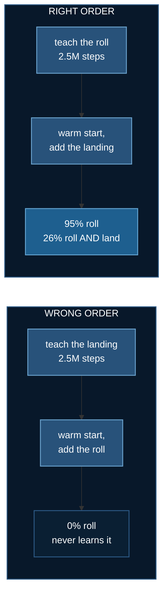
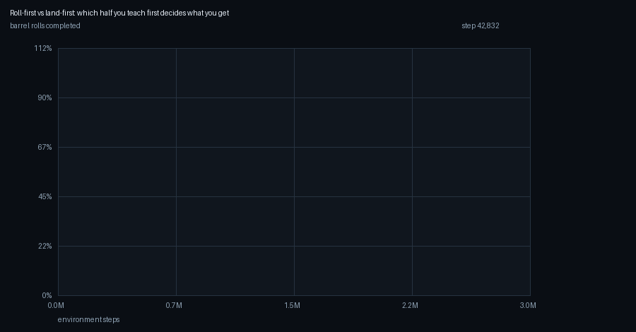
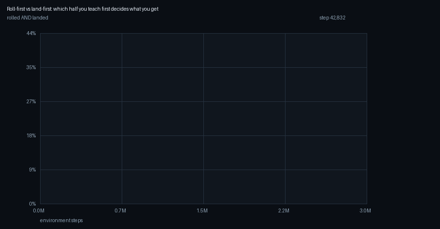
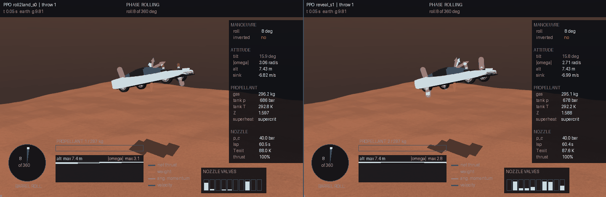

# Barrel Roll

**Baseline:** a scheduled roll plus a PD landing controller — no learning —
scored on the same held-out throws.
**Budget:** 2.5M steps to learn the roll, then 3M warm-started to add the
landing. 16-process pool, RK4 at 2 ms, three seeds. ~50 min per run on 20
CPU cores. No GPU.
**Falsifier:** if the two halves of the manoeuvre are independent, the order
they are taught in should not matter. It decides everything.

A two-tonne car is launched spinning at 2.6 rad/s with eight seconds of
clock and seven seconds of propellant. It has to complete one full 360°
turn about its own axis and then arrive on its wheels.

:::info In plain words
A car is thrown into the air already rotating. It must finish exactly one
complete roll — like an aircraft barrel roll — and then land on its wheels
instead of its roof. We taught a computer to fly it.
:::

## Result

:::info In plain words
It works. The trained controller completes the barrel roll 95 times out of
100, which is much better than the hand-built engineering controller
manages, and it does it on about 40% less gas. Landing cleanly afterwards
is harder, and there the hand-built controller is still ahead.
:::

96 held-out throws per controller, identical launches, rig `reveal`:

| | **roll completed** | roll **and** landed | gas |
|---|---|---|---|
| scheduled roll + PD landing | 65/96 = **68%** [58, 76] | 48/96 = **50%** [40, 60] | 218 kg |
| **PPO, pooled over 3 seeds** | **275/288 = 95%** [92, 97] | 74/288 = 26% [21, 31] | 124–145 kg |
| PPO, best seed | **96/96 = 100%** [96, 100] | 37/96 = 39% [29, 49] | 145 kg |

**The manoeuvre itself is solved.** PPO completes the roll on 95% of
throws against the engineered controller's 68% — the intervals are
disjoint — and spends roughly 40% less propellant doing it. One seed
rolled on all 96 throws.

The landing that follows is the half PPO is worse at, 26% against 50%, and
those intervals are disjoint too. Reported rather than buried; the
limitations section says what it would take to close.

[**Watch four clean roll-and-lands (24 MB) →**](../../docusaurus-docs/static/img/aerial/roll-success.gif)
Linked rather than embedded — 980 × 580, four throws, the roll dial filling
to 360° on each. Selected throws: these are four of the policy's successes,
and the rate is the table above, not the film.

## How this lab works

Two skills — complete a 360° roll, then land on the wheels — and the entire
finding is that **the order you teach them in decides whether either is
learnable at all.**



Same algorithm, same budget, same reward — only the curriculum order moves,
and it takes the roll from 0% to 95%. A landing reflex learned first makes
the roll *unlearnable*, because a policy that has learned to stay upright
will not initiate a tumble. **A prior can be worse than no prior.**

## Motivation

:::info In plain words
Tesla showed a car doing a mid-air rotation and landing on its wheels. Lab
1 reproduced the landing. This lab adds the rotation — the part that makes
it a stunt rather than a hop.
:::

Lab 1 asked only for a landing and reached 89%. The roll is not merely a
harder version of that: it forces the vehicle to spend attitude authority
on a goal that **conflicts** with the landing, on a clock, from a tank
that is paying for both.

The car is launched already rotating, because that is how the stunt works
— a car leaving a ramp sideways is spinning, it does not start level and
then decide to turn. At 2.6 rad/s one free turn costs 2.4 s of the 8 s
clock and the car would complete 3.4 turns if left alone. **The skill is
arresting at exactly one turn, not starting one.**

## Problem setup

:::info In plain words
Reinforcement learning needs four things written down before you can
train: what counts as success, what the machine can move, what it is not
allowed to do, and what it can see. This table is all four.
:::

| | |
|---|---|
| **Goal** | complete one 360° roll about the body's long axis, **then** arrive on the wheels under 2.5 m/s sink, under 25° tilt, under 1.2 rad/s spin. Both halves or it does not count. |
| **Degrees of freedom** | 6 for the vehicle (3 position, 3 attitude) plus 4 wheel spins. The policy commands **10 valve openings in [0, 1] at 100 Hz** — one per nozzle, nothing else. |
| **Constraints** | 297 kg of propellant ≈ 7 s of hover against an 8 s clock; thrust fades as the tank cools; nozzles push and never pull; 25 ms valve lag plus 10 ms transport delay; anything but a wheel touching the ground ends the episode. |
| **Observation** | 33 numbers: attitude as two rotation-matrix columns, body rates, velocity, altitude and lowest-corner clearance, ground slope, propellant fraction and thrust availability, time remaining, **three roll-state terms**, previous action. |
| **Action** | 10 continuous valve commands, sampled from a Gaussian the network outputs. |
| **Reward** | dense: uprightness and rate penalties, a propellant charge, and potential-based shaping on altitude and roll progress. Terminal: **+80 to +100** rolled and landed, **−20** landed without rolling, **−40** timeout, **−60** crash. |
| **Termination** | three wheels down and settled, any hull contact, or 8 s. |

The three roll-state terms are not decoration. Without them the task is
not Markov — the policy cannot tell whether it still owes a turn, and no
amount of training repairs a missing input.

### Roll measurement

:::info In plain words
We need to be sure a "roll" is really a roll and not the car thrashing
about. So it only counts if the car turns a full circle **and** genuinely
passes upside down on the way.
:::

Rotations do not commute, so the integral of body roll rate is a geometric
angle only when the manoeuvre is roll-dominant. Relying on it alone would
let a policy bank credit by tumbling. A roll therefore counts only if
**both** hold:

1. the unwrapped integral of body-frame ωₓ reaches 2π, **and**
2. the car's own up-axis points below the horizon at some instant.

The second is a geometric event no amount of yaw or pitch thrashing can
fake. `tests/test_barrel_roll.py` pins both directions: spinning past 360°
without inverting is rejected, and inverting without completing the turn
is rejected.

## Hardware check

:::info In plain words
Before training anything we check the thruster layout can physically do a
barrel roll. Some layouts cannot, and no amount of training fixes that.
:::

From lab 1's rig audit, computed in closed form with no simulator:

| rig | nozzles | pure roll couple | free roll torque | fastest 360° |
|---|---|---|---|---|
| `reveal` | 10 | 13,302 N·m | 24,602 N·m | **0.90 s** |
| `minimal` | 6 | **0 N·m** | 17,656 N·m | never |
| `sixlift` | 8 | **0 N·m** | 17,656 N·m | never |

A *pure couple* is torque with no net force. `minimal` and `sixlift` have
plenty of roll torque and no pure couple at all — every newton-metre they
produce arrives with a shove.

I pre-registered that couple purity would predict roll-and-land success.
**It is not an independent variable.** Cancelling the shove from a
side-mounted lift nozzle requires downward force, so *zero purity* and
*cannot push down* are the same property — and that same deficiency is
what makes fine descent control impossible. `minimal` could not be trained
to land at all, with or without the roll (0/48 over 2.5M steps), so the
purity comparison cannot be made with a learned controller. The engineered
controller still flies it, so it is a learnability gap rather than an
impossibility.

## Curriculum order

:::info In plain words
This is the real discovery. We tried teaching the car to land first and
then roll — it never rolled, not once. Teaching it to roll first and then
land worked. Same task, same everything; only the order changed.
:::

The compound task is not learnable from scratch at this budget: 4M steps
gave 0/96. So it was split into two stages. Taught in one order it fails
completely; in the other it works.

| order | rolls completed | rolls **and** lands |
|---|---|---|
| land first, then add the roll | **0.0%** (2 seeds, 3M steps each) | 0% |
| **roll first, then add the landing** | **94–100%** (3 seeds) | 25–37% |



The three rising curves are roll-first; the two flat on zero are
land-first. Roll completion for the land-first policies never leaves
0.0% at any checkpoint across 3M steps.



**Why the asymmetry.** A landing prior is the reflex *null the body
rates*. Handed a car spinning at 2.6 rad/s it kills the rotation in about
0.3 s — before enough roll accumulates for the shaping to pay anything —
so the roll is never attempted and never appears in a single training
batch. No data, no gradient, regardless of budget. A rolling prior is *do
not fight the rotation*, which costs the landing nothing: the car still
has 5.6 s of clock after the turn, and landing is the half lab 1 already
proved learnable.

**Roll-first transfers. Land-first does not.**



Left: roll-first. Right: land-first. Identical seed, so identical
attitude, tumble and velocity — the only difference is which half each
policy was taught first. The left car turns over; the right one cancels
the rotation it was given and lands flat, taking the −20.
[Two more throws (11 MB) →](../../docusaurus-docs/static/img/aerial/roll-order.gif)

## Reward design

:::info In plain words
Most of the work in this lab was not training — it was discovering that
the car was being paid, by accident, to do the wrong thing. Three times.
:::

Each of these produced a confident, stable, wrong policy. The optimiser
was correct every time; the question it was asked was not.

**Shaping that paid for stalling.** Potential-based shaping adds
`γΦ(s′) − Φ(s)`, which provably leaves the optimal policy unchanged. The
theorem is about the optimum; with γ below 1 the *sign of Φ* decides whether
loitering is pleasant. Holding station collects `(γ−1)·Φ` per step, so a
**negative** potential is a standing subsidy. At Φ ≈ −15 that was +0.075
per step — about **+60 per episode for free**. Roll completion fell from
21% to 12% while timeouts climbed to 86%. Shifting Φ non-negative flips
the subsidy into a clock.

**A consolation prize for not attempting the task.** Landing without
rolling was priced at **+10**, on the reasoning that a safe landing beats
a crash. True, and beside the point: it made declining worth a guaranteed
+28 against an unknown gamble, and a warm-started policy refused to roll
on **94.8%** of throws. It is now −20.

**Partial credit before the task was attempted.** With a gentle no-roll
landing at −20 and a *hard* one at −5, landing **badly** scored better
than landing well — and 44.5% of episodes became deliberate hard
landings. Any landing without the roll is now one flat price.

The measured breakdown of where reward actually comes from is in lab 1;
the same `--reward-audit` tooling applies here.

## Limitations

:::info In plain words
What this lab does not show, stated plainly.
:::

- **Landing after the roll is worse than the engineered controller**, 26%
  against 50%, intervals disjoint. The best seed ties it at 39% on 58% of
  the gas, but the seed spread is 18 / 21 / 39 and three seeds is few.
- **Seed variance is large.** The pooled figure is the honest one.
- **The purity hypothesis could not be tested** with a learned controller,
  because the zero-purity rigs cannot be trained to land at all.
- **One rig carries the headline.** `reveal` only; the rest are covered by
  the engineered controller.
- **The best seed was still improving** at 3M steps (32% → 39% over the
  last 400k). This is a budget result, not a ceiling.
- **The terrain is nearly flat where the car lands**, as in lab 1.

## Running it

```bash
cd 08_aerial_physics/02_barrel_roll && uv sync

uv run roll_env.py --budget          # can the tank afford a roll?
uv run roll_env.py --episodes 16     # random policy: 100% crash, 0% rolls
uv run thrusters.py --all            # what each rig can and cannot do
uv run verify.py                     # the physics audit, inherited from lab 1

uv run classical.py --episodes 96    # the baseline that does not learn
uv run train_roll.py --dry-run       # 40 s, proves it assembles

# stage A: learn the roll (from scratch)
uv run train_roll.py --rig reveal --name roller --total-steps 3000000
# stage B: add the landing
uv run train_roll.py --rig reveal --name roll2land_s0 \
    --init-from runs/roller --total-steps 3000000
uv run evaluate.py runs/roll2land_s0 --compare

uv run render_roll.py runs/roll2land_s0 --episodes 4
uv run render_compare.py --left runs/roll2land_s0 --right runs/reveal_s1
uv run render_curves.py "runs/roll2land_s*" --metric roll_rate

# or reproduce the whole thing in one command
./run_curriculum.sh
```

### Environment & local testing

CPU only, no downloads. A stage is ~50 minutes on 20 cores; the full set
of runs behind this page is about 6 hours. **No `require_gpu()`, and that
is deliberate** — the policy is 13,397 parameters and topic 7 measured one
this size running 1.7× *slower* on a GPU. What pays is the process pool:
4.70× on 20 cores, asserted bit-identical to the serial loop.

Two trainings at a time is 1.18× the aggregate throughput of one, measured
— the pool leaves the machine 43% idle during PPO updates and sync
barriers. Each job keeps its full 16 workers so the hyperparameters are
unchanged and the runs stay comparable.

```bash
uv run ../../tests/test_barrel_roll.py
```

### Renting a box (RunPod)

```bash
cd ../../runpod
uv run runpod_ctl.py run 08_aerial_physics/02_barrel_roll \
    --dry-run --collect --wait --terminate --yes
uv run runpod_ctl.py pods             # confirm it actually died
```

`--wait --terminate` is what stops the billing and `pods` is how you
confirm it. The pod never receives `RUNPOD_API_KEY`. Rent this one for
**cores, not a card**.

## What transfers

| | |
|---|---|
| **Curriculum order is not a detail** | the same two halves, same budget, same reward: 0% one way round, 100% the other |
| **A prior can be worse than no prior** | the landing reflex made the roll unlearnable; from scratch beat warm-started on the roll, 95% against 0% |
| **A behaviour absent from the batch cannot be learned** | 35,000 gradient steps over data where the roll never occurred |
| **Potential-based shaping is sign-sensitive** | the optimality theorem says nothing about whether loitering pays, and at γ below 1 a negative Φ subsidises it |
| **Do not pay for declining the task** | +10 for a safe non-attempt bought a 94.8% refusal rate |
| **Judge a plateau by the known breakout, not the budget you can afford** | five configurations were declared dead at 800k; the reference run breaks out at 1.4M |
