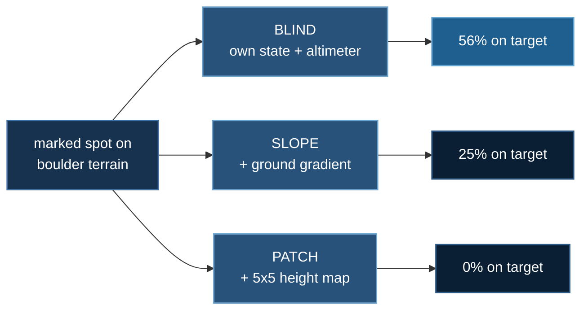

# Land on Target

**Baseline:** a hand-written guidance controller — pick a spot, fly a PD
trajectory to it, flare — scored on the same held-out launches. 61% on target.
**Budget:** 4M steps per arm, `dense` rig, `badlands` terrain, two seeds per
arm, 16-process pool, RK4 at 2 ms. ~47 min per run on 20 CPU cores. No GPU.
**Falsifier:** if knowing the ground is useful, the arm that sees more of it
should score higher. The ordering is the exact reverse, monotonically, and a
second controller reproduces it independently.

A two-tonne car is thrown into the air, tumbling, over broken ground. A spot
is marked on the surface. It has six seconds of clock, seven seconds of
propellant, and twenty nozzles that can only push. It has to come down on its
wheels, intact, within four metres of the mark.

:::info In plain words
A car is thrown into the air over rocky ground, and a target is painted on
the ground nearby. The car has gas thrusters and a few seconds of fuel. It
has to land on its wheels, in one piece, on the target. We taught a computer
to fly it, and then asked whether letting the computer *see* the rocks made
it any better at the job.
:::

## Result

:::info In plain words
It works. The trained controller puts the car on the mark more than half the
time, arriving so gently it is barely moving at touchdown — about as well as
a controller a human engineer designed by hand, except nobody told it how to
fly. The surprise is the second part: letting it see the ground made it
*worse*, and the more ground it could see, the worse it got.
:::

PPO lands the car on the mark **56% of the time** on held-out launches, with
a mean miss of **2.63 m** and a touchdown sink rate of **0.09 m/s** — it
arrives effectively settled rather than dropping the last metre. The
hand-written guidance controller, given the same vehicle and the same
launches, scores 61%. The two are statistically indistinguishable, and the
learned one was given no guidance law, no trajectory, and no notion of a
flare.

| arm | observation | on target | 95% CI | mean miss |
|---|---|---|---|---|
| **blind** | 33 dims | **56%** | [0.46, 0.66] | 2.63 m |
| slope | 35 dims | 25% | [0.17, 0.35] | 4.43 m |
| patch | 58 dims | 0% | [0.00, 0.04] | 4.26 m |

96 held-out episodes per arm, pooled over two seeds. The arms differ in
exactly one thing: how much of the ground the policy is allowed to see.
`blind` gets the mark and its own state plus a radar altimeter. `slope` adds
the two-component ground gradient under the car. `patch` adds a 5×5 height
patch spanning 8 m.

Per-seed, because the pooled figure hides a real spread:

| arm | seed 0 | seed 1 |
|---|---|---|
| blind | 56% | 56% |
| slope | 40% | 10% |
| patch | 0% | 0% |

`blind` reproduces exactly across seeds; `slope` does not, and that
four-fold spread is reported rather than averaged away.

## The second controller agrees

The hand-written controller chooses a landing spot by searching outward for
survivable ground. How far it is willing to divert is a single knob, and
sweeping it answers a question the learned arms cannot: is terrain knowledge
useless, or was it merely used badly?

| divert budget | on target | survived | mean miss | gas |
|---|---|---|---|---|
| **0 m** (ignores terrain) | **61%** | 83% | 2.81 m | 146 kg |
| 2 m | 61% | 83% | 2.82 m | 147 kg |
| 4 m | 55% | 80% | 3.05 m | 148 kg |
| 6 m | 52% | 78% | 3.28 m | 151 kg |

Diverting up to 2 m is free and worthless. Past that it costs accuracy,
survival and fuel together. **The best use of perfect terrain knowledge is
to ignore it**, and that holds for a hand-written controller and a learned
one independently — two different mechanisms arriving at the same answer.

### Why ignoring the ground wins

The mechanism is measurable rather than rhetorical, and it is a comparison
of two lengths:

| quantity | measured |
|---|---|
| touchdown scatter of either controller | **2.6–2.8 m** |
| median distance from bad ground to good | **4.0 m** |
| targets with survivable ground within 2 m | 66% |
| targets with survivable ground within 4 m | 82% |

A controller that aims at bad ground still lands on good ground much of the
time, because its own scatter is the same size as the gap it would have
deliberately crossed. Meanwhile, deliberately crossing that gap costs
lateral travel, propellant, clock, and — since the scoring circle is 4 m and
the escape is 4 m — frequently the target itself. The information is real,
the decision is real, and acting on it still loses.

:::info In plain words
The car cannot land exactly where it aims; it is off by about three metres
either way. The patches of bad ground are also about three metres from good
ground. So aiming at a bad patch lands you on good ground roughly as often
as aiming at a good patch does — and going out of your way to reach the good
patch burns fuel and pushes you off the target. The knowledge is genuine and
using it still does not pay.
:::

## The catch-up test

:::info In plain words
A fair objection: maybe seeing the ground is not *harmful*, just slower to
learn from, and the wide-view version simply needed more practice. We gave
both versions two and a half times the practice to find out. It did not
catch up.
:::

At 4M steps every arm was still improving, so "patch scores 0%" was a claim
about sample efficiency rather than a ceiling. Both arms were therefore
continued to **10M steps on matched budgets** — running only the losing arm
longer would answer a different question.

| arm | 4M | 10M | 95% CI at 10M |
|---|---|---|---|
| **blind** | 56% | **71%** | [0.61, 0.79] |
| patch | 0% | 8% | [0.04, 0.16] |

`patch` improved — from 0% to 8%, with its crash rate falling 94% → 82% —
and is still improving. It is not stuck. But at 2.5× the budget it reaches
roughly a ninth of what the blind arm reaches, and the gap is wider in
absolute terms at 10M than it was at 4M. The honest statement is therefore
not "the wide view can never learn this" but something nearly as strong:
**25 extra inputs of perfect, noiseless terrain information cost more than
2.5× the sample budget and were still losing.**

The mechanism is unglamorous and matters more than the framing: those 25
inputs nearly double the observation width for a ~13k-parameter policy, and
every one of them is a dimension the network must learn to ignore. The
information is not merely unhelpful, it is actively expensive to discount.

## How this lab works

One task, three policies, and the only thing that changes between them is
**how much of the ground the policy is allowed to see.**



Everything else is held fixed — reward, terrain, rig, budget, seeds. The
ordering is **the exact reverse** of what you would expect and it is
monotone: more terrain information, worse landing. A hand-written controller
reproduces it independently, and its best use of *perfect* terrain knowledge
turns out to be ignoring it.

## Motivation

Labs 1 and 2 asked whether the vehicle could control its attitude: arrest a
tumble, then complete a roll. Neither cared where it came down. This lab
adds the only thing a real lander actually has to do — arrive somewhere
specific — and that turns an attitude problem into a guidance problem.

It also sets up a question the course has asked once before, in
`07_physical_ai/10_perception_pays`, and got the same answer to: a robot
that only *feels* outperformed one that could *see*. Here the perception is
not a camera and a VLM but a perfect, noiseless height field handed directly
to the policy — the most generous possible form of the information. It still
does not pay. That is a stronger version of the same claim, and the reason
the lab is worth running twice.

## Problem setup

:::info In plain words
Below is exactly what the car is allowed to do, what it cannot do, and what
counts as winning. Reinforcement learning needs all three stated precisely
or it will find a way to win that you did not mean.
:::

**Goal.** Arrive on the wheels within 4 m of the mark, under 2.5 m/s sink,
under 25° of tilt, under 1.2 rad/s of spin. Close but broken does not count.
Intact but elsewhere does not count.

**Degrees of freedom.**

| | |
|---|---|
| vehicle | 6 — three translation, three attitude |
| wheels | 4 spins |
| commanded | 20 valve openings in [0, 1] at 100 Hz |

**Constraints.**

| | |
|---|---|
| propellant | 297 kg, about 7 s of hover; thrust fades as the tank cools |
| nozzles | push only, never pull |
| actuation lag | 25 ms valve time constant, 10 ms transport delay |
| clock | 6 s |
| termination | anything but a wheel touching the ground ends the episode |
| ground | badlands — packed boulder fields, not a parking lot |

**Observation.** 33 numbers for `blind`: attitude as two rotation-matrix
columns, body rates, velocity, altitude and lowest-corner clearance, the
target offset in body frame, propellant fraction and thrust availability,
time remaining, and the previous action. The terrain arms add 2 or 25 more.

**Reward.** Terminal-dominated, with potential-based shaping and a per-step
time cost, in full below. The shaping was where all the difficulty lived.

### The reward function, in full

> **In plain words**
> Below is the exact scoring rule, written in maths. If that is not your
> language, here it is in one paragraph: **every moment that passes costs the
> car a small fixed amount**, so dithering is never free. Spinning and burning
> gas cost a little more. On top of that there is a running "how well is this
> going" score — closer to the mark, lower down, right way up — and the car is
> paid the *improvement* in that score each moment rather than the score
> itself. Then at the very end it gets one big number: a large bonus for
> landing on the mark, a small one for landing safely elsewhere, and
> penalties of increasing size for landing hard, crashing, and never landing
> at all.


**Per step.** At each of the 600 control steps the car receives

$$
r_t = r^{\text{time}} + r^{\text{spin}} + r^{\text{gas}} + F_t
$$

$$
r^{\text{time}} = -0.15, \qquad r^{\text{spin}} = -0.05\,\lVert \boldsymbol\omega_t \rVert^2 \Delta t
$$

$$
r^{\text{gas}} = -0.004 \sum_{i=1}^{20} u_{t,i}\, \Delta t, \qquad \Delta t = 0.01\ \text{s}
$$

where $\boldsymbol\omega_t$ is the body angular rate and $u_{t,i} \in [0,1]$
is the commanded opening of nozzle $i$. The spin and gas terms are
deliberately tiny — about $10^{-2}$ per step against a time cost of
$1.5 \times 10^{-1}$ — because they are preferences, not objectives.

**Shaping.** $F_t$ is a potential-based shaping term in the sense of Ng,
Harada and Russell (1999):

$$
F_t = \gamma\,\Phi(s_{t+1}) - \Phi(s_t), \qquad \gamma = 0.999
$$

$$
\Phi(s) = \Phi_{\text{near}} + \Phi_{\text{low}} + \Phi_{\text{up}}
$$

with, writing $d$ for the horizontal miss distance in metres, $h$ for height
above ground, and $\hat{\mathbf{z}}\cdot\hat{\mathbf{u}}$ for the cosine
between the car's own up-axis and the world vertical,

$$
\Phi_{\text{near}} = 3\max\!\left(0,\ 1 - \tfrac{d}{40}\right) \in [0, 3]
$$

$$
\Phi_{\text{low}} = 2\left(1 - \tfrac{\min(h,\,10)}{10}\right) \in [0, 2]
$$

$$
\Phi_{\text{up}} = \tfrac{1}{2}\left(\hat{\mathbf{z}}\cdot\hat{\mathbf{u}} + 1\right) \in [0, 1]
$$

> **In plain words**
> The shaping term is a trick for giving hints without changing what counts as
> winning. You define a "warmth" score — warmer when the car is near the mark,
> low down and the right way up — and pay the car the *change* in warmth at
> each step. Because the payments are differences, they cancel out over a whole
> flight, so the hints steer the search without quietly inventing a different
> goal. The ranges on the right are the deliberate part: the whole warmth score
> can never exceed 6, and the next paragraph explains why that ceiling matters
> more than it looks.


**Why $\Phi$ is capped at 6.** Telescoping the shaping over an episode that
ends at step $T$ leaves

$$
\sum_{t=0}^{T-1} F_t = \gamma^{T}\Phi(s_T) - \Phi(s_0) + (\gamma - 1)\sum_{t=1}^{T-1}\gamma^{t-1}\Phi(s_t)
$$

The last term is the one that bites. With $\gamma$ below 1 it is a *toll* on
occupying high-potential states, worth roughly $(1-\gamma)\,\Phi_{\max}\,T$
over an episode. At $\Phi_{\max} = 6$, $\gamma = 0.999$ and $T = 600$ that is
about 3.6 — negligible against a terminal prize near 100. The first version
of this lab had $\Phi_{\max} = 31$ at $\gamma = 0.995$, a toll of about 93,
and the policy duly learned to run away from good states. See
[Reward design](#reward-design) below.

**Terminal.** One of five mutually exclusive outcomes is added on the final
step. Writing $v_\downarrow$ for sink rate in m/s and $\theta$ for tilt in
degrees, and calling a touchdown *gentle* when
$v_\downarrow \le 2.5$, $\theta \le 25$ and $\lVert\boldsymbol\omega\rVert \le 1.2$:

$$
R_T =
\begin{cases}
70 + 20\left(1 - \tfrac{d}{4}\right) + 10\left(1 - \tfrac{\theta}{25}\right)
  & \text{gentle},\ d \le 4 \\[4pt]
\max\!\left(5,\ 25 - 3(d - 4)\right) & \text{gentle},\ d > 4 \\[4pt]
-5 & \text{landed, not gentle} \\[4pt]
-40 - 4\min(v_\downarrow,\, 8) & \text{crash} \\[4pt]
-90 & \text{never landed}
\end{cases}
$$

> **In plain words**
> Every line of that table is graded rather than pass/fail, and that is the
> point. Landing dead centre pays more than landing at the edge of the circle;
> arriving at walking pace pays more than arriving at speed; and even a crash
> is scored by how fast the car hit, so "slow down" is something the computer
> can discover one small improvement at a time. A rule that just said "crash =
> bad" would be a cliff with nothing to climb.


Two properties of this ladder are load-bearing and the test suite pins both.
It is **monotone** — every outcome scores strictly above the one below it, so
no failure is ever worth choosing — and the worst outcome is **never
landing**, not crashing. The reason that ordering has to be enforced rather
than assumed is the discounting argument in
[Reward design](#reward-design) below: a penalty arriving later is cheaper, and
the policy will exploit that unless something charges for delay.

## Hardware check

Two rigs in the set have no dead wrench axis, meaning they can translate in
any direction without first rotating:

| rig | nozzles | rank | dead axes |
|---|---|---|---|
| `minimal` | 6 | 5 | −Fx, −Fz |
| `reveal` | 10 | 6 | −Fx |
| `fore10` | 12 | 6 | **none** |
| `dense` | 20 | 6 | **none** |

Full rank is not reachability: unidirectional nozzles make the achievable
wrench set a convex polytope, not a subspace, so a rank-6 rig can still be
unable to push backwards. `reveal` is rank 6 and cannot produce −Fx.

That left `fore10` and `dense`, and they are **not** interchangeable:

| rig | on target at 2.8M steps |
|---|---|
| `fore10` | 6% |
| `dense` | **37%** |

`fore10` is the slow learner, and lab 1's own run history says the same
thing: on the *easier* task it did not break out until 3.9M steps, where
`reveal` broke out at 1.7M. Three probes of this lab were written off as
reward failures before that curve was read. **Check whether the rig is slow
before concluding the reward is wrong.**

## Terrain decidability

A perception experiment on ground that contains no decision produces a clean
null by construction, so the ground is measured before the policy is.

| preset | target survivable | good ground within 2 m | within 4 m |
|---|---|---|---|
| `rough` | 55% | 97% | 100% |
| `hazard` | 43% | 81% | 90% |
| `badlands` | **40%** | 66% | 82% |

`rough` was rejected: per-spot success varied by sd 0.13 against a 0.14
binomial noise floor, so every spot was as good as every other. `hazard` made
spots differ but its features were 1.5 m from safety — smaller than a
touchdown error, so the decision existed and was unexploitable. `badlands`
builds landable pans and impassable fields in 10–20 m patches from a
low-frequency mask, putting the median escape at 4.0 m.

The honest reading of the result above is therefore not "there was nothing
to see". There was something to see, it was measured, and seeing it still
lost.

## Reward design

:::info In plain words
This is the part that took the longest and it had nothing to do with the
car. Four separate times, the scoring rules accidentally described a
different game from the one we meant, and the computer correctly won *that*
game instead. Each time the training charts looked perfectly healthy.
:::

The policy initially learned to **fly away**: crash rate falling to 0%, miss
distance climbing from 12 m to 86 m, 100% of episodes timing out. Four
distinct defects contributed, and the order in which they were found matters
because three plausible fixes did nothing.

**1. The shaping leak has a scale, not just a sign.** Potential-based
shaping adds `γΦ(s') − Φ(s)`. At γ < 1 an agent occupying a state collects
`(γ−1)Φ` every step it stays there. Lab 2 learned that a *negative* Φ pays an
agent to stall. This lab learned the other half: Φ_max was 31, so the toll
for being in a good state was 93 per episode against a ~100 prize. Φ is now
capped near 6, a toll of about 3.

**2. Shaping must not go flat inside the arena.** The distance term
saturated at 12 m. Beyond 12 m the gradient was exactly zero, so once the
car had fled there was nothing pulling it home. The term now falls out to
40 m.

**3. Discounting ranks terminals by timing, not only by size.** This is the
one that mattered, and the one three earlier fixes missed:

| outcome | raw | discounted to step 0 |
|---|---|---|
| crash at step 100 | −60 | **−54.3** |
| timeout at step 600 | −90 | **−49.4** |

The *larger* penalty was the cheaper one, purely because it arrived later.
The policy was not avoiding a bad outcome, it was postponing one. Raising the
timeout penalty to −90 — worse than a crash — did nothing, and neither did
raising γ from 0.995 to 0.999. What fixed it was a constant per-step cost,
which makes postponement itself expensive. **If every episode times out,
reach for a time cost, not a bigger terminal.**

**4. A flat terminal has no gradient in it.** A crash scored −60 whether the
car arrived at 10 m/s or 2.6 m/s, so "slow down" was not discoverable. The
penalty is now graded by impact speed, the same reasoning that already
graded the on-target reward by miss distance.

One diagnostic error is worth recording with them. After fix 3, the car
reached the mark and dived into it on 98% of episodes. That was read as the
time cost being too aggressive and it was halved — which brought the fleeing
straight back. Two symptoms, two causes: the dive was defect 4. Swapping one
fix for the other would have lost both.

The resulting outcome ladder is monotone and `tests/test_land_on_target.py`
pins it, along with a permanent counterexample for each of the four defects:

```
timeout −90  <  crash −64  <  hard landing −5  <  landed off +5…+25  <  on target +70…+100
```

## Prior work — the method here is not ours

| | |
|---|---|
| **Ng, Harada & Russell (1999)**, *Policy Invariance Under Reward Transformations: Theory and Application to Reward Shaping*, ICML, pp. 278–287 · [paper](https://people.eecs.berkeley.edu/~russell/papers/ml99-shaping.pdf) | Potential-based shaping, and the proof that $\gamma\Phi(s') - \Phi(s)$ leaves the optimal policy unchanged. Everything this lab says about Φ — including the $(\gamma-1)\Phi$ leak that made the first version flee — is their result applied carefully. The page named them; it now cites them. |
| **Gaudet, Linares & Furfaro (2018)**, *Deep RL for Six Degree-of-Freedom Planetary Powered Descent and Landing* · [arXiv:1810.08719](https://arxiv.org/abs/1810.08719) | Pinpoint powered descent by RL, targeting a sub-5 m landing ellipse. The task. |
| **Schulman et al. (2017)**, *PPO* · [arXiv:1707.06347](https://arxiv.org/abs/1707.06347) | The algorithm. |

Hazard detection and avoidance for planetary landing is a large aerospace
literature in its own right, and this lab's "the mark is often on a boulder"
premise is a toy version of it.

### What this lab adds

A **negative result with a second, independent confirmation**: giving PPO a
5×5 height patch takes it from 56% to **0%** on target, monotonically worse
with more terrain information. A hand-written controller then reproduces the
ordering from the other direction — sweeping its divert budget shows the best
use of *perfect* terrain knowledge is to ignore it.

That two-method agreement is what makes it a finding about the task rather
than about PPO. Topic 8 lab 7 is the follow-up that explains it, and also
inherits the warning: the patch was never the problem, the training signal
was.

## Limitations

- **Every arm was still improving at 4M steps**, and the two arms carried to
  10M were still improving there too. Every comparison here is at a fixed,
  matched budget rather than at convergence, and no claim is made about
  asymptotic performance.
- **`slope` was not carried to 10M.** Only the two extreme arms were, so the
  middle of the ordering is pinned at 4M only.
- **`slope` has a four-fold spread across two seeds** (40% / 10%). Two seeds
  is enough to notice that and not enough to characterise it.
- **The terrain is noiseless and perfectly known.** A real lander's height
  estimate would be worse, which can only weaken the case for using it.
- **One terrain generator, one vehicle, one gravity.** The claim is scoped to
  `badlands` on Earth with the `dense` rig, and the preset is committed so
  the surface the numbers describe cannot drift.
- **`ds_config.json` is absent deliberately**, as in labs 1 and 2: there is
  no `deepspeed.initialize` call here because a 13k-parameter MLP has nothing
  for ZeRO to shard. See *Running it*.

## Running it

```bash
cd 08_aerial_physics/03_land_on_target
uv sync

# free checks, cheapest first
uv run thrusters.py --all          # what the rig can and cannot do
uv run target_env.py --decidable   # is there a DECISION in this ground?
uv run verify.py                   # conservation residuals
uv run train_target.py --dry-run   # 40 s, assembles

# the engineered baseline, and the divert sweep that prices it
uv run classical.py --episodes 64 --max-divert 0
uv run classical.py --episodes 64 --max-divert 6

# one arm (~47 min on 20 cores)
uv run train_target.py --sense blind --name blind_s0 --total-steps 4000000

# everything, including both seeds and the baselines
bash run_arms.sh
```

No `deepspeed` launcher and no GPU, both deliberate and both measured. The
policy is ~13k parameters; topic 7 measured a policy this size running 1.7×
*slower* on a GPU because the rollout batch never fills a card. This lab
wants **cores**.

### Environment & local testing

Python ≥ 3.10, `numpy`, `mujoco`, `scipy`, `pillow`, `torch==2.11.0`. No model
downloads, no dataset, ~39 packages, and the whole lab runs on CPU. CoolProp
appears only under the optional `tables` extra and is build-time only — the
nitrogen property tables are committed as `n2_tables.npz`.

```bash
uv run tests/test_land_on_target.py      # 22 property checks, from the repo root
```

### Renting a box (RunPod)

```bash
uv run runpod/runpod_ctl.py run 08_aerial_physics/03_land_on_target \
    --dry-run --collect --wait --terminate --yes
uv run runpod/runpod_ctl.py pods          # confirm nothing is left running
```

## What transfers

- **If every episode times out, the problem is probably timing, not size.**
  A discount factor silently reorders terminal rewards by when they arrive.
  Check `γ^T × penalty` against the alternatives before making the penalty
  bigger.
- **Potential-based shaping has two failure modes, not one.** Negative Φ pays
  you to stall; large Φ charges you rent for being in good states. Keep
  `(1−γ)·Φ_max·T` small against the terminal rewards.
- **Grade every terminal.** A flat penalty is a cliff with no gradient, and
  the behaviour just short of it is invisible to the learner.
- **Check the rig before blaming the reward.** A six-fold difference in
  sample efficiency between two equally-capable layouts looked exactly like a
  broken objective for three probes running.
- **Information is only worth acting on if acting moves you further than your
  own error.** Compare the two lengths before designing a perception system:
  here they were 2.6 m and 4.0 m, and that single comparison predicted the
  whole result.
