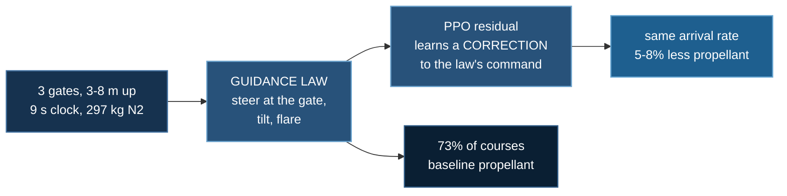

# Fly on Mars

**Baseline:** a hand-written guidance law — steer at the next gate on a velocity
setpoint, tilt to translate, then flare — flying the same held-out courses from
the same seeds. 73% on Mars.
**Budget:** 4M steps per arm, best checkpoint, `dense` rig, 3 gates on 4–8 m
legs, 9 s clock. Two seeds on Mars, one on Earth. ~55 min per run on 20 CPU
cores. No GPU.
**Falsifier:** if the learner can only match the controller, the propellant it
spends should be unchanged too. On Mars it is not — 5 to 8% less, replicated —
and on Earth it is.

A two-tonne cold-gas car is launched from the surface and has to fly three
gates floating 3–8 m above the ground, in order, within 4 m of each, and then
put itself down on its wheels. Nine seconds of clock, 297 kg of nitrogen.

:::info In plain words
Three invisible hoops hang in the air above a Martian landscape. A car with gas
thrusters has to fly through all three in order and then land in one piece. We
taught a computer to fly it, and then asked whether the computer could beat a
controller a human engineer wrote by hand.
:::

## How this lab works

A three-gate course on Mars, flown twice: once by a guidance law a human
wrote, once by a policy that **corrects** that guidance law rather than
replacing it.



The policy does not fly better — arrival rates are a coin toss between them,
p = 0.65. What replicates across seeds is the **propellant**: the learner
finds 5–8% of slack the hand-written law leaves on the table. Starting from
a working controller rather than from nothing is what makes a 9-second
course learnable at all.

## Result

:::info In plain words
It works, and it is thrifty rather than faster. The trained car flies all three
hoops and lands about as reliably as the hand-built controller — the two are
too close to call — but it does the same job on noticeably less fuel. Flying
the course is the achievement; saving the fuel is the measured win.
:::

**PPO flies the three-gate course and lands, on 5 to 8% less propellant than
the hand-written guidance law at the same completion rate.** Both arms fly the
same 96 held-out courses from the same seeds, so the comparison is paired.

| Mars, 96 paired courses | completion | McNemar | propellant¹ | Wilcoxon |
|---|---|---|---|---|
| **residual PPO, seed 0** | **77%** (74/96) | p = 0.60 | **131.0 kg** | **p = 0.0024** |
| **residual PPO, seed 1** | **76%** (73/96) | p = 0.65 | **134.7 kg** | **p = 0.0078** |
| scheduled guidance | 73% (70/96) | — | 143.0 / 141.8 kg | — |

¹ measured only on the courses **both** arms completed (56 and 62 of 96).

Read that honestly: **the completion difference is not significant.** Seed 0
flew 18 courses the controller missed and missed 14 the controller flew; that
is a coin toss. What replicates is the propellant — 8% and 5% on two
independent seeds, at p = 0.002 and p = 0.008.

Gates flown: **2.99 of 3**, both seeds. The course itself is not in doubt; only
the landing afterwards ever fails.

### Why the propellant comparison excludes failures

Averaging gas over every episode is a trap. A controller that crashes two
seconds in spends almost nothing, so failing more often would look like
efficiency. The figures above use only courses both arms completed, and compare
them pair by pair with a signed-rank test.

### Film: the course, flown

**[▶ Watch two complete courses (19 MB GIF)](/deepspeed-course/img/aerial/mars-course-reel.gif)**

Two consecutive flights by the trained policy on held-out courses. The gates
are the rings of markers: blue ahead, yellow for the one being flown, green
once flown. Bottom-left is a plan view of the whole course with the car's
ground track; the top strip reads the phase and the distance left to the next
gate. These two take 6.71 s and 6.55 s, on 131 kg and 154 kg of a 297 kg tank.

## Earth, the control

:::info In plain words
We ran the same experiment with Earth gravity. There the learned controller was
no better and no worse than the hand-built one, and saved no fuel at all. The
car has so little spare thrust on Earth that there is nothing left to
economise.
:::

| Earth, 96 paired courses | completion | propellant¹ |
|---|---|---|
| residual PPO | 76% (73/96) | 246.5 kg |
| scheduled guidance | 79% (76/96) | 248.6 kg |
| | p = 0.65 | p = 0.59, −1% |

Neither difference is significant. The learner found 8% of slack on Mars and
none on Earth, and the reason is visible in the tank: the Earth controller
already spends **249 kg of 297** flying this course, while the Mars controller
spends **143 kg**. There is simply less to give back.

Note also that Earth is *better* at this short course, not worse — 79% against
73%. Mars floats, and 25% of Mars episodes time out before touching down.
**Mars does not buy competence. It buys range**, which is the next section.

## Hardware check

Two numbers move between the worlds, and only one of them is gravity:

| | Earth | Mars | ratio |
|---|---|---|---|
| gravity | 9.81 m/s² | 3.72 m/s² | 0.38× |
| thrust, same hardware | 1.000 | **1.086** | 1.09× |
| lift-to-weight | 2.40 | **6.87** | **2.87×** |
| hover endurance, one tank | 6.9 s | **20.4 s** | 2.94× |

The vehicle weighs 62% less *and pushes 8.6% harder*, because a nozzle
expanding against 610 Pa of Martian atmosphere does more work than the same
nozzle against 101 kPa. The ratio that decides the task is lift-to-weight, and
it moves by more than gravity alone.

Where that matters is range. Holding the clock fixed and growing the course:

| legs | Mars gates | Mars gas | Earth gates | Earth gas |
|---|---|---|---|---|
| 7–11 m | 3.00 | 202 kg | 3.00 | 288 kg |
| 11–15 m | 3.00 | 243 kg | 2.96 | 294 kg |
| 15–19 m | **3.00** | 250 kg | **2.38** | 295 kg |
| 19–23 m | **3.00** | 248 kg | **2.00** | 296 kg |

**Earth is tank-limited and Mars is clock-limited.** Earth's gas pins at the
tank at every length and its gates fall away; Mars flies the whole course every
time with reserve.

## From scratch, the course never gets flown

:::info In plain words
Before giving the computer a head start, we tried teaching it from nothing. It
never learned to fly more than about one hoop out of three, no matter how long
we trained. This is the honest limit of the method, and it is why the final
version starts from the hand-built controller instead.
:::


*Gates flown per episode. The residual arm sits at 3.00 from the first
iteration because it starts as the guidance law. The from-scratch arm climbs to
about 1.1 and stops.*

End-to-end RL — the policy commanding the hardware directly, as in labs 1 to 3
— **plateaus at 1.14 of 3 gates**. That figure survived:

- **7.4M steps.** The last ten evaluation windows averaged 1.14 gates; thirty
  windows earlier, 1.12. Flat, not slowly rising.
- **two action spaces.** Twenty raw valve commands, and a 6-vector body wrench
  with a convex solver doing the allocation.
- **four reward designs**, each of which fixed something genuinely broken.

**[▶ Watch the from-scratch policy (13 MB GIF)](/deepspeed-course/img/aerial/mars-scratch.gif)**

*The same vehicle under the best from-scratch policy. It reaches the first gate
and loses the course. Both filmed flights crash.*

Chaining three waypoints is a materially larger exploration problem than
arresting a tumble or coming down on a mark, and this budget does not solve it.
That is reported rather than hidden, and `--action valves` and `--action
wrench` reproduce it.

## The residual

:::info In plain words
Instead of learning to fly from nothing, the computer starts as the hand-built
controller and learns a correction to it. At its default output the correction
is exactly zero, so on its first attempt it flies exactly as well as the
engineer's version — and everything it learns after that is an improvement on
something that already worked.
:::

The policy commands a 6-vector that is **added** to the guidance law's wrench:

- at action 0.5 on every axis the residual is exactly zero, so **episode one is
  the scheduled controller**. Any gain is a gain over a real baseline.
- the residual is capped at **0.4×** the full command range. A residual free to
  cancel the base wrench would be the from-scratch problem in disguise.
- the guidance law has **one definition**, `base_wrench()` in the environment,
  used by the controller, the residual and the tests. A second copy would mean
  the baseline and the residual's starting point were different controllers.


*Course completion during training. Both Mars arms rise above the dashed
baseline; the Earth arm declines.*

### Best checkpoint, not last

Both Mars runs peaked near **90% around 1.2–1.9M steps** and drifted back to
**77%** by 4M. Scoring the final weights measured a policy that had already
degraded, and the first version of this lab reported *no improvement at all*
because of it. The trainer now keeps the best checkpoint by in-training
completion rate; selection uses the training window only, and the published
number is still a fresh run on held-out seeds.

The Earth arm drifts much harder — 74% down to 31% — which is why the Earth
figure above is also a best checkpoint rather than a final one.

## Problem setup

:::info In plain words
Below is exactly what the car may do, what it cannot do, and what counts as
winning. Reinforcement learning needs all three stated precisely, or it will
find a way to win that you did not mean — which happened repeatedly here.
:::

**Goal.** Pass within 4 m of three gates in order, then arrive on the wheels
under 2.5 m/s sink, 25° of tilt and 1.2 rad/s of spin. Gates without a landing
do not count as flying the course, and a landing without the gates does not
either.

| degrees of freedom | |
|---|---|
| vehicle | 6 — three position, three attitude |
| wheels | 4 spins |
| commanded | a 6-vector residual wrench at 100 Hz (or 20 valves directly) |

| constraints | |
|---|---|
| propellant | 297 kg; thrust fades as the tank cools |
| nozzles | push only, never pull |
| actuation lag | 25 ms valve time constant, 10 ms transport delay |
| clock | 9 s |
| termination | anything but a wheel touching the ground ends the episode |

**Observation.** 46 numbers: attitude as two rotation-matrix columns,
uprightness, body rates, velocity, altitude and lowest-corner clearance, the
next gate *and the one after it* in body frame, gates remaining, propellant
fraction and thrust availability, time remaining, and the realised valve state.

The gate index is in there deliberately. Without it the task is not Markov —
the same position means different things depending on how much course is left.

### The reward function, in full

:::info In plain words
The scoring rule in maths. In one paragraph: every moment costs a small fixed
amount, so dithering is never free; crossing a hoop pays a large bonus
immediately; and at the end there is one big number that depends on whether the
car finished the course and how neatly it landed. Crashing is the worst
possible outcome — worse than running out of time.
:::

**Per step.** At each of the 900 control steps,

$$
r_t = r^{\text{time}} + r^{\text{spin}} + r^{\text{gas}} + F_t + G_t
$$

$$
r^{\text{time}} = -0.10, \qquad r^{\text{spin}} = -0.05\,\lVert\boldsymbol\omega_t\rVert^2\Delta t
$$

$$
r^{\text{gas}} = -0.004\sum_i u_{t,i}\,\Delta t, \qquad \Delta t = 0.01\ \text{s}
$$

**The gate bonus is paid at capture**, not at the end:

$$
G_t = 40 \cdot \bigl(k_{t+1} - k_t\bigr), \qquad k_t = \text{gates flown by step } t
$$

This was the single biggest reason the policy would not fly. Gate credit
started in the terminal, where a gate flown at step 150 was paid at step 900 —
discounted to 47% of its value, with 750 steps of unrelated reward in between
for the advantage estimator to spread it across. Since $k_t$ only increases and
each gate increments it once, the bonus is strictly one-off.

**Shaping.** $F_t = \gamma\,\Phi(s_{t+1}) - \Phi(s_t)$ with $\gamma = 0.999$,
and $\Phi$ switches when the course is finished because the job does:

$$
\Phi_{\text{cruise}} = 6k + 5\max\!\left(0,\ 1 - \tfrac{d}{25}\right)
  + \tfrac{1}{2}\left(\hat{\mathbf z}\cdot\hat{\mathbf u} + 1\right)
$$

$$
\Phi_{\text{landing}} = 6k + 5\max\!\left(0,\ 1 - \tfrac{m}{25}\right)
  + 3\left(1 - \tfrac{\min(h,10)}{10}\right)
  + \tfrac{1}{2}\left(\hat{\mathbf z}\cdot\hat{\mathbf u} + 1\right)
$$

where $d$ is the distance to the next gate, $m$ the horizontal miss from the
landing point and $h$ the height above ground. The first version kept pointing
at the last gate — which sits metres *above* the ground — so after flying the
course nothing pulled the car down. It hovered beside the gate at 75% timeouts.

$\Phi_{\max} = 27$, so the $(1-\gamma)\Phi$ toll is about **24 per episode**
against a course worth about **190**.

**Terminal.**

$$
R_T =
\begin{cases}
50 + 10\left(1 - \tfrac{\min(m,12)}{12}\right) + 10\left(1 - \tfrac{\theta}{25}\right)
  & \text{all gates, landed gently} \\[4pt]
-5 & \text{landed gently, course unfinished} \\[4pt]
-25 & \text{landed, not gently} \\[4pt]
-90 & \text{never landed} \\[4pt]
-120 - 4\min(v_\downarrow, 8) & \text{crash}
\end{cases}
$$

:::info In plain words
Notice that crashing scores worse than running out of time. That is the
opposite of the previous lab, and the reversal was forced by measurement: with
a per-step cost and a cheap crash one dive away, a car that could not yet fly
the course learned to end the episode early instead. Crashes hit 98%. Making
destruction the bottom of the ladder turns the cheapest available improvement
into "stop crashing" rather than "crash sooner".
:::

## Limitations

- **The completion difference is not significant** (p = 0.60 and 0.65). The
  claim is a propellant claim, not a reliability claim.
- **Nothing here is at convergence**, and the arms are scored at a best
  checkpoint rather than a final one. Both facts are stated because both change
  what the numbers mean.
- **One Earth seed** against two on Mars.
- **The from-scratch plateau is an upper bound on this budget**, not a proof
  that the task is unlearnable end to end.
- **The course was sized to the vehicle**, measured rather than guessed: at the
  original 12–18 m legs the scheduled controller finished the tank and timed
  out at 1.94 gates. Published numbers describe 4–8 m legs on a 9 s clock.
- **`ds_config.json` is absent deliberately**, as in labs 1 to 3: there is no
  `deepspeed.initialize` call because a ~15k-parameter MLP has nothing for ZeRO
  to shard.

## Running it

```bash
cd 08_aerial_physics/04_fly_on_mars
uv sync

# free checks, cheapest first
uv run flight_env.py --budget      # can the tank afford the course?
uv run thrusters.py --all          # what the rig can and cannot do
uv run verify.py                   # conservation residuals
uv run train_flight.py --dry-run   # 40 s, assembles

# the guidance law, on each world
uv run classical.py --world mars --episodes 96
uv run classical.py --world earth --episodes 96

# the residual arm (~55 min on 20 cores)
uv run train_flight.py --world mars --name mars_res_s0 --total-steps 4000000

# the paired head-to-head, which is where the published numbers come from
uv run compare.py runs/mars_res_s0 --world mars --episodes 96

# reproduce the from-scratch negative
uv run train_flight.py --world mars --action wrench --total-steps 4000000

# everything
bash run_arms.sh
```

No `deepspeed` launcher and no GPU, both deliberate and both measured. The
policy is ~15k parameters; topic 7 measured a policy this size running 1.7×
*slower* on a GPU because the rollout batch never fills a card. This lab wants
**cores**.

### Environment & local testing

Python ≥ 3.10, with `numpy`, `mujoco`, `scipy`, `pillow` and `torch==2.11.0`.
No model downloads, no dataset, ~39 packages, CPU only. CoolProp appears only
under the optional `tables` extra and is build-time only — the nitrogen
property tables are committed as `n2_tables.npz`.

```bash
uv run tests/test_fly_on_mars.py       # 33 property checks, from the repo root
```

### Renting a box (RunPod)

```bash
uv run runpod/runpod_ctl.py run 08_aerial_physics/04_fly_on_mars \
    --dry-run --collect --wait --terminate --yes
uv run runpod/runpod_ctl.py pods          # confirm nothing is left running
```

`--terminate` is driven from your machine in a `finally`, so the pod shuts
itself down even if the run dies. Always confirm with `pods` afterwards: a pod
that outlives its job bills until someone notices.

## What transfers

- **Pay credit where the behaviour happens.** Moving the gate bonus from the
  terminal to the moment of capture mattered more than any other single change.
  A discount factor and a 900-step episode will bury a delayed reward.
- **Compare paired when the arms share an environment.** Two independent
  binomial intervals could not separate these controllers; the paired test on
  the same courses found a significant propellant difference the unpaired view
  missed entirely.
- **Exclude failures from efficiency metrics.** Crashing early is cheap. Any
  "uses less fuel" claim has to be restricted to the runs that succeeded.
- **Keep the best checkpoint.** A policy that peaks at 90% and is scored at 77%
  reports no improvement when it learned a large one.
- **When exploration is the wall, give the learner a floor.** Residual RL on a
  working controller turned an unlearnable task into a measurable improvement,
  and the from-scratch curve is still worth publishing beside it.
- **The world reaches more than you think.** Three separate defects here were a
  world that failed to reach one derived constant: the hover bias, the rig
  audit, and the training log's header.
