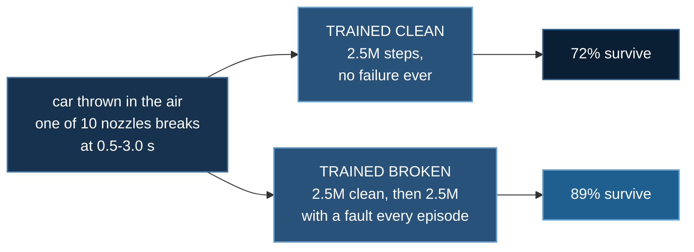

# Thruster Failure

**Baseline:** a PPO policy trained on the identical task with no failures in
it, scored on the same broken-thruster landings. 72% across two seeds.
**Budget:** 2.5M steps to learn the clean landing, then 2.5M warm-started with
a failure in every episode. `reveal` rig, Earth, two seeds, best checkpoint.
~35 min per run on 20 CPU cores. No GPU.
**Falsifier:** if a cheap static authority check told you which failures are
survivable, the policy's landing rate should split on it. It does not split
at all — see *The geometry does not predict the flight*.

A two-tonne cold-gas car is thrown into the air tumbling. It has six seconds
and 297 kg of nitrogen to arrive on its wheels. Somewhere between 0.5 s and
3.0 s, one of its ten nozzles breaks.

:::info In plain words
A car with gas thrusters is thrown into the air and has to land itself. Part
way down, one of the thrusters breaks — either it stops working, or it jams
fully on and cannot be switched off. We trained a computer to fly it, and
asked whether practising with broken thrusters actually helps.
:::

## How this lab works

Two policies on the identical broken-thruster task. One practised with
failures; one never saw a failure until the day it was scored.



A nozzle either goes dead or **jams fully on and cannot be shut off**, which
is the harder case. Both arms are scored on the same failures. Practice is
worth 17 points — and a cheap static check of whether the remaining nozzles
*could* hold the car up does **not** predict which flights survive, which is
the lab's second and less comfortable finding.

## Result

:::info In plain words
It works, and practice matters a lot. A controller that trained with broken
thrusters lands 89 times out of 100. An identical controller that never saw a
breakage — but is just as good at normal landings — manages 72. It also lands
faster and on a quarter of the fuel.
:::

**PPO trained with in-flight failures lands 89% of broken-thruster descents,
against 72% for a policy that never saw one.** Both arms are scored on the
same 128 held-out launches, and the failure is drawn from the seed, so the two
policies meet exactly the same breakages on exactly the same throws.

| arm | landed | 95% CI | propellant |
|---|---|---|---|
| **robust** (pooled, 2 seeds) | **89%** (227/256) | [0.84, 0.92] | **21 kg** |
| healthy (pooled, 2 seeds) | 72% (185/256) | [0.66, 0.77] | 37–73 kg |

Paired, seed by seed, on identical failures:

| pairing | only robust lands | only healthy lands | McNemar |
|---|---|---|---|
| seed 0 | **42** | 10 | **p = 9.1 × 10⁻⁶** |
| seed 1 | **15** | 5 | **p = 0.041** |

Both seeds significant, same direction. The per-seed spread is wide on the
healthy arm — 59% and 85% — which is why the pooled figure and the paired test
are both reported rather than one flattering seed.

### Film: the same failure, twice

**[▶ Robust policy — three failures, three landings (15 MB)](/deepspeed-course/img/aerial/fail-robust.gif)**

**[▶ Healthy policy — the same three failures, three crashes (21 MB)](/deepspeed-course/img/aerial/fail-healthy.gif)**

Identical seeds, identical breakages. In the HUD: the fault panel names the
nozzle, the mode and the second it broke; the nozzle strip draws the broken
one in red at what it is *actually* doing rather than what was commanded; and
the attitude ball shows tilt against the 25° landing gate. Watch nozzle 9 latch
open at 0.72 s and the healthy policy go past 50° of tilt while still
commanding a normal descent.


*Both robust seeds, landing rate during training. The healthy arm is
deliberately **not** plotted here: it trains without failures, so its training
curve describes an easier task and putting the two side by side would imply a
closeness that the held-out numbers contradict.*

## It is faster and cheaper, not just luckier

The robust policy uses **a quarter of the propellant** and arrives *more*
gently. That is not an artifact of failing earlier — failing early would
spend less fuel while landing less often, and this lands more often.

| | healthy | robust |
|---|---|---|
| landed (48 episodes) | 27 | **40** |
| time to touchdown | 1.93 s | **1.23 s** |
| mean valve-sum per step | 2.58 | **1.60** |
| propellant | 80.3 kg | **17.9 kg** |

Two measured factors: it finishes sooner, and it commands less valve opening
while doing it. The healthy policy spends its tank fighting a fault it does
not know it has.

## The geometry does not predict the flight

:::info In plain words
Before training anything, you can ask a cheap question with no simulation at
all: with this thruster broken, can the vehicle still hold itself in the air?
It takes milliseconds. We expected it to tell us which failures were
survivable. It tells us nothing useful — the "impossible" ones land about as
often as the possible ones.
:::

`fault.py` answers a question about shape. Lab 1 established that nozzles push
and never pull, so the achievable wrench set is a convex **polytope** rather
than a subspace. A failure shrinks it. Asking whether a hover is still inside
that polytope is a linear program that runs in milliseconds, before any
training. On `reveal` it says 4 of 10 stuck-shut failures and 6 of 10
stuck-open failures are infeasible.

Split the held-out landings on that prediction:

| arm | shut, feasible | shut, **infeasible** | open, feasible | open, **infeasible** |
|---|---|---|---|---|
| healthy | 65% | **73%** | 50% | 51% |
| robust, seed 0 | 86% | 82% | 86% | 83% |
| robust, seed 1 | 95% | 91% | 96% | 89% |

**The split carries no information.** The infeasible group lands about as often
as the feasible one in every arm and both modes, and on the healthy arm's
stuck-shut cases it lands *more* often.

The reason is that the cheap test asks the wrong question. **Landing is not
hovering.** Hover feasibility asks whether the vehicle can hold station
indefinitely; a lander never needs to. It can spend its remaining authority on
the way down and arrive inside the gate having never been able to stop.

A second, graded test fails the same way for the same reason. `max_lift()`
computes the largest torque-free upward force still available:

| nozzle | broken how | torque-free lift | hover feasible |
|---|---|---|---|
| 0, 2, 4, 6 | stuck shut | **0.00×** weight | no |
| 1, 3, 5, 7 | stuck shut | 2.40× | yes |
| 8, 9 | stuck open | **0.00×** | no |

Losing any **one of the four corner lift nozzles destroys torque-free lift
entirely** — three corner thrusters all pushing up cannot balance roll *and*
pitch except by all going to zero. And the vehicle still lands 82–91% of those
cases, because it does not need torque-*free* lift: it trims with the other
nozzles and accepts transient spin.

So the lab's finding is a negative one about desk-checking, and it is the
argument for the RL: **you cannot tell whether a vehicle survives a failure by
computing its static authority. You have to fly it.**

## Stuck open is worse than stuck shut, and not by a little

Both the geometry and the flight agree on this, which is worth noting because
they disagree on everything else.

| rig | n | world | stuck **shut** infeasible | stuck **open** infeasible |
|---|---|---|---|---|
| minimal | 6 | both | 4/6 | **6/6** |
| sixlift | 8 | earth | 4/8 | 6/8 |
| sixlift | 8 | **mars** | **0/8** | **8/8** |
| reveal | 10 | both | 4/10 | 6/10 |
| fore10 | 12 | both | 0/12 | 0/12 |
| dense | 20 | both | 0/20 | 0/20 |

A dead nozzle costs authority. A latched one costs authority, **adds a force
and torque nobody asked for, and drains the tank** until it is dry. The drain
is unconditional: commanding every valve shut, a latched nozzle still spends
11.7 kg in 0.6 s while a dead one spends nothing.

The rotational signature is real but milder than a single example suggests.
Averaged over all ten nozzles on one launch, a latched nozzle leaves the
vehicle at **2.90 rad/s** against **2.19** for a dead one — 1.32x, not the 4.6x
the first draw happened to show. For four of the ten it is the *dead* nozzle
that spins the car more. The first version of this section quoted that single
draw.

**`sixlift` on Mars is the case worth remembering.** It survives losing *any*
one of its eight nozzles — 0 of 8 infeasible — and is killed by *any* one of
them sticking on, 8 of 8. **Redundancy is not symmetric.** A design review that
asked only "what if one fails?" would have passed that vehicle.

## Telling the policy what broke is worth nothing

:::info In plain words
We also tried giving the computer a perfect fault alarm — a readout naming
exactly which thruster broke and how, the instant it happened. It did not help.
The controller had already worked it out from how the vehicle was moving.
:::

A third arm gets the fault in its observation: a one-hot over the nozzles plus
a sign for the mode, exact and instant. Scored on the same 128 failures as
`robust_s0`:

| arm | landed | paired McNemar |
|---|---|---|
| robust (told nothing) | 84% (108/128) | — |
| told (perfect fault detector) | 79% (101/128) | p = 0.31 |

Not significant, and pointing the wrong way. The policy infers the fault from
the dynamics well enough that a perfect detector adds nothing — which is worth
knowing before anyone funds one.

## Problem setup

:::info In plain words
Below is exactly what the car may do, what it cannot do, and what counts as
winning. Reinforcement learning needs all three stated precisely or it will
find a way to win that you did not mean — which happened twice here.
:::

**Goal.** Arrive on the wheels under 2.5 m/s sink, 25° of tilt and 1.2 rad/s of
spin, within six seconds of a tumbling launch, with one nozzle broken.

| degrees of freedom | |
|---|---|
| vehicle | 6 — three position, three attitude |
| wheels | 4 spins |
| commanded | 10 valve openings in [0, 1] at 100 Hz |

| constraints | |
|---|---|
| propellant | 297 kg; thrust fades as the tank cools |
| nozzles | push only, never pull |
| actuation lag | 25 ms valve time constant, 10 ms transport delay |
| clock | 6 s |
| failure | one nozzle, `shut` or `open`, at a uniform time in [0.5, 3.0] s |
| termination | anything but a wheel touching the ground ends the episode |

**Observation.** 41 numbers: attitude as two rotation-matrix columns,
uprightness, body rates, velocity, altitude and lowest-corner clearance, ground
slope, propellant fraction and thrust availability, time remaining, the
previous action, and a fault channel that is **zero unless `--tell`**.

**The fault is applied to the realised control, not the command.** It never
touches `u_act`, which is what the policy asked for and what the observation
reports. The gap between the two *is* the fault, and the vehicle has to notice
it from the dynamics — as a real one would.

**Propellant follows the realised opening too.** A latched nozzle keeps
spending whether or not the policy asks it to. Billing the command would have
hidden half of why stuck-open is worse.

### The reward function, in full

:::info In plain words
The scoring rule in maths. In one paragraph: every moment airborne costs a
small fixed amount, so hovering is never free; there is a running "how well is
this going" score that pays only its *improvement*; and at the end one large
number depending on whether it landed and how neatly. Running out of time is
the worst possible outcome — worse than crashing — and the next box explains
why that is not a typo.
:::

**Per step.** At each of the 600 control steps,

$$
r_t = r^{\text{time}} + r^{\text{spin}} + r^{\text{gas}} + F_t
$$

$$
r^{\text{time}} = -0.10, \qquad
r^{\text{spin}} = -0.05\,\lVert\boldsymbol\omega_t\rVert^2 \Delta t
$$

$$
r^{\text{gas}} = -0.004 \sum_{i=1}^{10} u_{t,i}\,\Delta t,
\qquad \Delta t = 0.01\ \text{s}
$$

**Shaping.** $F_t = \gamma\,\Phi(s_{t+1}) - \Phi(s_t)$ with $\gamma = 0.999$:

$$
\Phi(s) = 3\left(1 - \tfrac{\min(h,\,8)}{8}\right)
        + \left(\hat{\mathbf z}\cdot\hat{\mathbf u} + 1\right)
$$

where $h$ is height above ground and
$\hat{\mathbf z}\cdot\hat{\mathbf u}$ the cosine between the car's up-axis and
the world vertical. $\Phi_{\max} = 5$, so the $(1-\gamma)\Phi$ toll is about
**3 per episode** against a landing worth about 80.

Lab 1 used $\Phi = -2.5\min(h,8) + 3(\hat{\mathbf z}\cdot\hat{\mathbf u})$ and
a $+2\,(\hat{\mathbf z}\cdot\hat{\mathbf u})\,\Delta t$ uprightness bonus. That
bonus is worth $+62$ over six seconds for hovering neatly, and lab 1 spent most
of training collecting it. Both are gone.

**Terminal.**

$$
R_T =
\begin{cases}
60 + 10\left(1 - \tfrac{v_\downarrow}{2.5}\right)
   + 10\left(1 - \tfrac{\theta}{25}\right) & \text{landed gently} \\[4pt]
-25 & \text{landed, not gently} \\[4pt]
-60 - 4\min(v_\downarrow,\,8) & \text{crash} \\[4pt]
-130 & \text{never landed}
\end{cases}
$$

:::info In plain words
Crashing is scored by how fast it hit, not as one flat number. That matters
most on the failures nothing could save: when landing is impossible, arriving
slowly is the only improvement left, and a flat penalty would make the
computer indifferent between a gentle bump and a write-off.
:::

### Why running out of time is the worst outcome

Lab 4 put the **crash** at the bottom of its ladder, on the honest argument
that destroying the vehicle is worse than running out of clock. Ported here
unchanged, that taught the policy never to try: across a full 4M-step run,
crashes fell 97% → 3% while timeouts rose 3% → 97%, and landings never exceeded
1%.

The two tasks differ in **what inaction reaches**. On lab 4's gate course,
doing nothing earns no gates, and the gate bonus pulls the policy out of a
hover. In a pure landing task, doing nothing *is* a hover, and the only route
to a landing runs through the risk of a crash.

So the rule is neither "crash worst" nor "timeout worst":

> **The outcome reachable by doing nothing must be the worst one available**,
> or a policy that cannot yet do the task will do nothing instead.

That one line reconciles labs 3, 4 and 5, which had each picked a different
answer for reasons that looked sound locally.

## The curriculum is not optional

Trained from scratch with a failure in every episode, the policy never learned
to land at all — **0.8% landings at 1.35M steps**. On `reveal`, about half of
all (nozzle, mode) draws leave no hover reachable, so half the training signal
came from episodes nothing could save and the base skill never formed.

Learn to land, then break the vehicle. The robust arm warm-starts from the
healthy one, which is also the control.

## Limitations

- **The healthy arm's seeds spread widely** — 59% and 85%. Two seeds is enough
  to see that and not enough to characterise it. Both the pooled figure and the
  per-seed paired tests are reported for that reason.
- **One rig, one world, one failure at a time.** `fault.py` can price
  simultaneous failures and other rigs; nothing was trained on them.
- **The fault is instantaneous and permanent.** Real valves degrade, chatter
  and sometimes recover.
- **The `--tell` arm is one seed**, so "a perfect fault detector is worth
  nothing" is a single measurement, not a replicated one.
- **`ds_config.json` is absent deliberately**, as in labs 1 to 4: a
  ~14k-parameter MLP has nothing for ZeRO to shard.

## Running it

```bash
cd 08_aerial_physics/05_thruster_failure
uv sync

# free checks, cheapest first
uv run fault.py                    # which failures are survivable, by geometry
uv run fault.py --simultaneous     # how many at once can `dense` take?
uv run thrusters.py --all          # what the rig can and cannot do
uv run verify.py                   # conservation residuals
uv run train_fail.py --dry-run     # 40 s, assembles

# the control: learn to land, no failures (~35 min on 20 cores)
uv run train_fail.py --fail-p 0.0 --name healthy_s0 --total-steps 2500000

# the robust arm, warm-started from it
uv run train_fail.py --fail-p 1.0 --name robust_s0 \
    --init-from runs/healthy_s0 --total-steps 2500000 --eval-episodes 128

# did the geometry predict the flight?
uv run analyze.py runs/healthy_s0 runs/robust_s0

# everything
bash run_arms.sh
```

No `deepspeed` launcher and no GPU, both deliberate and both measured. The
policy is ~14k parameters; topic 7 measured a policy this size running 1.7×
*slower* on a GPU because the rollout batch never fills a card. This lab wants
**cores**.

### Environment & local testing

Python ≥ 3.10, with `numpy`, `mujoco`, `scipy`, `pillow` and `torch==2.11.0`.
No model downloads, no dataset, ~39 packages, CPU only. CoolProp appears only
under the optional `tables` extra and is build-time only — the nitrogen
property tables are committed as `n2_tables.npz`.

```bash
uv run tests/test_thruster_failure.py    # property checks, from the repo root
```

### Renting a box (RunPod)

```bash
uv run runpod/runpod_ctl.py run 08_aerial_physics/05_thruster_failure \
    --dry-run --collect --wait --terminate --yes
uv run runpod/runpod_ctl.py pods          # confirm nothing is left running
```

`--terminate` is driven from your machine in a `finally`, so the pod shuts
itself down even if the run dies. Always confirm with `pods` afterwards.

## What transfers

- **The worst terminal must be the one inaction reaches.** Not "crash worst",
  not "timeout worst" — it depends on what a policy that cannot yet do the task
  can get by doing nothing.
- **A cheap static feasibility check can carry no information at all.** Two
  different ones here — hover feasibility and torque-free lift — both failed to
  predict landing, because both answer a question the task does not ask.
- **Train on the perturbation you will face.** Not a new idea; the size is the
  news. 72% → 89% on identical failures, from the same base policy.
- **Robustness can be cheaper, not just safer.** The robust arm landed more
  often, sooner, and on a quarter of the propellant.
- **Price the sensor before you build it.** A perfect, instant fault detector
  was worth nothing here, because the dynamics already carried the signal.
