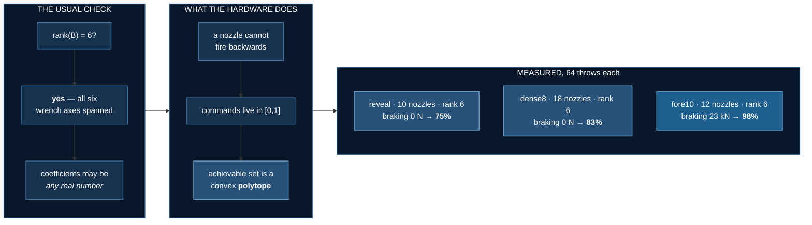

# Aerial Stabilization

<!--chain-->
:::info **Lab 1 of 1** in Aerial Physics — a new topic. Topic 7 ended with the
machine as the constraint; this one changes the machine to one that leaves
the ground, where the budget is propellant rather than time.
← previous topic: [Physical AI](../physical/overview)
:::

**Baseline:** a classical PD attitude controller with a thrust allocator —
no learning — scored on the same held-out throws.
**Budget:** 4M environment steps, 16-process pool, seed 0, RK4 at 2 ms,
~55 minutes on 20 CPU cores. No GPU.
**Falsifier:** if thruster COUNT is what matters, clean-landing rate is
monotone in nozzle count. *It looked monotone, and then it wasn't* — see
[What the rig sweep actually found](#what-the-rig-sweep-actually-found).

A 2-tonne car is thrown into the air tumbling. It has about three seconds
of flight, ten cold-gas nozzles, and a tank holding seven seconds of
hover. It has to arrive on its wheels.

## Where this comes from

Tesla revealed the Roadster on 15 October 2026 at SpaceX's McGregor site:
the car drove inverted along a ramp held by fan suction, then made a
thruster-powered hop with a mid-air rotation and landed on its wheels.
Reported: roughly **10 nozzles**, **~600 L** of compressed gas in
carbon-fibre overwrapped pressure vessels.

It was **one clip** — no repeatability, no sustained flight, no
independent measurement. Everything below except those three numbers is a
stated engineering assumption. This is a physics sandbox motivated by the
reveal, not a reconstruction of anyone's hardware.

## The physics comes first, and it has to be audited

`uv run verify.py` measures residuals against the equations the lab
claims to solve, and prints them rather than printing the word "passed":

| check | residual | scale | relative |
|---|---|---|---|
| control effectiveness matrix vs MuJoCo's applied wrench | 0.0014 N | 15.7 kN | 8.8e-08 |
| Newton, `M·a_com = F + M·g`, mass dropping | 0.85 N | 20.6 kN | 4.1e-05 |
| angular momentum about the system CoM, ballistic | 0.011 kg·m²/s | 3,271 | 3.3e-06 |
| energy, ballistic in vacuum | 0.0006 J | 8.1 MJ | 7.1e-11 |
| propellant, `Δm = ∫ G_t·A_t dt` | 2.3e-13 kg | 292 kg | 7.8e-16 |
| impulse, `Σ m·Δv = ∫ F dt` | 27 N·s | 77.6 kN·s | 3.4e-04 |
| tank pressure vs CoolProp over the blowdown | 0.022% | — | 2.2e-04 |

**Five defects were found this way, two of which had already been
published.** A learning curve cannot find any of them — it rises just as
happily against a broken simulator, and the policy exploits whatever you
built rather than whatever you meant.

### The tank holds 297 kg, not 244

The first version picked a compressibility of 1.95 by hand because it made
the arithmetic come out. CoolProp's reference equation of state disagrees:

| model | Z at 689 bar, 293 K | mass in 600 L |
|---|---|---|
| ideal gas | 1.000 | 475 kg |
| van der Waals | 1.463 | 325 kg |
| **a hand-picked Z** | **1.950** | **244 kg** ← shipped, wrong |
| **CoolProp (Span–Wagner)** | **1.602** | **297 kg** |

The ideal figure is denser than *liquid* nitrogen (807 kg/m³), which
should have been the tell. Tables are now generated from CoolProp and
committed; interpolation error over the operating envelope is 0.001% mean.

### Specific impulse is not a constant

The tank cools as it drains — the blowdown is isentropic — and a cold tank
holds less pressure. Effective exhaust velocity falls with it:

| gas left | tank | T | p_c | Isp | thrust |
|---|---|---|---|---|---|
| 297 kg | 689 bar | 293 K | 40 bar | 60.6 s | 100% |
| 178 kg | 193 bar | 228 K | 40 bar | 49.2 s | 101% |
| 89 kg | 67 bar | 184 K | 40 bar | 45.7 s | 103% |
| 53 kg | 38 bar | 168 K | 32.7 bar | 44.4 s | 82% |
| 15 kg | 11 bar | 153 K | 9.2 bar | 36.0 s | 18% |

Thrust *rises* to 103% mid-burn — colder gas is denser at the throat, so
mass flux gains more than vₑ loses while the regulator holds — and then
falls off a cliff when the regulator drops out. Total impulse integrated
along this path is **139 kN·s**; a constant-vₑ model claims 176, a **27%
overstatement**.

### "Expand to ambient" is impossible on Mars

It takes nitrogen below its 63.15 K triple point. The nozzle uses a real
area ratio with the `(pₑ − pₐ)·Aₑ` term, which also shows that Earth has an
*optimum* area ratio and Mars does not — and that the **same hardware gets
Isp 65.8 s on Mars against 60.6 s on Earth**, purely from ambient pressure.

### The simulation had the wrong centre of mass

The worst defect, and invisible from outside. Gas mass was written into
`body_mass` as it burned, but not into `body_subtreemass` — and MuJoCo
divides by that to obtain `subtree_com`, about which the entire
composite-rigid-body dynamics are expressed. Angular momentum drifted
**3.1e-02** in a ballistic tumble where it is exactly conserved. Fixed:
**3.5e-07**, a factor of 89,000. The policy had been training against a
vehicle that does not exist.

### RK4, which reverses topic 7

Measured on a 4 s tumble in vacuum with zero contacts:

| integrator | dH/H | dE/E | steps/s |
|---|---|---|---|
| Euler | 1.07e-02 | 8.74e-05 | 144,000 |
| implicitfast | 1.07e-02 | 8.74e-05 | 137,000 |
| implicit | 1.00e-02 | 1.09e-04 | 110,000 |
| **RK4** | **4.19e-07** | **1.84e-10** | 39,000 |

Topic 7 adopted `implicitfast` after measuring it 3.9× faster on a legged
robot — correctly, for a machine with feet on the ground every step. This
vehicle is *ballistic* for most of its episode, the energy-conserving case
RK4 is for. A 1% momentum drift per four seconds is not a rounding error
on a task whose entire content is arresting a tumble: the policy would
spend propellant cancelling the integrator. RK4 costs 4× end to end
(5,700 → 1,300 steps/s) and is worth it.

### An ideal cold-gas tank freezes its own propellant

At β = 0 — perfect insulation — the tank crosses the saturation dome below
about 60 kg remaining and nitrogen condenses inside it. The single-phase
tables do not describe that, so `gas.blowdown_T` **refuses** it rather than
interpolating across the dome and returning a plausible pressure. The
default β = 0.30 keeps 54 K of superheat margin.

## The result

96 held-out throws, rig `reveal`, Earth, rolling terrain:

| | clean landings | sink | tilt | gas used |
|---|---|---|---|---|
| classical PD + allocator | 75% | 0.17 m/s | 1.6° | 147 kg |
| **PPO, 4M steps** | **89%** [81, 94] | **0.01 m/s** | 1.2° | **36 kg** |

PPO beats the textbook controller and uses **a quarter of the propellant**.
On a vehicle with seven seconds of hover in the tank, that margin is the
whole game. The classical controller holds a commanded descent rate the
whole way down, which means firing continuously; the learned policy
coasts, then catches itself late.

Every frame is MuJoCo rendering the same state the policy acted on. The
arrows are real quantities at a stated scale — net thrust, weight, angular
momentum, velocity — and the panel reads tank pressure and temperature,
compressibility, superheat margin, chamber pressure, live Isp, nozzle exit
temperature against the freezing point, and thrust fraction.

## The plateau

| steps | crashes | landings | what it had learned |
|---|---|---|---|
| 60k | 97% | 0% | nothing |
| 370k | 33% | 0% | how to stop tumbling |
| 680k–1.3M | **0%** | **0%** | **how to never land** |
| 1.6M | 2% | 14% | that the ground is survivable |
| 4M | 0% | 89% | the task |

For 600k steps the policy sat at a *zero percent crash rate* and a zero
percent landing rate. It had discovered hovering — not a bug, but the
correct answer to a reward that paid for being upright and alive and
priced a timeout at −10 against a crash's −60.

Fixed by repricing the timeout to −40 and adding **potential-based**
shaping on altitude, Φ = −2.5·h + 3·cos θ. Ng, Harada & Russell's result
is that γΦ(s′) − Φ(s) leaves the optimal policy *provably unchanged* while
still indicating which way is down — the reason to use that shape rather
than a "descend!" bonus, which changes what optimal means and can be
collected by diving into the ground. A first attempt at weight 0.9 failed
differently: landings fell 1.0% → 0.0% over 550k steps while crashes fell
98% → 2%.

**The plateau reproduced exactly after the physics was corrected**, which
is what makes it a property of the reward rather than an artifact.

### What the reward is actually paying for

A reward is a list of terms with weights, and reading the weights tells you
almost nothing: a large coefficient on a quantity that barely moves
contributes nothing, and a small one on something that moves a lot
dominates. The only way to know is to integrate each term over episodes the
trained policy actually produces — `uv run evaluate.py runs/r_reveal
--reward-audit`:

| term | per episode | share |
|---|---|---|
| **terminal** (landed or crashed) | +56.67 | **74%** |
| **shaping** (altitude potential) | +17.59 | **23%** |
| upright | +2.35 | 3% |
| spin · alive · dive · gas | −0.15 combined | under 1% |

Three knobs moved across two redesigns, and they were not the same kind of
change. Pricing a timeout at −10 against a crash's −60 said *running out
the clock is six times better than touching the ground*, and paying 0.20
per step merely for existing said *delay is fine*. Those were wrong
statements of the goal, not missing guidance — the policy believing them is
the system working. Only the altitude term is shaping, and it is the safe
kind: potential-based, so it provably cannot change which policy is
optimal, only how findable it is.

:::tip The most useful number here is the zero
**The propellant penalty contributes 0.0% of the reward, and the policy
still flies on a quarter of the baseline's gas.** Efficiency was never paid
for. It fell out of "land soon and land softly" — the terminal bonus plus
the altitude potential. If you want frugal behaviour, you may not need a
frugality term; you may just need to stop paying for delay.
:::

## What the rig sweep actually found

Not what was predicted. The falsifier was written first: *if count is what
matters, the rate is monotone in nozzle count.* Read the first five rows
in count order — 66, 69, 75, 78, 100 — and it is monotone. The hypothesis
carried over from topic 7, "placement beats count", does not survive its
own test.

Then the controls arrived. `dense` was the only rig with **forward-firing**
nozzles, so its 20-nozzle count was confounded with a capability nothing
else had — two variables moved at once, which is the ablation failure
topic 7 wrote a rule about. `dense8` is dense *without* the fore pair;
`fore10` is reveal *with* one:

| rig | N | rank | braking / weight | landed | 95% CI |
|---|---|---|---|---|---|
| waisted | 6 | 5/6 | 0.00 | 16% | [9, 26] |
| minimal | 6 | 5/6 | 0.00 | 66% | [53, 76] |
| sixlift | 8 | 5/6 | 0.00 | 69% | [57, 79] |
| narrow | 10 | 6/6 | 0.00 | 67% | [55, 77] |
| reveal | 10 | 6/6 | 0.00 | 75% | [63, 84] |
| wide | 14 | 6/6 | 0.00 | 78% | [67, 86] |
| dense8 | 18 | 6/6 | 0.00 | 83% | [72, 90] |
| **fore10** | **12** | 6/6 | **1.16** | **98%** | [92, 100] |
| **dense** | 20 | 6/6 | **1.16** | **100%** | [94, 100] |

**Perfect separation, and count has nothing to do with it.** Every rig
that can brake lands ≥ 98%; every rig that cannot tops out at 83%. A
**12-nozzle rig beats an 18-nozzle one by 15 points**. The apparent
monotonicity was an artifact: the two rigs that happened to carry fore
nozzles sat at counts 12 and 20, and 20 was the largest in the table.

### Rank is the wrong test

`reveal` is **rank 6 and can produce exactly zero backward force.** Every
horizontal nozzle on it pushes the same way: it can accelerate and it
cannot brake. The throw hands the car up to 6 m/s of downrange velocity,
and it arrives still carrying it.

Rank asks whether the six wrench axes are spanned when coefficients may be
*any real number* — including the negative ones that mean firing a nozzle
backwards. A nozzle cannot do that. Commands are box-constrained to
[0, 1], so the achievable set is

$$
\{\, B u \;:\; 0 \le u \le 1 \,\}
$$

a convex **polytope**, not a subspace. Full rank is necessary and nowhere
near sufficient. This lab shipped `rank` as its headline hardware metric
and it was wrong; `thrusters.py` now reports the signed reach on every
axis and names the directions a rig cannot produce at all.

The other end of the table is the same lesson: `waisted` has the same six
nozzles as `minimal` and scores **16% against 66%**, because it has no
fore-aft lever arm and therefore no pitch torque in *either* direction.

## Better hardware, slower learning

The classical controller does no exploration, so it reads the hardware
directly: `fore10` beats `reveal` 98% to 75%. Give the same two rigs to
PPO at an identical budget, seed and configuration — one variable, the
rig — and the ordering **reverses**:

| | escapes the plateau | held-out | 95% CI | gas |
|---|---|---|---|---|
| `reveal` — 10 nozzles, cannot brake | **1.47M** steps | 89% | [81, 93] | **36 kg** |
| `fore10` — 12 nozzles, can brake | **3.75M** steps | 83% | [75, 89] | 235 kg |

Two extra nozzles cost **2.5× the steps** to escape the hover plateau.
`fore10` got out with 250k steps left and had not converged: it lands
almost as often and spends **six and a half times the propellant** doing
it, which on a seven-second tank is the difference between a margin and
none.

The intervals overlap, so the honest statement is not "`reveal` is better".
It is: **the better hardware bought no measurable learned performance at
this budget, and cost 2.5× the exploration.** A larger action space is a
larger space to search, and capability you cannot afford to find is not
capability yet.

:::warning One seed each
Both runs are a single seed. Topic 7's first lab exists to make the point
that one seed proves nothing, and plateau exit is exactly the kind of
event that varies between them. The *rig* finding above rests on the
classical sweep — a deterministic controller over 64 held-out throws per
rig with Wilson intervals — not on these two runs.
:::

An artefact worth knowing when reading the curve: the in-training trace
samples actions, so it carries exploration noise, while the held-out
evaluation uses the distribution mean. `fore10`'s training trace reads 0%
at 3.2M while its deterministic policy was already landing — the noise
was masking a policy that had learned.

## What is modelled

6-DOF rigid-body flight · real-gas tank blowdown from CoolProp tables,
isentropic with a wall-return blend · an isenthalpic regulator · a
real-gas converging-diverging nozzle whose throat is found as the maximum
of mass flux along the isentrope · flow separation at pₑ < 0.4 pₐ ·
saturation refusal · 25 ms valve lag and 10 ms transport delay · mass and
inertia that shrink as gas leaves (297 kg of 2047 is 15%, and roll inertia
moves more than mass because the tanks sit outboard) · wheel contact and
hull strikes · Earth or Mars, with gravity, air density and ambient
pressure travelling together.

**Not modelled, and said rather than hidden:** plume impingement on the
ground, boundary-layer and divergence losses beyond a flat 0.92 velocity
efficiency, tank wall heat transfer as anything but the β blend,
structural loads, suspension travel beyond MuJoCo's contact solver, and
two-phase flow anywhere.

## Why MuJoCo and not a web 3D engine

A renderer that is not the simulator can show a car doing something the
physics never did, and this course has paid for that once already. Every
frame here is MuJoCo drawing the same `MjData` the policy acted on. The
cosmetics went into the model — a 24-slice lofted hull, glass, wheels with
rims and brake discs, a bell at every nozzle — and the loft **carries no
mass**, which the suite pins at exactly 1750 kg after it once added 394 kg
nobody chose.

## What transfers

| | |
|---|---|
| **A learning curve cannot audit your physics** | it rises just as happily against a broken simulator |
| **Full rank is not reachability** | unidirectional actuators make a polytope, not a subspace; a rank-6 rig could not brake |
| **An ablation is only an ablation if one thing moved** | `dense` confounded 20 nozzles with a thrust direction nothing else had |
| **Report residuals, not verdicts** | a tolerance nobody can see is a tolerance nobody checked |
| **The ideal gas law fails where the pressure is interesting** | it claimed a tank denser than liquid nitrogen |
| **Derived state must be maintained, not just set** | `body_mass` without `body_subtreemass` simulates a different vehicle |
| **A reward with no cost for stalling will be stalled** | 600k steps at a 0% crash rate and a 0% landing rate |
| **Capability you cannot afford to explore is not capability** | the better rig took 2.5x the steps to leave the plateau and finished no better |
| **The right integrator is a property of the system, not a preference** | the same measurement reversed topic 7's answer |

## Where this goes next

Three things carry forward. The audit: every number above sits downstream
of an integrator, and `verify.py` found five defects no learning curve
could have — including a simulation whose centre of mass was wrong for an
entire round of training.

The reachability result, which generalises past thrusters. Any actuator
that only pushes one way — a tendon, a jet, a unidirectional clutch, a
muscle — makes the achievable set a polytope rather than a subspace, and
the usual linear-algebra health check cannot see the difference.

And the gap between the two rankings. The hardware the classical
controller prefers is not the hardware the learner does best with, at a
fixed budget. Capability enlarges the search space that has to find it.
