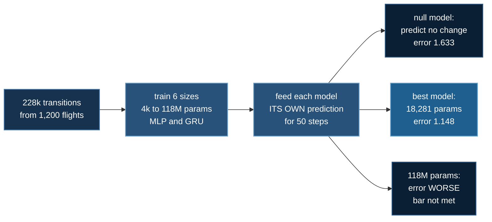

# Learned Dynamics

<!--chain-->
:::info **Lab 6 of 7** in Aerial Physics. Labs 1 to 5 taught a computer to fly
the car; this one asks whether a computer can learn to predict it — and
whether that model is ever big enough to need sharding.
← previous: [Thruster Failure](./thruster-failure)  ·  next: [Teacher and Student](./teacher-student) →
:::

:::info Reading this without a background in machine learning
Every section opens with a plain words box like this one. Read only those and
you get the whole story; the technical detail underneath is there if you want
it.

**The one line version:** we trained models from four thousand to a hundred
and eighteen million parameters to predict the car's physics. The best one has
eighteen thousand. Bigger did not help, so the big-model machinery this course
is named after has nothing to do here — now measured rather than assumed.
:::

**Baseline:** the null model — predict that nothing changes. 0.2185 at one
step, 1.633 over fifty.
**Budget:** 228k transitions over 1,200 episodes, 8 epochs, batch 256, six
model sizes from 4k to 118M parameters, both an MLP and a GRU, on one RTX
3080 Ti. Learning rate re-swept at 3e-4 and 1e-4 for the top rungs.
**Falsifier, written down before the measurement:** a model 1000× larger must
cut 50-step error by at least half, or the sharding machinery is not earning
its place in this topic.

Labs 1 to 5 all train a ~14k-parameter policy, and all five say the same
thing: there is nothing for ZeRO to shard. That is true of the *policy*. This
lab builds the one model in topic 8 big enough to make the question real — a
dynamics model that has to reproduce real-gas blowdown, valve lag, contact and
terrain — and measures the answer instead of asserting it.

:::info In plain words
The last five labs taught a computer to *fly* the car. This one asks whether a
computer can learn to *predict* it — to run the physics in its head. And since
that kind of model can be made very large, it is the first place in this topic
where the big-model machinery this course is named after might actually be
needed. We checked. It isn't.
:::

## How this lab works

Not a policy this time — a **world model**. Can a network learn to predict
the car's physics, and does making it bigger help?



The bar was written down first: *a model 1000× larger must halve the 50-step
error.* It did not — the best rung on the whole ladder has **18,281
parameters**, and scaling past it makes prediction worse. So the sharding
machinery this course is named after has nothing to do here, now measured
rather than assumed.

## Result

:::info In plain words
Making the model bigger does not make it better. The best predictor we trained
has eighteen thousand numbers in it; a model six thousand times larger is
slightly worse. And none of them is much better than simply assuming the car
keeps doing what it was already doing.
:::

**Across 29,000× the parameters, 50-step prediction error is flat.** The best
model on the entire ladder has **18,281 parameters**.

| kind | size | params | 1-step | 50-step | vs null |
|---|---|---|---|---|---|
| | *null: predict no change* | — | *0.2185* | *1.633* | *1.00×* |
| mlp | tiny | 4,073 | 0.0270 | 1.292 | 1.26× |
| **mlp** | **small** | **18,281** | 0.0288 | **1.148** | **1.42×** |
| mlp | medium | 155,433 | 0.0266 | 1.166 | 1.40× |
| mlp | large | 1,843,241 | 0.0262 | 1.425 | 1.15× |
| mlp | xl | 21,172,265 | 0.0257 | 1.476 | 1.11× |
| mlp | xxl | 117,850,153 | 0.0257 | 1.468 | 1.11× |
| gru | tiny | 9,353 | 0.0256 | 1.584 | 1.03× |
| gru | xl | 126,081,065 | 0.0252 | 13.360 | 0.12× |


*50-step error against parameter count, log on both axes. The MLP line is flat
and just below the null; the GRU climbs above it. The best rung is circled.*

**The bar is not met**, and it is not close. 1000× would need to halve the
error; 29,000× moves it from 1.292 to 1.468.

## One-step accuracy is not prediction

:::info In plain words
Every model learns the next hundredth of a second almost perfectly. That
sounds like success and is nearly worthless: at that timescale the car barely
moves, so "nothing changed" is already a good guess. What matters is whether
the model can still be trusted half a second later, and it cannot — small
errors feed back into themselves and compound.
:::

Every rung beats the null at one step by about 8×, and the spread between a
4k model and a 118M one is **0.0270 against 0.0257** — nothing.

The 50-step number is a different story because the model is fed **its own
prediction**, so error compounds. That is the metric any downstream use would
actually depend on, and it is where every model collapses toward the null.

### Film: the car and its own prediction

**[▶ Watch the best model's ghost drift away (13 MB)](/img/aerial/dyn-ghost-small.gif)**

**[▶ The same flight under the 118M model (13 MB)](/img/aerial/dyn-ghost-xxl.gif)**

One MuJoCo scene, two vehicles. The solid car is the real physics; the
translucent one is where the dynamics model thinks the car is, having been
given the true starting state and then nothing but the valve commands. They
start on top of each other and come apart. The HUD carries the live drift and
both altitudes.

The ghost's *position* is not predicted directly — it is integrated from the
model's predicted velocity, which is exactly what a planner asking "where will
I be" would have to do, and it compounds accordingly.


*The best model, run open-loop from a real state. The traces sit on top of each
other for the first few steps; by step 50 the model has the vehicle steadily
climbing while the truth is level. The one-step error of 0.029 became a car in
the wrong place.*


*A model 6,400× larger, same picture.*

## Bigger is worse, and it is not the optimiser

:::info In plain words
A fair objection: maybe the big models failed because we trained them badly —
large models usually need a gentler learning rate. We re-ran them at two
gentler rates to check. It did not rescue them.
:::

The ladder used lr = 1e-3 everywhere, and `gru_xl`'s first epoch hit a loss of
**231,748** before recovering. That is a diverging optimiser, not a statement
about capacity, and publishing it as a scaling result would have been
publishing a hyperparameter.

| model | params | lr 1e-3 | lr 3e-4 | lr 1e-4 |
|---|---|---|---|---|
| mlp xxl | 117,850,153 | 1.468 | 1.447 | **1.338** |
| gru large | 10,702,121 | 49.087 | 8.551 | 13.819 |
| gru xl | 126,081,065 | 13.360 | 46.925 | **12.247** |

Lowering the rate helps the big MLP a little and **does not rescue the GRU at
all** — 12.2 at best against tiny's 1.58. The ordering survives, so it is a
property of the problem rather than of the optimiser.

The GRU's failure has a shape worth naming: its *one-step* error is the best on
the board (0.0234) while its rollout is the worst. It is the compounding that
kills it — a recurrent state fed its own output amplifies its own mistakes, and
more capacity amplifies harder.

## DeepSpeed, actually run

:::info In plain words
We did not just estimate whether the big-model machinery would help — we ran
it. On a single graphics card it used nearly twice the memory and took longer,
for the same accuracy. That is not a bug; it is what the tool does when there
is only one card to share work across.
:::

Same model, same data, same learning rate, same epochs:

| | 50-step error | peak GPU | wall |
|---|---|---|---|
| plain torch | 1.338 | **2.46 GB** | **12.4 min** |
| DeepSpeed ZeRO-2 | 1.302 | 4.46 GB | 14.0 min |

**ZeRO at world size 1 costs 1.81× the memory and 1.12× the time and buys
nothing.** Accuracy is unchanged, as it should be — ZeRO is a memory
optimisation, not a numerical one. With one card there is no one to partition
with, so you pay the bookkeeping and receive no sharding. This is the cargo
cult this course keeps warning about, with a number attached.

### Where sharding would be real

The largest rung is a 705M-parameter GRU. Weights plus Adam state alone:

| model | params | 1 card | ZeRO-2 ×8 | ZeRO-3 ×8 |
|---|---|---|---|---|
| mlp xxl | 117,850,153 | 1.89 GB | 0.65 GB | 0.24 GB |
| gru xl | 126,081,065 | 2.02 GB | 0.69 GB | 0.25 GB |
| **gru xxl** | **705,196,073** | **11.28 GB** | 3.88 GB | 1.41 GB |

Measured rather than predicted: `gru_xxl` trains at **15.97 GB of the card's
16.38 GB** at batch 256. It fits, barely. A slightly larger model, or a larger
batch, would not — and that is exactly where ZeRO starts earning its place.

**But that model is not worth training**, which is the whole finding. The
sharding question becomes real at a size the accuracy curve says is pointless.

### The nvcc trap

`deepspeed.initialize` with `"optimizer": {"type": "Adam"}` builds DeepSpeed's
*fused* Adam and JIT-compiles it with `nvcc`. There is no CUDA toolkit on this
box — the PyPI CUDA wheels ship `ptxas`, not `nvcc` — so it dies with:

```
OSError: CUDA_HOME environment variable is not set.
```

which reads like a misconfiguration and is really a missing toolchain. The
repo already carries this lesson for `DS4Sci_EvoformerAttention`; this is a
second instance. Handing DeepSpeed a **pre-built torch optimiser** keeps ZeRO's
partitioning and skips the kernel build entirely.

A second trap on the way in: without `RANK`, `WORLD_SIZE` and `MASTER_ADDR`
set, DeepSpeed falls through to MPI discovery and dies on a missing `mpi4py`.
There is no rendezvous to discover in a single-process run; the variables are
set in `train_dyn.py` before the import.

## The data

:::info In plain words
A model that only ever watched a good pilot has never seen a crash, and will
be confidently wrong the moment anything goes unusual. So the training data
deliberately mixes good flying, mediocre flying, and completely random
flailing.
:::

| | episodes | transitions |
|---|---|---|
| trained policies (from lab 5) | 526 | |
| scripted hover-plus-wander | 281 | |
| random valve commands | 393 | |
| **train total** | **1,200** | **227,709** |
| **validation**, disjoint seeds | **300** | **54,840** |

15% of training transitions had a broken nozzle, inherited from lab 5's fault
model. The mix is written **into the `.npz`**, because a prediction error
quoted without the distribution it was measured on is not a number.

## Problem setup

**Goal.** Given the 41-number observation and the 10 valve commands, predict
the next observation — and keep predicting when fed your own output.

**The model predicts the delta, not the state:**

$$
\hat{o}_{t+1} = o_t + f_\theta(o_t, u_t)
$$

At 100 Hz consecutive observations differ by very little, so a model asked for
the absolute state spends its capacity learning the identity. The output head
is **zero-initialised**, so an untrained model predicts *no change* — the right
prior here, and it keeps the first epochs from diverging.

**The loss** is a per-channel normalised squared error, weighted by the inverse
spread of the true delta:

$$
\mathcal{L} = \frac{1}{B}\sum_{b}\left\lVert
\frac{\hat{o}_{t+1} - o_{t+1}}{\sigma_{\Delta}} \right\rVert^2,
\qquad
\sigma_{\Delta} = \operatorname{std}(o_{t+1} - o_t)
$$

Without that weighting a channel that barely moves is invisible to the loss and
one that moves a lot dominates it.

**The metric** is open-loop rollout error at horizon $H$:

$$
E_H = \mathbb{E}\left[\;\bigl\lVert \hat{o}_{t+H} - o_{t+H} \bigr\rVert\;\right],
\qquad
\hat{o}_{k+1} = \hat{o}_k + f_\theta(\hat{o}_k,\, u_k)
$$

Note the $\hat{o}$ on both sides: the model is fed its **own** prediction, which
is what makes the error compound and what separates this from the one-step
number.

## Limitations

- **One system, one horizon.** A flat scaling curve here is a fact about a
  2-tonne cold-gas car at 100 Hz, not about dynamics models generally.
- **8 epochs for every rung.** Equal budget makes the comparison fair and may
  under-train the large models; the lr sweep is the partial check on that.
- **The GRU is one recurrent architecture.** A transformer over trajectory
  windows might behave differently and was not tried.
- **No downstream task.** The lab measures prediction, not planning. A model
  that is mediocre at 50 steps could still be useful inside a short-horizon
  controller, and that was not tested.
- **ZeRO was measured at world size 1** because there is one card. The 8-card
  columns in the memory table are computed, not measured, and are labelled so.

## Running it

```bash
cd 08_aerial_physics/06_learned_dynamics
uv sync

# the size ladder and what each rung costs in memory
uv run dynamics.py

# what "learned nothing" scores — read every result against this
uv run baseline.py

# collect trajectories (~25 min on CPU; needs lab 5's runs for the
# trained share, and says so if they are missing)
uv run collect.py --episodes 1200 --out data/train.npz
uv run collect.py --episodes 300 --seed0 500000 --out data/val.npz

# one rung (the small ones run on CPU with ALLOW_CPU=1)
uv run train_dyn.py --kind mlp --size small --epochs 8

# the whole ladder; an OOM is recorded, not fatal
bash run_ladder.sh

# is "bigger is worse" the optimiser?
bash lr_check.sh

# DeepSpeed, actually run
uv pip install "deepspeed>=0.14"
uv run train_dyn.py --kind mlp --size xxl --lr 1e-4 --deepspeed --zero-stage 2

# collate and judge against the bar
uv run ladder.py
```

**This is the first lab in topic 8 with a real `require_gpu()`.** Labs 1 to 5
deliberately carry none — a 14k-parameter MLP against MuJoCo is faster on CPU
and a guard that can never fire is decoration. Here `xl` and `xxl` genuinely
need a card, so the guard means something, and `ALLOW_CPU=1` still lets the
small rungs run anywhere.

### Environment & local testing

Python ≥ 3.10, with `numpy`, `mujoco`, `scipy`, `pillow` and `torch==2.11.0`.
DeepSpeed is an **optional extra** — the lab runs end to end without it. No
model downloads; the dataset is generated locally.

```bash
uv run tests/test_learned_dynamics.py    # property checks, from the repo root
```

### Renting a box (RunPod)

```bash
uv run runpod/runpod_ctl.py run 08_aerial_physics/06_learned_dynamics \
    --dry-run --collect --wait --terminate --yes
uv run runpod/runpod_ctl.py pods          # confirm nothing is left running
```

## What transfers

- **Set the bar before the measurement.** "1000× must halve the error" was
  written down first, and the answer was no. Topic 7 lab 6 did the same with
  GPU physics and also got a no. A bar chosen afterwards is a description.
- **One-step error is not prediction.** Any model fed its own output compounds
  its mistakes. Report the horizon you actually care about, and report the null
  beside it.
- **Measure the null first.** "Predict no change" scores 0.2185 here. Without
  it, 0.0257 looks like mastery instead of a 1.4× edge that vanishes by step
  fifty.
- **Check the optimiser before claiming a scaling law.** A diverging learning
  rate looks exactly like a capacity ceiling.
- **ZeRO at world size 1 is overhead.** It is a way to split work between
  cards. With one card you pay the bookkeeping and get nothing, measured here
  at 1.81× memory.
- **Sharding becomes necessary at a size this problem does not want.** The
  honest conclusion for five previous labs' `launcher="python"` is not that
  DeepSpeed is bad — it is that the model has to deserve it first.
