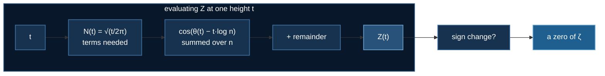

# Riemann Zeros at Scale

:::info Reading this without a background in machine learning
The plain words boxes carry the whole story; the technical detail around them
is there if you want it.

**The one line version:** we tried to find the zeros of a famous mathematical
function using single-precision numbers to go faster. It worked perfectly up to
a point, then found **zero of the 400** answers — not because it got sloppy, but
because the numbers themselves ran out of room. And the fix everyone reaches for
— buy a graphics card with better double-precision hardware — turned out to buy
almost nothing, for a reason worth knowing.
:::

**Baseline:** float64 is the reference arm — 400 zeros found in a 400-zero
window at every height from `t = 1e3` to `t = 1e10` — and an ordinary matrix
multiply on the same card is the FLOP-bound control.
**Budget:** 8 heights (`1e3` … `1e10`), 20,000 grid points per window, windows
sized to 400 mean zero spacings, every timing best-of-3.

**Falsifier:** on an A100 — whose float64 matrix multiply is as fast as its
float32 — this workload's float64 penalty must stay near the 2× byte ratio
rather than collapsing toward the matmul's. Written before the A100 was rented.
Matmul **1.00×** vs Z(t) **1.47×**. **HOLDS.**

:::note Credit
The mathematics here is **Ashwin Rao's** Riemann Hypothesis notebook, the source
of the Riemann–Siegel formulation used throughout. This page is not a
reproduction of it. His notebook asks *where the zeros are*; this lab asks the
systems question underneath — **what it costs to look, and what breaks first as
you look higher.**
:::

---

## The headline


Two GPUs whose float64 **matmul** capability differs by **34×**. If this
workload were limited by float64 arithmetic, its penalty would differ by 34×
too. It differs by **1.6×**.

---

## What the function is, in one picture

The Riemann–Siegel **Z function** is real-valued, and its absolute value equals
that of the zeta function on the critical line. So the zeros everyone cares
about are exactly the points where **Z crosses zero** — which turns a question
about complex analysis into "sample a curve and look for sign changes".



Two facts set up everything below.

| | |
|---|---|
| Work per point | grows as **√t** — 398 terms at `1e6`, **39,894** at `1e10` |
| Gap between zeros | shrinks only **logarithmically** |

One grows like a square root; the other shrinks like a reciprocal log. That
mismatch is the whole lab.

---

## Finding 1 — float32 goes blind, it does not get noisy

:::tip In plain words
We expected the faster, lower-precision numbers to give slightly *wrong*
answers. Instead they gave **perfect** answers, then **too many** answers, then
**no answers at all** — and the switch between those happens over a very short
stretch.
:::


| height | fp64 | fp32 | diff |
|---:|---:|---:|---:|
| `1e3` | 416 | 416 | 0 |
| `1e4` | 402 | 402 | 0 |
| `1e5` | 400 | 480 | **+80** |
| `1e6` | 399 | 595 | **+196** |
| `1e7` | 400 | 90 | −310 |
| `1e10` | 400 | **0** | −400 |

Three things there matter more than the headline.

**It is exact, then wrong in the wrong direction, then gone.** float32 matches
float64 *perfectly* up to `1e4`. Then it **over-counts** — 196 spurious zeros at
`1e6`, manufactured by cancellation in a sum whose individual terms dwarf their
own total. Only after that does it collapse. A lab that tested only up to `1e4`
would have published *"float32 is fine here"* and been right about its range and
wrong about everything else.

**The collapse is representability, not rounding.** At `t = 1e10` the gap
between adjacent float32 numbers is **1024**, while the gap between zeros is
**0.2965**. All 20,000 grid points in the window round to the *same* float32
value: the function is evaluated at one height, twenty thousand times.

**Both GPUs agree bit-for-bit.** All eight rows are identical on an RTX 3080 Ti
and an A100 — different architectures, different torch builds. A stochastic
rounding effect would not reproduce like that; a deterministic limit does.

The animation is what made the mechanism obvious. In the final frame float32 is
not a noisy curve — it is a **flat line**:

[▶ Watch float32 drown as t climbs (GIF, 188 KB)](/img/riemann/fp32_drowns.gif)

---

## Finding 2 — precision is reach, not an error bar

:::tip In plain words
The useful question is not "how much error does this add" but "**how high can
this number type count at all**". Past a certain height there simply are no
float32 numbers left between one answer and the next.
:::


| type | runs out near | at `t = 1e10` |
|---|---|---|
| float32 | `t ≈ 4 × 10⁶` | **0 points per zero** |
| float64 | `t ≈ 1 × 10¹⁵` | 155,000 points per zero |

Below one point per zero, the height is unreachable **no matter how good the
algorithm is**. No care in the summation buys it back.

You can print this table with no GPU and no downloads:

```bash
cd 02_intermediate/06_riemann_scaling
uv run benchmark_zeta.py --plan
```

---

## Finding 3 — the penalty is set by bytes, not by arithmetic

This is the measurement the lab was built for, and the first prediction was
**wrong in a way worth keeping**.

A consumer GPU does float64 arithmetic at 1/64 the float32 rate, so float64 here
"should" have been catastrophic. Measured on an RTX 3080 Ti: **2.39×**, not 64×.
So the hypothesis became *the cost is memory traffic, so the penalty should stay
near 2× — the byte ratio — even on a card with excellent float64.* That is
falsifiable, so an A100 was rented to test it.

| | RTX 3080 Ti | A100 80GB |
|---|---:|---:|
| matmul fp32 | 12.33 TFLOP/s | 18.29 TFLOP/s |
| matmul fp64 | 0.364 TFLOP/s | **18.28 TFLOP/s** |
| **matmul penalty** *(control)* | **33.84×** | **1.00×** |
| **Z(t) penalty** at `1e10` | **2.39×** | **1.47×** |


The A100's float64 matmul measured **18.282 TFLOP/s**, and that card's
*non-tensor* float64 peak is **9.7 TFLOP/s**. The measurement **exceeds what is
possible without the FP64 tensor cores** — not an inference, since you cannot
beat the non-tensor peak using non-tensor units. On that card float64 matmul is
effectively **free** relative to float32.

And this workload still pays 1.47×.

:::tip In plain words
We rented the one kind of graphics card where double-precision maths is not
slower than single-precision at all. The slowdown mostly **stayed**. That is how
we know the cost was never the maths — it is the cost of hauling twice as many
bytes to and from memory.
:::

So the conclusion, stated no wider than the evidence:

> The float64 penalty here tracks the **2× byte ratio**, not float64 ALU
> provisioning. The control swings **33.84× → 1.00×** between the two cards;
> this workload moves **2.39× → 1.47×**.

Neither figure is exactly 2.00×, and the lab does not claim they should be. The
3080 Ti sits a little above it (a small real arithmetic contribution at 1/64
rate); the A100 sits below (some of the time is precision-independent launch and
masking overhead). What is established is the **insensitivity**: a 34× change in
the relevant hardware moved the outcome by 1.6×.

### If you are choosing hardware

Paying for float64 throughput buys almost nothing here. Buy **memory
bandwidth** — and before buying either, measure, because the float64 ratio on
the spec sheet describes the control, not your workload.

---

## Why this lab has no DeepSpeed launcher

The entire workload is one elementwise cosine over a `(points × N)` array and a
reduction. There is no optimizer, no gradient and no model state — and ZeRO
shards optimizer state, gradients and parameters, which is all three of the
things this does not have. A single card saturates on memory bandwidth long
before a second would help.

So the batch script is `run_slurm.sh`, not `run_deepspeed.sh`, and the lab is
registered with `launcher="python"`. Using a distributed launcher where there is
nothing to distribute is the cargo cult this course warns about.

---

## Running it

| | |
|---|---|
| Minimum | 1 × 16 GB GPU |
| Measured on | RTX 3080 Ti Laptop and A100 80GB PCIe (RunPod) |
| Runtime | ~3 minutes for the full sweep |
| Downloads | none — the data is generated |

```bash
cd 02_intermediate/06_riemann_scaling
uv sync

uv run benchmark_zeta.py --plan                 # no GPU needed
uv run benchmark_zeta.py --max-heights 8        # full sweep
uv run make_figures.py                          # rebuild every figure
```

---

## Two things this lab learned the hard way

**A rented pod's JSON does not survive.** The harness collects **stdout**, then
destroys the machine. The first A100 run computed the matmul control — the
number this entire page rests on — wrote it to `results/*.json`, and lost it.
Anything a rented pod measures must be *printed*.

**One timed call is a sample, not a measurement.** A single matmul benchmark on
the laptop GPU returned 5.378, 11.08 and 12.088 TFLOP/s on three consecutive
runs while float64 held steady at 0.366. The *ratio* therefore wandered between
15× and 33× while neither absolute moved much. Best-of-3 brings it to ±4%.

---

## References

- Rao, A. *The Riemann Hypothesis* — the notebook this lab builds on.
- Riemann, B. (1859). *Über die Anzahl der Primzahlen unter einer gegebenen
  Grösse.*
- Siegel, C. L. (1932). *Über Riemanns Nachlaß zur analytischen Zahlentheorie.*
- Odlyzko, A. M. (1987). *On the distribution of spacings between zeros of the
  zeta function.* Math. Comp. 48.
- Edwards, H. M. (1974). *Riemann's Zeta Function.*
- NVIDIA. *A100 Tensor Core GPU Architecture* — the FP64 tensor core path the
  control measurement lands on.
