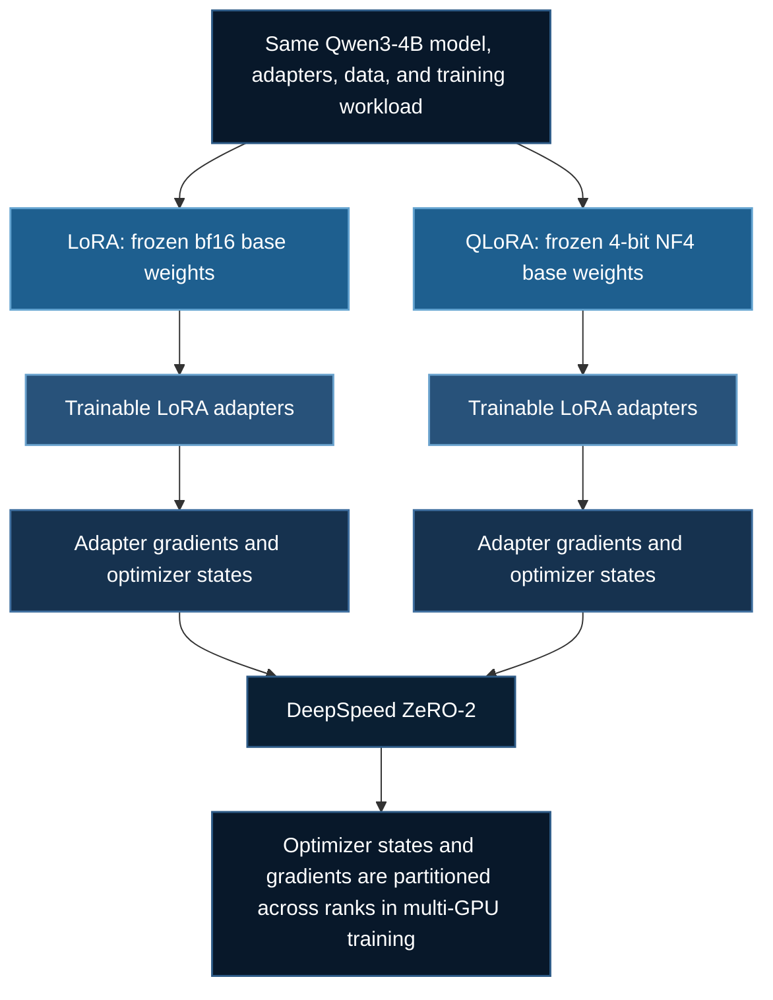

# QLoRA vs LoRA: Measuring the Frozen Base

The companion lab in `03_llms/13_qlora/` trains the same Qwen3-4B adapters
twice: once with bf16 base weights, once with NF4 four-bit base weights.
It asks an infrastructure question: how much **allocated GPU memory per
rank** does each path use? The example does not test model quality.

## Why ZeRO-2 for both?

DeepSpeed's Zero Redundancy Optimizer (ZeRO) reduces memory duplication
during distributed training. Its three stages partition different
components of the training state.

| ZeRO stage | What it partitions across GPU ranks |
|---|---|
| ZeRO-1 | Optimizer states |
| ZeRO-2 | Optimizer states and gradients |
| ZeRO-3 | Optimizer states, gradients, and model parameters |

For this experiment, **ZeRO-2 provides a consistent comparison
environment**. Both LoRA and QLoRA use the same DeepSpeed stage,
optimizer, trainable adapter configuration, and training workload.

The principal difference is how the frozen Qwen3-4B base model is stored:

- **LoRA:** The frozen base model uses bf16 weights.
- **QLoRA:** The frozen base model uses 4-bit NF4 quantization.

ZeRO-2 leaves model parameters replicated across ranks. Consequently,
the difference between bf16 and NF4 base-weight storage remains visible
in each GPU's memory measurements.

### Why not ZeRO-3?

ZeRO-3 partitions model parameters in addition to optimizer states
and gradients. This can provide significant memory savings during
distributed training, but it introduces additional complexity when
comparing quantized and unquantized model representations.

In the Transformers version pinned by this project, quantized models
may bypass the initialization path used for ZeRO-3 parameter
partitioning. As a result, comparing ordinary bf16 ZeRO-3 against
quantized ZeRO-3 could produce different parameter-partitioning
behavior between the two configurations.

That would introduce a confounding variable: we would no longer be
comparing only the effect of bf16 versus NF4 storage.

For this educational benchmark, ZeRO-2 avoids that potential
compatibility issue while still demonstrating DeepSpeed integration.

### What ZeRO-2 does not demonstrate here

All five recorded benchmark runs used a **single GPU**.

On one GPU, ZeRO-2 cannot distribute optimizer states or gradients
across multiple GPU workers. Therefore, the measured 51.86% reduction
should not be interpreted as a demonstration of distributed ZeRO-2
memory savings.

The benchmark instead measures the memory difference between the
LoRA and QLoRA configurations while using the same DeepSpeed setup.

A future experiment using two or more GPUs could separately evaluate
the benefits of ZeRO-2 partitioning.

### GPU memory architecture

Both approaches train the same LoRA adapters. Their primary difference is
how the frozen base model is stored in GPU memory.



**Important:** All five benchmark runs used a single GPU. Consequently,
the experiment does not measure memory savings from distributing ZeRO-2
optimizer states and gradients across multiple GPUs. The observed memory
reduction primarily reflects the difference between bf16 and NF4 model
storage under the tested configurations.

With about 4.02 billion base parameters, bf16 storage is roughly 8.04 GB
and ideal 4-bit storage roughly 2.01 GB. Neither number is a VRAM
prediction: scales, embeddings, activations, CUDA allocation and optimizer
state require additional space. Budget each GPU separately.

## Experimental methodology

A useful memory benchmark must control the variables that could
otherwise explain differences between training configurations.

### What stays constant?

Both configurations use:

- The same Qwen3-4B pretrained model.
- The same four repeated training text samples.
- LoRA rank 8, alpha 16, and dropout 0.
- The same seven adapter target projections.
- The same optimizer and DeepSpeed ZeRO-2 configuration.
- The same number of optimizer steps.

Each configuration trains 16,515,072 adapter parameters.

The primary experimental difference is the representation of the
frozen base model: bf16 for LoRA and 4-bit NF4 for QLoRA.

### Why separate training processes?

Running LoRA and QLoRA sequentially inside one Python process could
complicate GPU memory measurements. Allocations and cached memory
associated with the first run could affect the second.

To reduce this risk, the comparison launches each training
configuration in a separate child process.

This allows CUDA resources from one configuration to be released
before the next configuration begins.

### What does the memory measurement include?

The experiment records peak GPU memory allocated through PyTorch.
The measurement includes allocations associated with model loading
and training, including activations and adapter training state.

Peak allocated memory is not identical to total GPU utilization.
Some CUDA allocations may occur outside PyTorch's allocator.

The reported measurements therefore describe a specific,
consistently collected metric rather than total physical VRAM usage.

### Why repeat the experiment?

Individual training runs can vary because of system conditions and
execution overhead.

Five benchmark runs were recorded:

| GPU | Number of runs |
|---|---:|
| NVIDIA RTX 3090 | 3 |
| NVIDIA RTX 4090 | 2 |

Each run trained both configurations for 40 optimizer steps.

Repeating the experiment allows readers to examine whether memory
measurements are consistent and whether training durations vary.

## Try the comparison

With a suitable GPU and from inside the lab folder:

```bash
uv sync
uv run --locked deepspeed --num_gpus=1 train_qlora.py --max-steps 20
```

The 20-step option caps **each arm**. `comparison.json` records peak
allocated bytes, actual stored tensor bytes, logical and trainable parameter
counts, and the first/last losses for each rank. The peak counter resets
before each load. Packed NF4 parameters use their original quantization
shape for logical counts; stored bytes also include quantization state.
The run rejects identical representations or adapters and rejects an NF4
memory peak that is not smaller on a rank. For the SLURM and RunPod commands,
see the lab [README](https://github.com/yiqiao-yin/deepspeed-course/tree/main/03_llms/13_qlora).

Without a GPU, `--plan` shows only the ideal weight arithmetic. The offline
test checks the comparison invariants:

```bash
uv run --no-project python 03_llms/13_qlora/train_qlora.py --plan
uv run tests/test_qlora.py
```

## Measured GPU results

Five single-GPU benchmark runs were completed on October 26, 2026:
three using an NVIDIA RTX 3090 and two using an RTX 4090. Each run
trained both configurations for 40 optimizer steps.

Across all five runs, the measured peak PyTorch-allocated GPU memory was
8.19 GiB for LoRA and 3.94 GiB for QLoRA, representing a **51.86% reduction**
in peak allocated memory.

Training-loop durations varied between runs. These measurements demonstrate
memory savings under the tested configuration but do not establish
equivalent model quality, generalization, or a statistically reliable
training-speed advantage.

The companion lab README contains the individual benchmark results,
original execution logs, JSON measurements, and statistical analysis.

## Understanding the training-time tradeoff

Memory efficiency is only one consideration when selecting a
fine-tuning method. Quantization can introduce additional computation,
including the processing required to use quantized weights.

The benchmark recorded the following average training-loop durations:

| GPU | LoRA | QLoRA | QLoRA time difference |
|---|---:|---:|---:|
| RTX 3090 | 14.57 s | 17.30 s | 18.74% slower |
| RTX 4090 | 14.99 s | 15.26 s | 1.80% slower |

The RTX 3090 results showed a larger average training-time overhead
for QLoRA than the RTX 4090 results.

However, only three RTX 3090 runs and two RTX 4090 runs were recorded.
These small samples do not establish a statistically reliable
performance difference between the two GPUs.

The measurements illustrate an important distinction:

**A configuration that uses less GPU memory is not necessarily faster.**

Memory usage and execution time should be evaluated separately.

## Experimental limitations

Several limitations should be considered when interpreting these results.

### Model quality was not evaluated

The experiment uses four repeated training samples and a short
training workload.

Decreasing training loss on these samples does not establish
generalization, downstream accuracy, or equivalent model quality.

A separate evaluation dataset would be necessary to compare
the quality of the resulting adapters.

### Distributed training was not evaluated

All five benchmark runs used a single GPU.

Although both configurations use DeepSpeed ZeRO-2, these experiments
do not measure memory savings from distributing optimizer states
and gradients across multiple GPUs.

### The results are configuration-specific

The measured 51.86% reduction applies to the tested Qwen3-4B model,
adapter configuration, training workload, and hardware.

Different models, sequence lengths, batch sizes, and software versions
could produce different memory measurements.

### GPU memory is not total system memory

The experiment reports peak memory allocated through PyTorch.

It does not measure all possible CUDA allocations, total GPU
utilization, or host RAM consumption.

## Further experiments

Several extensions would strengthen this comparison:

1. Evaluate model quality using a separate validation dataset.
2. Repeat the benchmarks more extensively to characterize timing variation.
3. Compare results across additional model sizes and sequence lengths.
4. Evaluate ZeRO-2 using multiple GPUs to measure distributed-state savings.
5. Record additional GPU memory metrics alongside PyTorch allocations.

These extensions would help distinguish quantization-related memory
savings from other factors affecting large-model training.
