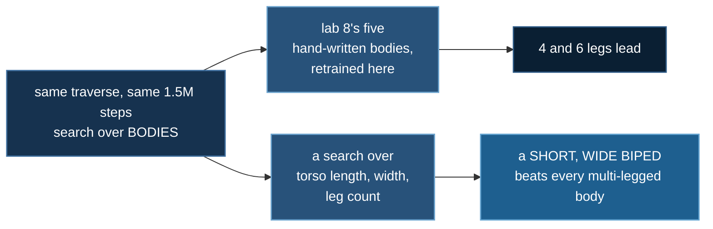
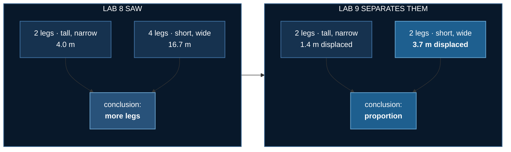

# Body Search

<!--chain-->
:::info **Lab 9 of 10** in [Physical AI](./overview) — ten labs that build one argument.
← previous: [Long Traverse](./long-traverse) · next: [Does Perception Pay?](./perception-pays) →
:::

:::info Reading this without a background in machine learning
The plain words boxes like this one carry the whole story; the technical
detail around them is there if you want it.

**The one line version:** lab 8 said more legs walk further. Here we searched over body shapes as well as leg counts, and a short, wide two-legged body beat everything. The extra legs were standing in for a better shape.
:::

## Abstract

Lab 8 compared five bodies somebody typed out and concluded that more
legs is better. This lab turns a body into **parameters** and searches
the space instead.

The winner is a **two-legged** robot — and not the one lab 8 tested.
The hand-written biped is tall and narrow; the one the search found is
short and wide. Same leg count, same nine actuators, **2.6× the
displacement and a third fewer falls**.

**Baseline:** lab 8's five hand-written bodies, retrained here so the
comparison stays inside this lab's physics.
**Budget:** 1.5M steps per body, 16-process pool, seed 0, Mars relief,
`implicitfast`; scored on **36 fresh episodes** with Wilson intervals.
**Falsifier:** if leg count explains the result, bodies rank by leg
count and proportion does not matter. It does not, and it does.

## How this lab works

Lab 8 found that more legs walk further. This lab asks whether that was
really about **legs** — by searching over body *proportions* as well as
limb count, on the same task and budget.

**Proportion, not leg count.** Lab 8's conclusion survives as a
measurement and dies as an explanation: the extra legs were a proxy for a
wider, lower body, and once you search proportions directly, two legs in
the right shape win. A hand-picked set of bodies can only tell you which
of *those* is best.

## Fifteen bodies, ranked

:::info In plain words
Instead of hand-picking a few robot shapes, we generated fifteen — varying how long the torso is, how wide, and how many legs — and trained each one identically.
:::

| body | legs | posture | act | **displaced** | eff | path | falls |
|---|---|---|---|---|---|---|---|
| **bs_m2** | 2 | mammal | 9 | **3.7 m** | **0.22** | 17.0 m | 13.9% |
| bs_m6 | 6 | mammal | 25 | 2.7 m | 0.17 | 16.0 m | 2.8% |
| bs_m4 | 4 | mammal | 17 | 2.5 m | 0.17 | 14.7 m | 5.6% |
| bs_s4 | 4 | sprawl | 13 | 2.3 m | 0.19 | 12.2 m | 11.1% |
| if_quadruped | 4 | mammal | 17 | 2.3 m | 0.18 | 13.2 m | 8.3% |
| if_hexapod | 6 | mammal | 25 | 2.1 m | 0.14 | 14.6 m | 5.6% |
| bs_m10 | 10 | mammal | 41 | 1.9 m | 0.14 | 13.4 m | 2.8% |
| bs_m8 | 8 | mammal | 33 | 1.7 m | 0.14 | 12.4 m | 5.6% |
| bs_s6 | 6 | sprawl | 19 | 1.5 m | 0.15 | 10.6 m | 8.3% |
| **if_biped** | 2 | mammal | 9 | **1.4 m** | **0.08** | 17.7 m | 19.4% |
| if_spider6 | 6 | sprawl | 19 | 1.4 m | 0.14 | 9.4 m | 8.3% |
| bs_s3 | 3 | sprawl | 10 | 1.3 m | 0.13 | 10.7 m | 2.8% |
| bs_s8 | 8 | sprawl | 25 | 1.3 m | 0.13 | 9.4 m | 2.8% |
| **if_spider8** | 8 | sprawl | 25 | 1.3 m | 0.13 | 10.3 m | **0.0%** |
| bs_s10 | 10 | sprawl | 31 | 1.0 m | 0.12 | 8.0 m | 8.3% |

Same terrain, same seed, same task, same budget. Only the machine
changes, and the tiles are ordered by how far it actually got.

## Proportion, not leg count

:::info In plain words
The winner has two legs. Lab 8 concluded that more legs walk further, and that was a true measurement of the bodies it happened to test — but the extra legs were standing in for a wider, lower body. Get the proportions right and two legs beat six.
:::

`bs_m2` and `if_biped` are both two-legged with nine actuators. The
only difference between them is shape:

| | leg length | stance width | height / width |
|---|---|---|---|
| if_biped | 0.76 m | 0.14 m | **5.4** |
| bs_m2 | 0.44 m | 0.34 m | **1.3** |

Short and wide beats tall and narrow by **2.6×**, at a third fewer
falls, with identical leg count and motor count.

:::warning This complicates lab 8
Every multi-legged body in [Long Traverse](./long-traverse) was *also*
squatter and wider than its biped, so leg count and proportion moved
together and only leg count got the credit. Separated, most of the
effect belongs to proportion.

Lab 8's measurements stand — its own bodies, its own physics, and its
4.2× survives re-measurement on displacement at 4.4×. The
**interpretation** was too simple.
:::

## The metric that nearly published a lie

:::info In plain words
A measurement error almost put out the opposite ranking. It is described here rather than quietly fixed, because the version that was wrong looked entirely reasonable.
:::

The first ranking used **distance walked** and crowned `if_biped` at
17.7 m. It ends **1.4 m from where it started**.

Path length counts every centimetre the torso moves, so a robot
thrashing on the spot banks it as fast as one travelling:

| body | path | displacement | efficiency |
|---|---|---|---|
| if_biped | 16.8 m | 1.4 m | **0.09** |
| bs_m2 | 14.3 m | 3.3 m | 0.23 |

Lab 8 used path length too, so it was **checked rather than assumed**:
re-measured on displacement its bodies rank identically (efficiencies
in a narrow 0.13–0.17 band) and its headline survives. The two metrics
only diverge here, where the biped's efficiency collapses to 0.08.

**Nothing travels in a straight line.** Every efficiency is 0.08–0.22
— the best body wanders roughly five metres for every one it gains.
Reading any of this as competent walking would be generous.

Overhead with trails, the distinction is the picture rather than a
column: a thrashing body draws a knot, a travelling one draws a line.
Bodies are simulated separately and composited on one map — nothing
interacts, and the clock is shared so frame *k* is step *k* for all.

## A body is parameters

`make_layout` takes leg count, posture, limb scale, fore-aft spread,
lateral width and mid-leg splay. Every hand-written body in labs 5–8
is reproducible from it **exactly, leg for leg** — and the first
version failed that check by dropping the hexapod's widened middle
pair, which is real insect geometry (mid-legs splay so swing legs miss
the front and hind pairs), not a typo in the table.

It refuses nonsense loudly — one leg, an odd count for a mammal
layout, an unknown posture — rather than building a lopsided robot
that would train, walk badly, and be scored as a finding.

That enables shapes nobody would type out, including one that answers
a question lab 8 raised:

**Three legs is the minimum to stand, and cannot walk.** Lift one leg
of three and the remaining two form a **line**, not a polygon, so a
tripod has no statically stable gait — it must topple and catch itself
every step, exactly like a biped. Four is the real minimum, which is
why falls hit zero there.

## Free speed: the integrator, not the hardware

The search needs many trainings, so training had to get cheap. Lab 6's
corrected figures put physics at 49–56% of a step, and the shipped
model used `integrator="RK4"` — which evaluates the dynamics **four
times per step**.

[MuJoCo recommends `implicitfast`](https://mujoco.readthedocs.io/en/stable/modeling.html)
for contact-rich models and reserves RK4 for energy-conserving systems;
RK4 can inject contact vibration. Measured on spider8:

| option | steps/s | speedup | divergence from RK4 |
|---|---|---|---|
| RK4 (shipped) | 1,165 | 1.00× | — |
| **implicitfast** | **4,577** | **3.93×** | 0.014 m |
| Euler | 4,492 | 3.85× | 0.014 m |
| RK4, no self-collision | 1,159 | 0.99× | 0.000 m |

End to end, training became **1.7–2.6× faster** — more than the ~1.40×
eight rented GPUs would have bought. **The free fix beat the rental.**

:::danger Open-loop drift lied about the behaviour change
0.014 m of divergence looked adoptable. The same trained policy then
walked **7.9 m under `implicitfast` against 5.9 m under RK4** and
stopped falling: contact dynamics amplify small differences.

So every body here was retrained under the new integrator, and these
numbers are **not comparable with labs 5–8**. The `if_*` re-baselines
exist so the comparison stays inside this lab.
:::

Self-collision removal — the other candidate, and the one that felt
most promising — does nothing at all (0.99×).

## What transfers

| | |
|---|---|
| **Path length is not progress** | the leader ended 1.4 m from its start |
| **Hand-picked comparisons confound variables** | leg count and proportion moved together until a search separated them |
| **Verify a speedup on the real system** | 0.014 m of open-loop drift hid a 34% behavioural change |
| **A generator must reproduce what it generalises** | exactly, leg for leg, or it is a second implementation |
| **The cheap fix can beat the expensive one** | an XML attribute beat eight rented GPUs |

Nine labs in, the robot still does not cross Mars. But the reason has
moved: not the terrain, not compute, not perception, not leg count —
the proportions of the machine. And the best body yet still wanders
five metres for every one it gains, which is the next thing worth
fixing.

## References

- Sims, [Evolving Virtual Creatures](https://doi.org/10.1145/192161.192167), SIGGRAPH 1994 —
  morphology and controller evolved together, the origin of this question
- Gupta et al., [Embodied intelligence via learning and evolution](https://doi.org/10.1038/s41467-021-25874-z),
  Nature Communications 2021 — DERL, evolving morphologies that learn locomotion
- Ha, [Reinforcement Learning for Improving Agent Design](https://arxiv.org/abs/1810.03779),
  Artificial Life 2019 — learn the body jointly with the policy
- Pfeifer & Bongard, *How the Body Shapes the Way We Think*, MIT Press 2006 —
  morphological computation, the frame lab 8 argues in
- Schulman et al., [PPO](https://arxiv.org/abs/1707.06347), 2017 ·
  [GAE](https://arxiv.org/abs/1506.02438), 2015
- Agarwal et al., [Deep RL at the Edge of the Statistical Precipice](https://arxiv.org/abs/2108.13264),
  NeurIPS 2021 — why a handful of seeds and a mean are not enough
- Henderson et al., [Deep Reinforcement Learning that Matters](https://arxiv.org/abs/1709.06560), 2018

Body-and-controller co-design is thirty years old and this lab does a small, fixed
search rather than evolution. What it contributes is a **correction to its own
predecessor**: lab 8 concluded that more legs walk further, which was a true
measurement of the five bodies it happened to test and a false explanation. Search
over proportions as well as leg count and a **short, wide biped beats every
multi-legged body**. The extra legs were standing in for a better shape.
