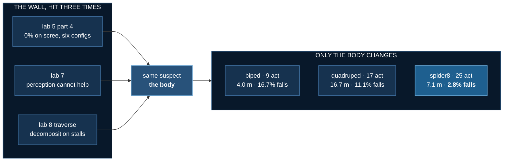

# Long Traverse

<!--chain-->
:::info **Lab 8 of 8** in [Physical AI](./overview) — eight labs that build one argument.
← previous: [Terrain VLM](./terrain-vlm)
:::

## Abstract

Three labs reached the same wall from three directions. Lab 5 part 4
scored 0% on scree across six configurations. Lab 7 gave a model eyes
and found that perception could not help. This lab decomposed a long
route into short legs and watched the robot stall anyway.

Each time the suspect was the same, and here it is finally tested:
**same terrain, same task, same 1.5M-step budget, same seed — only the
body changes.**

The body was the bottleneck, and the margin is not subtle. A
four-legged robot walks **4.2× further** than the biped, and an
eight-legged one falls a sixth as often.

**Baseline:** the biped labs 5–7 measured on — 2 legs, 9 actuators,
byte-identical here and asserted so by the suite.
**Budget:** 1.5M steps per body, 16-process pool, seed 0, Mars relief.
Scored on **36 fresh episodes** with Wilson intervals, because the
trainer's own evaluation is 12 episodes where 8.3% is a single run.
**Falsifier:** more legs should mean fewer falls and more distance. If
9 actuators beat 25 at equal budget, the limbs bought nothing.

## The result

| body | legs | actuators | arrived | falls | **walked** |
|---|---|---|---|---|---|
| **biped** (baseline) | 2 | 9 | 0% [0, 10] | 16.7% [8, 32] | **4.0 m** |
| **quadruped** | 4 | 17 | 0% [0, 10] | 11.1% [4, 25] | **16.7 m** |
| hexapod | 6 | 25 | 0% [0, 10] | 11.1% [4, 25] | 15.1 m |
| spider6 | 6 sprawl | 19 | 0% [0, 10] | 5.6% [2, 18] | 10.5 m |
| **spider8** | 8 sprawl | 25 | 0% [0, 10] | **2.8% [0, 14]** | 7.1 m |

Same hillside, same seed, same task, same training budget — only the
machine changes. On this seed the biped manages 1.6 m while the others
cover 17–22 m.

**Distance is the result, not arrival.** Every arrival interval
includes zero — **no body solves the task**. What separates the
bodies is how far they get: 4.0 m against 16.7 m, which is **4.2×**.

**Stability and distance are won by different bodies.** The
sprawling spider8 falls least (2.8%), the upright quadruped travels
furthest (16.7 m), and neither does both.

## The worst and the best, close up

The grid above is five panels wide and the gaits are small in it.
These are the two ends of the result at full size.

**Both are MEDIAN runs, not selected ones.** Sixteen seeds were
scored per body and the seed closest to that body's median distance
was filmed. Picking the hexapod's best run and the biped's worst
would have made a better clip and a dishonest one.

### Worst — the biped, 4.0 m

Seed 9006, the median of sixteen (range 0.4–12.7 m; it fell on 4 of
those 16). Nine actuators, and almost all of their work goes into
not toppling. Watch how much of the motion is lateral correction
rather than progress — that is a statically unstable body paying its
rent every step.

### Best — the quadruped, 19.4 m

Seed 9013, the median of sixteen (range 2.5–24.1 m; it fell on 1 of
those 16). Seventeen actuators, trained on exactly the same 1.5M
steps, carrying a chassis that makes it **8.1 kg against the biped's
4.9 kg** — and it still covers nearly five times the ground. The
torso stays level; almost none of the motion is correction.

**4.0 m against 19.4 m, same terrain, same budget, and the heavier
body wins.** The difference is not the controller.

## Morphological computation

[Pfeifer and Bongard's term](https://www.researchgate.net/publication/247161863_Morphological_Computation_-_Connecting_Brain_Body_and_Environment)
for a body doing work a controller would otherwise do. The canonical
demonstration is McGeer's passive dynamic walker: it walks down a
shallow slope with no actuators and no software at all, purely
because its geometry and mass distribution are right.

The framing is contested. [Hoffmann and Müller](https://direct.mit.edu/artl/article/23/1/1/2858/What-Is-Morphological-Computation-On-How-the-Body-Contributes-to-Cognition-and-Control)
argue that "offloading computation" is a metaphor being overworked —
the walker is not computing, it is well-shaped physics. This lab does
not settle that, and deliberately describes what the body *does*
rather than leaning on the disputed word.

What it can do is make the prediction falsifiable:

> A statically stable body should not need its policy to **learn**
> balance. So a 25-actuator body should hold its own against a
> 9-actuator one at an identical step budget, despite a far harder
> search.

**It held.** The hexapod and spider8 carry **2.8× the actuators** and
got exactly the same 1.5M steps — fewer samples per action dimension
— and still beat the biped on both falls and distance, while also
carrying a chassis that makes them nearly twice its mass. The
capacity the biped spends learning not to topple, they never spend
at all.

## The trade-off, and the prediction that failed

Comparative biomechanics reports a stability/efficiency trade for
posture in animals. Sprawling gives stability and manoeuvrability but
[costs energy](https://www.sciencedirect.com/science/article/abs/pii/S094420060700013X):
the feet sit far from the centre of mass, so muscles resist large
joint moments and the body sways laterally. Erect posture loads limbs
in compression and recovers pendular energy. Larger tetrapods tend to
erect postures for exactly that reason, and the
[Permian–Triassic trackway record](https://onlinelibrary.wiley.com/doi/10.1111/j.1475-4983.2009.00897.x)
shows the shift happening.

So the prediction was: **sprawlers fall less and travel less.**

**Against the biped, that is wrong.** They fall less and travel
*more*. `compare_bodies.py` prints `NO TRADE-OFF HERE` by itself — a
branch that exists so the script can contradict its author.

**Among the multi-legged bodies it is exactly as predicted**, and
with a proper chassis it is unambiguous:

| posture | bodies | falls | walked |
|---|---|---|---|
| upright | quadruped, hexapod | 11.1%, 11.1% | **16.7, 15.1 m** |
| sprawling | spider6, spider8 | **5.6%, 2.8%** | 10.5, 7.1 m |

Sprawling halves the fall rate and costs a third to a half of the
distance. That is the stability/efficiency trade comparative
biomechanics reports for posture in animals, reproduced here. The
biped baseline is so weak it loses to everything, which hides the
effect entirely — the trade only appears when the comparison is
between bodies that both work.

> **Legs buy stability. Posture decides whether you can spend it on
> distance.**

A lab that compared only against its baseline would have reported the
first half and missed the second.

**What this cannot claim:** anything about evolution. The
sprawling-to-erect shift is real vertebrate history and the trade-off
is measured in real animals, but a MuJoCo robot can only illustrate
*why such a trade-off exists*. It is not evidence about how tetrapods
evolved.

## A second correction: the bodies had no chassis

The numbers above are the **second** version of this experiment, and
the first was published before this was found.

The torso is a capsule of radius 0.06 m on the centreline, sized for
a biped whose hips sit 0.07 m out. The hexapod's hips sit at 0.30 m,
so **nothing spanned the gap** — a reader noticed the legs looked
detached, and they were. MuJoCo still attaches child bodies to the
parent frame, so the physics was a valid rigid structure and the
policies were correct for the model. But that model handed the
multi-legged bodies their limbs for free:

| missing | consequence |
|---|---|
| chassis **mass** | a hexapod weighed exactly what a biped weighs |
| chassis **inertia** | `Izz` identical across all five bodies |
| chassis **collision** | terrain passed between the legs |

All three errors flattered the multi-legged result, which is the one
direction a measurement must never be wrong in.

With a real frame (300 kg/m³ — structure and air, not a billet) the
quadruped goes from 4.9 to **8.1 kg** and the hexapod to **9.2 kg**,
with **20–26× the rotational inertia**. Every body was retrained from
scratch. What changed:

| | before (no chassis) | after (chassis) |
|---|---|---|
| biped | 4.0 m, 16.7% falls | **identical** — the control |
| quadruped | 14.1 m | **16.7 m** |
| hexapod | 13.9 m, **0.0%** falls | 15.1 m, **11.1%** falls |
| spider8 | 9.3 m, 5.6% falls | 7.1 m, **2.8%** falls |

**Retracted:** "the hexapod did not fall once in 36 episodes." That
was an artifact of a body with no mass. With a chassis it falls
11.1%, and the most stable body is the sprawling spider8 at 2.8%.

**Strengthened:** the distance advantage *grew*, from 3.5× to
**4.2×**, and the posture trade-off became unambiguous. The heavier,
higher-inertia bodies still win — so the stability is geometric,
which is what the morphological-computation claim predicted and what
the broken model could not have told us.

## The metric was broken, and that is the real lesson

None of the above meant anything until a measurement bug was found,
and it is the most instructive thing in the lab.

**`fallen()` was not a fall detector.** It was `clearance < threshold`
— torso height above *the ground directly beneath it* — so on uneven
terrain it fires whenever the **ground rises**. Measured: **13 of 13**
trigger events occurred at a torso tilt of **0–1°**. Not one was a
fall.

The artifact scales with how low a body sits, so it punished exactly
the sprawling shapes the lab exists to test. And because `fallen()`
**terminates training episodes**, it was cutting those bodies off
before they could learn. The first run of this experiment reported
that four legs were *worse* than two — 83.3% falls against 58.3% —
and that was the detector, not the robot.

It now tests the robot rather than the world: `tilt > 60°` **or**
torso-above-its-own-feet collapsed. `stance_height()` is invariant to
terrain height — it shrinks when legs buckle, holds when the ground
rises — and the suite keeps the old rule as a permanent
counterexample, asserting that clearance alone *still* calls an
upright robot fallen.

:::warning This corrects lab 5
[Mars Terrain](./mars-terrain)'s published 58–83% fall rates are
partly terrain contact rather than falls, for the reason above.
:::

Three further bugs, all the same species — **a constant calibrated for
one body silently assuming that body**:

| bug | symptom |
|---|---|
| four legs with the biped's 0.76 m legs on a 0.22 m base | height/width **3.5** — a biped on stilts, not a quadruped |
| `START_DZ` / `FALL_CLEARANCE` biped-tuned | short-legged bodies held at biped height, feet dangling, dropped every reset |
| foot geom was the whole shin capsule | `geom_xpos` is the capsule **centre**, so spiders measured half a tibia short → 100% false falls |

A fourth was pure process: `--morphology` kept a hardcoded
`choices=("biped","quadruped","hexapod")`, so argparse rejected the
spiders with exit 2, the sweep swallowed it, and two bodies were
reported as "FAILED training" having never started. The choices now
derive from the layout table.

## The traverse machinery

The lab also carries the waypoint decomposition that found the wall.
A long route is split into legs the policy can actually walk, because
lab 5 measured that asking for 16–30 m end to end gave six
configurations at exactly 0%. The policy is **retargeted, not
retrained** — its goal feature is range and bearing, so moving the
goal is the whole trick.

On flat ground it works: **27.1 m at 100% arrival, 0 interventions,
efficiency 0.95**, against lab 5's ~6 m. On relief the biped stalls,
which is what sent this lab into morphology in the first place.

A perception sweep — router accuracy swept 50%→100% — is implemented
and **deliberately not reported**, because it cannot be run
meaningfully yet. On the `course` preset there is no relief at which
the body can walk *and* blockers exist:

| relief | blocked landforms | robot traverses? |
|---|---|---|
| 0.05–0.15 | 0.0 of 10 | yes |
| 0.30 | 0.6 of 10 | no — stalls at 6.7 m |
| 1.00 | 2.8 of 10 | no — stalls at 8.0 m |

Where the robot can walk there is nothing to route around; where
there is something to route around it cannot walk. That sweep becomes
runnable now that six legs walk 14 m, which is the obvious next step.

## What transfers

| | |
|---|---|
| **A constant calibrated on one body is a hidden parameter of that body** | four bugs here, all that shape |
| **A metric can measure the world instead of the system** | `clearance` tracked terrain; `stance_height` tracks the robot |
| **Check the metric before believing the comparison** | the broken detector made more legs look *worse* |
| **Compare against more than the baseline** | the posture trade-off was invisible against a biped that loses to everything |
| **Write the prediction so it can fail** | mine did, and the script said so before its author did |

Eight labs in, the robot still does not reliably cross Mars. But it
walks **3.5× further** than it did, and for the first time the reason
it stops is not something we have mismeasured.
