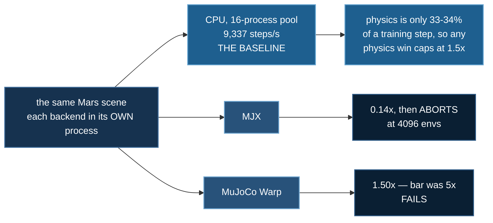
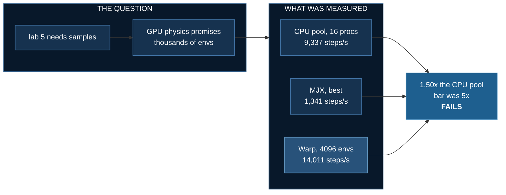

# Mars on GPU Physics

<!--chain-->
:::info **Lab 6 of 10** in [Physical AI](./overview) — ten labs that build one argument.
← previous: [Mars Terrain](./mars-terrain) · next: [Terrain VLM](./terrain-vlm) →
:::

:::info Reading this without a background in machine learning
The plain words boxes like this one carry the whole story; the technical
detail around them is there if you want it.

**The one line version:** we asked whether renting a GPU would speed up the simulation. We wrote down the bar first — it has to be five times faster — and measured 1.5. So no.
:::


## Abstract

Lab 5 ended needing samples, not a bigger network. The obvious next
move is GPU physics: MJX and MuJoCo Warp both advertise tens of
thousands of environments stepping at once, and the published numbers
are large enough that renting a card looks like a formality.

This lab rents nothing until it has measured. On the Mars course the
best GPU backend reaches **1.50×** the CPU worker pool, against a bar
of 5× written down before the run — so the recommendation is to stay
on the CPU, and the lab publishes that.

It also contains a correction. The first pass explained the gap by
blaming the terrain, and that explanation was **withdrawn**: it had
compared two different collision routines and attributed the result to
the ground. Re-run as a controlled ablation, the terrain is exonerated.

**Baseline:** lab 5's 16-process CPU worker pool, already proven
bit-identical to the serial loop — **9,337 steps/s** on 20 cores. Not
one CPU environment (5,630 steps/s).
**Budget:** 60 timed steps per backend per env count after warm-up and
JIT; ablation variants are the median of 3 repeats with spread
reported; 64 → 4096 envs; one RTX 3080 Ti Laptop (16 GB), 20 cores.
**Falsifier:** a GPU backend must reach **≥ 5×** the CPU pool. Result
**1.50× — FAILS.**

## How this lab works

Not a policy — a **procurement decision**. Is a GPU worth renting for this
simulation? The bar was written down first: *at least 5× the CPU worker
pool, or it is not worth it.*



Three things that generalise. **Baseline against the pool, not one
environment** — dividing by a single CPU env would have reported Warp at
2.5× instead of 1.50×. **A backend that `abort()`s is a data point**, which
is why each measurement runs in its own process. And **Warp falls back to
CPU silently**, reporting throughput that looks like GPU throughput, so
every backend is asked whether it can see the card before any number is
printed.

## Sixteen Mars rollouts at once

:::info In plain words
Running many copies of the simulation side by side is how you make training fast. The question is whether a graphics card does that better than sixteen ordinary processor cores.
:::


Sixteen independent episodes on sixteen generated maps — each with its
own robot, its own route, its own scarps and craters and boulders, and
its own outcome.

What the picture claims and does not claim, because this matters more
than the picture: the episodes are **simulated one at a time and
composited**, not stepped concurrently. Frame *k* of every tile is step
*k* of that episode, so the grid is synchronised in simulation time and
comparing tiles compares like with like — but it is **not** evidence of
parallel throughput. The numbers for that are below, and they say the
GPU loses.

It is also the only way it runs at all. Sixteen live MuJoCo renderers
means sixteen OpenGL contexts, which corrupts the heap under GLFW; one
context, reused, is both safer and indistinguishable in the output.

## What the three backends do

:::info In plain words
Three different pieces of software that can run the same physics: one on the processor, two on the graphics card. They are timed against each other on identical work.
:::



| backend | 64 envs | 256 | 1024 | 4096 | best vs CPU pool |
|---|---|---|---|---|---|
| **MJX** | 1,036 | 1,341 | 343 | *allocator abort* | **0.14×** |
| **Warp** | 2,304 | 7,383 | 11,979 | 14,011 | **1.50×** |

All figures steps/s on the Mars `course` preset (34 m, 75 rocks, 89
geoms, 14 DoF).

**MJX loses by an order of magnitude and then dies.** At 4096
environments XLA's allocator does not raise a catchable exception — it
hits a `Check failed` and calls `abort()`, taking the interpreter down
with it. In the first version that meant MJX's failure erased Warp's
results *and* the ablation that explains them. Each measurement now
runs in its own process, which turns the crash into a row in the table
instead of a lost run. "MJX died at 1024 envs on 16 GB" is a finding
about MJX on this hardware, and it belongs in the table.

**Warp wins, and the win is too small to rent for.** It needs 1024
environments merely to draw level with sixteen CPU processes.

## The explanation this lab had to withdraw

:::info In plain words
We first concluded the Martian terrain was what made the graphics card slow. That was wrong — the comparison had changed two things at once. Re-run properly with only one thing changing, the terrain costs almost nothing.
:::

The first pass concluded that the height-field collider costs **8.6×**
of all GPU throughput. That number was wrong, and how it was wrong is
the lesson: it compared a MuJoCo `plane` geom against a height field.
Those are **two different collision routines**. The comparison measured
the collider *type* and the conclusion named the *terrain*.

Re-run with the collider held fixed — a height field of zeros against a
height field with relief, same geom type, same resolution, only the
geometry differing:

| variant | steps/s (median of 3) | spread | contacts/step |
|---|---|---|---|
| rocks 0 | 13,111 | 1.2% | 23.0 |
| rocks 75 | 12,992 | 3.1% | 23.0 |
| hfield 45² | 12,384 | 0.5% | 33.7 |
| hfield 180² | 12,686 | 3.2% | 23.0 |
| **hfield FLAT** | **14,001** | 1.0% | **4.2** |

Mars terrain generates **5.5× the contacts** of flat ground and costs
**1.10×** the throughput for them, against a 3.2% run-to-run spread.
The 75 rocks cost nothing measurable. Quadrupling the field's
resolution costs nothing measurable.

So the terrain is exonerated. Warp is not slow here because the ground
is complicated — it is slow because the scene is **small** (14 degrees
of freedom, 89 geoms) and a 20-core CPU is already good at small. This
lab does not claim to have explained the remaining gap to the published
benchmarks; what it establishes is which three explanations are **ruled
out**.

## The ablation, drawn


Same robot, same policy, same seed, same collider. The only difference
is whether the surface has relief — the exact variable the ablation
isolates. The readout under each panel is the live contact count.

Walking over a full episode, Mars generates **10.8×** the contacts of
flat ground (mean 11.5 vs 1.1, peak 31 vs 7). That is a *different
quantity* from the benchmark's 5.5×, which is measured on a robot
settling under gravity for 300 steps — the two are scoped where they
are reported and neither replicates the other.

The animation is worth watching for what it gets wrong. The contact
counts separate dramatically, and the intuition that follows — that
Mars must therefore be far more expensive to simulate — is the
intuition the throughput table refutes. An eyeball estimate from this
picture alone would get it wrong by a factor of five.

## Scope check: does the verdict hold for a bigger robot?

Every number above was measured on **lab 5's biped** — 14 degrees of
freedom, 9 actuators. A measured claim is scoped to the configuration
it was measured in, and lab 8 then built bodies more than twice that
size, so the verdict had to be re-tested rather than carried over.
GPU throughput amortises better the more work each environment does,
which is exactly the condition a bigger body creates.

Re-run on the same card, `--morphology spider8`:

| body | DoF | geoms | CPU pool | Warp @ 4096 | vs pool |
|---|---|---|---|---|---|
| biped | 14 | 89 | 8,341/s | 13,870/s | **1.66×** |
| spider8 | 30 | 108 | 2,579/s | 5,311/s | **2.06×** |

**The GPU advantage does grow with the body** — 1.66× to 2.06× — so
the original figure was indeed scoped rather than universal. It is
still far under the 5× bar.

### And Amdahl, measured correctly the second time

:::warning This section was published wrong once
The first version reported physics as **21%** of a spider8 training
step. That figure came from dividing spider8's *training* rate by the
**biped's** *physics* rate — `amdahl_share` was not passing the
morphology through, so it benchmarked the wrong robot. It is exactly
the error this whole page warns about, committed inside the fix for
it. Corrected below; the verdict is unchanged, the reasoning is not.
:::

| body | training | physics alone | physics share | ceiling at infinite GPU |
|---|---|---|---|---|
| biped | 3,729/s | 7,601/s | **49%** | 2.0× |
| spider8 | 1,299/s | **2,350/s** | **56%** | 2.3× |

Spider8's physics is **3.2× slower** than the biped's — 30 degrees of
freedom against 14, and 33 collision geoms against 14. Physics is the
*majority* of its training step, slightly more than for the biped,
not less.

Combining with the measured 2.06× GPU speedup:

$$\text{end to end} = \frac{1}{0.44 + 0.56/2.06} \approx 1.40\times$$

**The verdict holds against the pre-registered bar** — 2.06× is far
short of the 5× set before any measurement — but it is a judgement
call rather than a rout. A 1.40× end-to-end saving is real; it is
simply not worth renting eight cards for when the same hour of
wall-clock is available locally.

An independent direct profile of the training loop agrees on the
shape: physics 67%, PPO update 32%, everything else under 1%. The two
methods bracket the physics share at **55–67%**, and both say the
simulator is still the thing to beat.

## Amdahl: 1.50× would not have been enough anyway

:::info In plain words
Physics is only about a third of the work in a training step. Even if the graphics card made physics instant, the whole thing could only get about 1.5 times faster. The ceiling was there before we measured anything.
:::

Physics is not the whole training step. Measured on lab 5's own
`v3_flat_blind` run, at **that run's own configuration** (16 workers,
64 envs, flat) — because a pool measured at 16 envs divided by a 64-env
training run would invent a speedup out of a mismatch:

| | steps/s |
|---|---|
| training, end to end (its recorded wall clock) | 5,344 |
| physics alone (the same pool, measured here) | 16,018 |

Physics is **33–34%** of a training step across 3 repeats. An
*infinitely fast* physics engine gives at most **1.5× end to end**.

**Scope, and it matters:** this share is sensitive to machine load.
Measured on a busy box the pool reads faster relative to the training
run and the share drops to ~24%, which would cap the ceiling at 1.3×
instead. Both readings point the same way and neither rescues a 1.50×
physics win, but the figure quoted here is the idle-box one and should
not be quoted without that.

That is why the bar was 5× on the physics rather than 2×, and it was
set before any measurement. A component speedup divided by Amdahl is
the only version of it that means anything.

## Watching the checks fail

Three of this lab's four ablation results are **negative** — rocks
don't matter, resolution doesn't matter, relief barely matters. That is
exactly the shape a broken knob produces: a `rocks=0` argument that
silently did nothing would report "rocks make no difference" and be
believed, because the number is plausible and agrees with the
conclusion already in hand.

So `tests/test_mars_mjx.py` tests the knobs rather than trusting them:
`rocks=0` must remove exactly 75 geoms, `hfield_res=45` must produce a
45×45 field, `plane=True` must flatten the elevation while keeping
`nhfield == 1` so the collider type does not change underneath the
comparison.

One of those checks shipped unable to fail. It asserted on
`hfield_data`, which MuJoCo **normalises to [0, 1]** at compile time —
so its range is 1.000 for every non-flat terrain and the assertion
passed on anything. The real elevation is in `hfield_size[2]`. Rewritten
against that, the check was then shown to reject a deliberately
squashed resample (1.785 m vs 3.745 m) before being trusted.

## Running it

```bash
cd 07_physical_ai/06_mars_mjx
uv sync

uv run probe_mjx.py                     # feasibility gate: will MJX take our terrain?
uv run bench_backends.py                # the whole thing, ~6 min
uv run bench_backends.py --ablate-only  # just the why
uv run bench_backends.py --skip-mjx     # if MJX's allocator is unhappy

uv run render_swarm.py --tiles 16 --rough      # the montage
uv run render_ablation.py                      # flat vs Mars
```

With no GPU the CPU baselines still run and the GPU rows report why
they could not. The logic test needs no GPU at all:

```bash
uv run tests/test_mars_mjx.py
```

**There is no `deepspeed` call in this lab, deliberately** — the
twelfth `launcher="python"` example in the course. Nothing here trains:
no parameters, no gradients, nothing for ZeRO to shard. The subject is
precisely whether the hardware DeepSpeed usually runs on helps at all
here, and the measured answer is that it does not.

## What transfers

Not the numbers, which belong to one model on one card. The order of
operations:

| | |
|---|---|
| **Write the bar before measuring** | in a form that can lose — this one lost |
| **Baseline against what you'd actually use** | 16 CPU processes, not one; the single-env comparison flatters every GPU |
| **Ablate, don't theorise** | one property at a time is what caught the withdrawn 8.6× |
| **Check the knobs move the model** | three negative results are worthless if a knob is a no-op |
| **Divide by Amdahl** | 33% of wall clock caps any physics win at 1.5× |

This is the third time in topic 07 that "rent a bigger box" was the
wrong answer. Lab 5 measured the GPU **1.7× slower** for the policy
update and found 3.9× sitting unclaimed in a serial loop and a
too-frequent evaluation. This lab measures GPU physics at 1.50× against
a 5× bar. Both times the machine was answerable in minutes, and both
times the answer was no.

## References

- Todorov, Erez & Tassa, [MuJoCo: A physics engine for model-based control](https://doi.org/10.1109/IROS.2012.6386109),
  IROS 2012 — the simulator this topic runs on
- Makoviychuk et al., [Isaac Gym: High Performance GPU-Based Physics Simulation](https://arxiv.org/abs/2108.10470),
  2021 — physics and policy both resident on the GPU, no CPU round trip
- Freeman et al., [Brax: A Differentiable Physics Engine for Large Scale Rigid Body Simulation](https://arxiv.org/abs/2106.13281),
  2021 — the JAX lineage MJX belongs to
- Rudin et al., [Learning to Walk in Minutes Using Massively Parallel Deep RL](https://arxiv.org/abs/2109.11978),
  CoRL 2021 — thousands of parallel environments on one GPU
- Amdahl, [Validity of the single processor approach to achieving large scale computing capabilities](https://doi.org/10.1145/1465482.1465560),
  AFIPS 1967 — why a 1.50x physics win caps the whole step at 1.5x

GPU physics for RL is thoroughly established and the papers above are why people
expect it to pay. This lab's contribution is a **negative procurement result with
the bar written down first** — at least 5x the CPU worker pool or it is not worth
renting — measured at **1.50x**, with three findings that generalise: baseline
against the POOL and not one environment; a backend that `abort()`s is a data
point, so each measurement runs in its own process; and Warp falls back to CPU
**silently**, reporting throughput that looks like GPU throughput.
