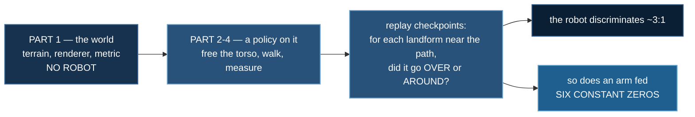
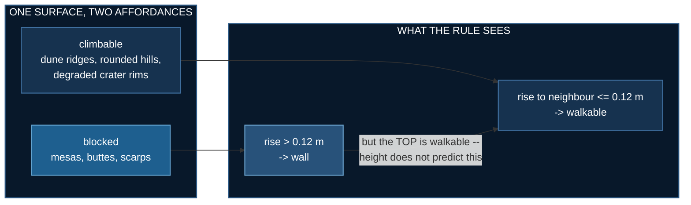
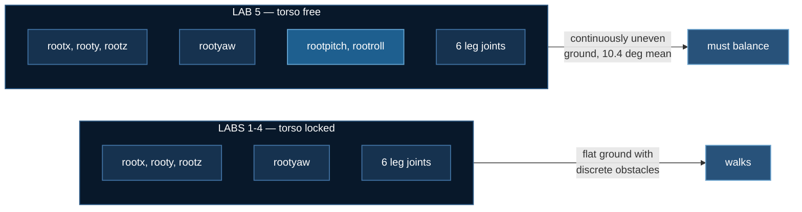

# Mars Terrain

<!--chain-->
:::info **Lab 5 of 10** in [Physical AI](./overview) — ten labs that build one argument.
← previous: [Terrain Navigation](./terrain-navigation) · next: [Mars on GPU Physics](./mars-gpu-physics) →
:::

:::info Reading this without a background in machine learning
The plain words boxes like this one carry the whole story; the technical
detail around them is there if you want it.

**The one line version:** we built a Martian landscape first, with no robot in it at all, and only then put a walker on it. The walker does avoid obstacles — but it turns out it is feeling them, not seeing them, because a robot given no information at all avoids them just as well.
:::


## Abstract

**Part 1 — the ground.** This half builds a Martian surface and then tries to catch it lying.
There is **no robot in it** — no policy, no reward, no success rate.
That is deliberate: the previous lab published a result that turned
out to be wrong, and the faults were in its world, its renderer and
its measurement rather than in anything the robot learned. So terrain
gets its own lab, built first and measured on its own terms. What
follows is a generator at two scales, six animations, seven properties
that can fail, and three bugs found by checking rather than looking.

**Part 2 — the robot.** Trains a PPO navigator on that surface, and it
**works**: about one episode in seven reaches the goal on the full
10.4° terrain. Getting there took two corrections. The torso pitch and
roll that labs 1–4 lock had to be freed, because a body that cannot
tilt cannot stand on ground that is uneven everywhere. And then six
training configurations in a row scored exactly 0%, which we spent
hours attributing to the terrain before measuring the thing that
actually mattered: **the robot walks about 6 m of sloped ground per
episode, and the task was asking for 24.** The terrain was never the
obstacle; the route length was.

**Part 4 — forcing the decision.** Rebuilds the task so every map
makes the robot choose: a 34 m arena, twice the blocker density, and
a detour on 13 of 13 maps. Nothing solves it — all six runs score
zero. The lab now holds a correctly specified hard problem with a
measured baseline, which is a better place to be than a
mis-specified easy one.

**Part 3 — the decision.** Asks the question the lab was built around
and had never tested: does the robot actually tell a climbable dune
from a cliff-edged scarp? It does — it crosses climbable landforms
about three times as often. But a policy fed **six constant zeros**
discriminates just as well, so the behaviour is **emergent from
embodiment, not perception**: you learn a scarp is impassable by
walking into one.


## How this lab works

A generated planet, built in **two separate parts on purpose**: a world
first, with no robot in it at all, and only then a policy to walk on it.



The split exists because lab 4 published a result that was wrong, and the
faults were in its world, its renderer and its metric rather than in
anything a policy had learned. Terrain and policy are different problems;
mixing them leaves you unable to say which one broke.

The finding: **the robot avoids obstacles by contact, not by seeing them.**
A policy given constant zeros discriminates just as well — you learn a
scarp is impassable by walking into one. Arrival rate alone could never
have told these apart.

## Problem Statement

:::info In plain words
Build a stretch of Mars, then teach a robot to walk across it. The landscape is built and checked completely separately from the robot, so that if something goes wrong we know which half broke.
:::

Procedural noise will give you something that looks like a planet in
about twenty lines. The hard question is different:

> What has to be **true** of a generated world before you are entitled
> to believe anything you measure on it?

Terrain is unusually good at hiding mistakes, because the only check
most people run is whether it looks right — and a height field almost
always looks right. One of the bugs below produced a surface with
**46 m of relief inside a 60 m box**, a near-vertical cliff-world, and
it still rendered as perfectly reasonable ground.

### Two scales, because the famous landforms do not fit

Olympus Mons is roughly 600 km across and 22 km tall. Valles Marineris
runs about 4,000 km. A robot arena is tens of metres across. Neither
fits, and a two-metre bump labelled "Olympus Mons" would be a lie told
with geometry.

| preset | extent | purpose |
|---|---|---|
| `regional` | 20 km | shield volcano, rift canyon, graben swarms, cratered highlands, the crustal dichotomy. **For looking at.** |
| `rover` | 60 m | dune ridges, scarps, boulder fields, small craters, fractured bedrock. **Part 2 walks here.** |

The rover map is a *local sample of a Martian-looking surface*, not a
scale model of Mars. Saying so is cheaper than pretending otherwise
and being caught by anyone who knows the numbers.


## Solution

### What is modelled

Each of these changes the **shape** of the ground, which is the test
for whether it belongs in a height field at all:

- the **crustal dichotomy** — smooth low northern plains against high,
  rough, ancient southern highlands. Regional only: a 60 m patch does
  not straddle a hemispheric boundary, and applying it there produced
  a "dichotomy" of 0.7 m, which is not a dichotomy, it is a slope.
- **impact craters** with raised rims, bowls and ejecta, drawn from a
  power-law size distribution and each carrying an **age** — sharp
  young bowls superimposed on soft, half-filled old ones. A plain
  where every crater is fresh looks like a golf ball.
- a **shield volcano**, far flatter than anyone draws it, with a
  summit caldera rather than a cone
- a **rift canyon** with terraced walls, plus **swarms of parallel
  graben**. Fossae come in sets sharing one orientation, because they
  are extensional fractures from a common stress field — the
  parallelism is the part that reads as real.
- **dendritic dry channels** that run downhill and join
- **aeolian ripples**, transverse to one prevailing wind
- surface rock as angular **platy slabs**, not spheres
- patches of exposed, **fractured bedrock pavement**

### What is not

Polar ice caps — a square tile has no pole in it, and a white blob in
the corner would be decoration. Atmospheric scattering. Real MOLA
elevation data. Regolith mechanics: the ground here is rigid, and
sinkage and slip are a much harder lab.

### The two affordance classes

A surface without a decision in it is scenery. Mars supplies both
shapes needed to make it a task:



The mesa is the interesting obstacle. Its top is as traversable as the
open plain — only the shoulder stops you — so **height alone does not
tell a robot whether it can be there.** It has to read the edge. The
0.12 m threshold is inherited from [lab 2](./biped-stairs), which
measured a two-legged robot climbing 0.04–0.10 m treads reliably and
failing above that.

$$
\text{walkable}(c) \;=\; \bigwedge_{c' \in \mathcal{N}_4(c)}
\big[\, h(c') - h(c) \;\le\; 0.12\ \text{m} \,\big]
$$

## Experiments and Results

Twenty seeds at both scales, via `uv run mars.py --check 20`:

| | rover (60 m) | regional (20 km) |
|---|---|---|
| relief | 2.7–4.0 m | ~4.2 km |
| slope, mean | 6–10° | 22° |
| walkable (rise ≤ 0.12 m) | **96%** | — |
| crater exponent *b* | ~1.9 | **2.02** |
| edge blocked, **climbable** class | **4–6%** | — |
| edge blocked, **cliff** class | **17–24%** | — |

The classes separate by about **3×** at the edge. That separation is
the property this lab exists to produce, and it is measured rather
than asserted — the constants that generate it could be right by
accident, and twice they were not.


Craters are drawn from $N(>D) \propto D^{-b}$ and the fitted exponent
comes back at **2.02**, against the ~2 seen in real crater counts.
That fit is a test, not a decoration: a uniform sample fits
$b = 0.92$, and the suite asserts that such a sample is **rejected**.
A check you have not watched fail is not a check.


### What does not work yet

:::warning The routing decision is weak, and Part 2 inherits it
Refusing to climb saves a median of **+1.24 m**, and only **5 of 10
seeds** save more than a metre. Lab 4's arena — a quarter of the area
— reached **+3.40 m**.

With 96% of cells walkable, a route can usually avoid every obstacle
for free. The fix is probably not more obstacles but **goal
placement**: lab 4 found that where you put A and B decides whether
the terrain's decision actually binds. That is a Part 2 question and
it is listed here rather than discovered there.
:::


Relief is invisible at noon and obvious at low sun. That is not only
atmosphere: shadow length is how a human reads terrain, and it is what
a vision-based policy would key on too.


## What Went Wrong, and What It Taught Us

Three failures while building this. **None of them crashed**, and each
produced output that looked entirely reasonable.

**A carve that accumulated.** The channel walker subtracted its depth
at each of 150 overlapping steps, so a channel asked for 0.15 m was cut
tens of metres deep. The result was 46 m of relief inside a 60 m box
— and it still looked like terrain. Fixed by accumulating the deepest
cut per cell and applying it once; relief is now asserted against the
preset, because eyeballing does not distinguish 3 m from 46 m.

**A measurement that answered the wrong question.** Traversability was
averaged over each landform's bounding box, which reported mesas as
86% walkable. True, and useless: the box is mostly the flat top and the
surrounding plain. The obstacle is the shoulder, so the measurement now
samples a **ring** at the landform's own radius.

:::danger A silent zero is the worst possible failure value
`climbing_pays` blocked every cell above the median elevation — 38% of
the arena — which walled the map off completely. Every route in the
counterfactual came back infinite, every sample was dropped, the list
ended up empty, and the function returned **`0.0`**.

Eight seeds in a row read `+0.00 m`. That looks exactly like *this
terrain contains no decision in it*, and it actually meant *nothing
was measured at all*. The number was plausible, in range, and pointed
at entirely the wrong culprit — so the natural next move would have
been to redesign terrain that was fine.

It now returns `NaN` and reports how many samples it actually got.
Zero and no-data are different facts and must not share a
representation.
:::

## Part 2 — Putting a robot on it

Part 1 built ground and measured it. Part 2 trains a PPO policy to
cross it, the same experiment as
[lab 4](./terrain-navigation): a random start **A**, a random goal
**B**, and arms that differ only in whether the robot is told what the
terrain ahead looks like.

**It does not work yet, and the reason is the most interesting thing
on this page.** What follows is the setup, then the measurements, then
the wall we hit.

### The task

A pair of points is drawn from a pool of 120 pre-solved maps. Both are
**standable** (defined below), the oracle's route between them is
16–30 m long, and that route is at least **15% longer than the
straight line** — so the path has to bend around something.

That last filter is not cosmetic. Lab 4 capped goal distance by
walking B backwards along the oracle's route; we tried it here and
measured the consequence:

| goal placement | median detour |
|---|---|
| truncate the route (lab 4's method) | **1.00–1.07×** |
| select naturally-bent pairs | **1.58×** |

Truncation lands B on the straight run before the first obstacle. The
route is the right *length* and contains no *decision*. Selecting on
both properties is what keeps the task a navigation problem.

### What the robot observes

$$
o \;=\; \big[\underbrace{q_{2:},\; \dot{q}}_{\text{proprioception}},\;
\underbrace{d,\; \sin\beta,\; \cos\beta}_{\text{goal, robot frame}},\;
\underbrace{(\rho_k, c_k)_{k \in \{\text{ahead, left, right}\}}}_{\text{terrain, privileged only}}\big]
$$

The goal is given as range $d$ and the sine and cosine of **relative**
bearing $\beta$, never as world coordinates — a world-frame goal
invites memorising positions in a fixed arena, and a relative one is
the same problem wherever you put it.

The privileged channel is six numbers: for each of three directions,
the worst rise $\rho_k$ within 3 m, and a bit $c_k$ for whether the
gait can clear it. Rises are measured **relative to the ground the
robot stands on**, because the decision is about the step it must
clear, not about altitude.

Three arms, differing only here:

| arm | dims | what it gets |
|---|---|---|
| blind | 25 | proprioception + goal |
| privileged | 31 | + the six terrain features |
| padded | 31 | + six constant **zeros** |

The padded arm is the control lab 4 needed and lacked: blind vs
privileged changes information *and* dimensionality together, so
without it you cannot attribute a difference to either.

### The reward

$$
r_t \;=\; \underbrace{10\,(d_{t-1} - d_t)}_{\text{progress toward B}}
\;+\; \underbrace{1.5}_{\text{alive}}
\;-\; \underbrace{10^{-3}\lVert a_t \rVert^2}_{\text{control}}
\;+\; \underbrace{100 \cdot \mathbb{1}[\text{first arrival}]}_{\text{paid once}}
$$

Three of those four terms exist because of a specific failure:

- **Progress, not forward velocity.** Running north at full speed when
  the goal is east is worth nothing. Paying for velocity produces a
  robot that sprints in a straight line and ignores B.
- **Alive at 1.5, not 0.5.** Too small and the policy learns to fall
  over immediately, because falling ends the episode and ends the
  accumulating control cost.
- **The arrival bonus is paid once, and arriving does NOT end the
  episode.** Terminating on success made success the worst outcome:
  standing still for 2000 steps earned 3000, while arriving at step
  ~700 earned 1170. The policy correctly learned not to arrive.

### The robot has two more joints than lab 4's



Labs 1–4 locked torso pitch and roll deliberately — freeing them gives
you the bipedal-balance problem on top of whatever the lab is about,
and with two legs it cost return and bought no climbing. **That
reasoning depended on their ground being flat with obstacles standing
on it**, and Mars is not like that.

### Measurement 1: the locked torso has a slope ceiling

The lab-4 robot, walking with a trained gait, on the same route, with
only the terrain relief scaled:

| mean ground slope | distance walked |
|---|---|
| 0.0° | 9.8 m |
| 0.7° | 11.6 m |
| 1.3° | 5.3 m |
| **2.6°** | **0.64 m** |
| 4.3° | 0.43 m |
| 10.4° (Mars as generated) | 0.31 m |

It stops dead somewhere between 1.3° and 2.6°, long before anything
Mars would call a hill. Removing all 140 boulders changes nothing
(0.36 m either way); flattening the height field restores it
completely (8.89 m). **The obstacle is not the obstacles — it is the
continuous unevenness between them.**

So the two joints come back. Part 2 is balance *and* navigation by
necessity, not by ambition.

### Measurement 2: freed, it walks — on flat


With pitch and roll free, trained on flat ground: **100% arrival**,
mean distance remaining 0.1 m.


### Measurement 3: the first attempt failed, and the terrain was not why


The flat-trained policy, dropped on Mars, walked **8.6 m of a 29.7 m
route** and timed out. Every training strategy we tried on that task
stalled at exactly 0%:

:::warning Correction — these fall rates are partly terrain contact
[Lab 8](./long-traverse) found that `fallen()` was not a fall
detector. It tested `clearance < threshold` — torso height above *the
ground directly beneath it* — so on uneven terrain it fires whenever
the **ground rises**, not when the robot tips. Measured on Mars
relief: **13 of 13** trigger events happened at a torso tilt of
**0–1°**. Not one was a fall.

So the 75–83% figures in this table conflate genuine falls with the
robot's belly meeting a rise. The arrival rates — all 0% — are
unaffected, and the conclusion that the flat-trained policy cannot
cross Mars stands. The *fall* numbers should be read as an upper
bound on falling, not a measurement of it.

The detector now tests the robot rather than the world (`tilt > 60°`
or torso-above-its-own-feet collapsed), and lab 8 re-measures this
biped at **16.7% [8, 32]** over 36 episodes.
:::

| strategy | steps | arrival | note |
|---|---|---|---|
| cold start on Mars | 900k | **0%** | fall rate *rose* 75% → 83% |
| warm start, flat → Mars | 246k | **0%** | 83% falling |
| graded ladder, 1.9° → 10.4° | 450k × 5 | **0%** | every rung |
| + posture reward | 900k | **0%** | |
| + 147k-parameter policy | 900k | **0%** | |
| + finer ladder from 0.6° | 400k × 3 | **0%** | |

Six configurations, one number. **That is the tell**, and we read it
too slowly: when posture, network size, curriculum and step budget all
produce an identical result, none of them is the variable that
matters.

### Measurement 4: it was the route length

The locked-torso ceiling measured earlier is a *gradual* decline, not
a cliff — and the freed-torso robot behaves the same way:

| mean slope | 0.0° | 0.7° | 1.3° | 1.9° | 3.7° |
|---|---|---|---|---|---|
| distance walked | 10.4 m | 11.6 m | 8.2 m | **5.9 m** | 1.2 m |

The robot manages roughly **6 m** of sloped ground per episode. The
task was asking for **24**.

That is a task-specification error, not a terrain property. [Lab
4](./terrain-navigation) — an *easier* problem, flat ground with
discrete obstacles — used routes of about **7 m** in a 20 m arena.
This lab asked for three times the distance on continuously uneven
ground and then blamed the ground.

Shortening the route band to 6–11 m, with nothing else changed, a
policy that **had never trained on Mars at all** immediately arrived:

| slope | zero-shot arrivals |
|---|---|
| 1.9° | 3/12 |
| 6.3° | 1/12 |
| **10.4° (full Mars)** | **1/12** |

### The result

Six runs, three arms, two seeds each, trained on the full 10.4°
surface and scored on **120 episodes** per checkpoint:


| arm | seed 0 | seed 1 | pooled | Wilson 95% | path efficiency |
|---|---|---|---|---|---|
| blind | 17.5% | 11.7% | **14.6%** | 10.7–19.6% | 66%, 63% |
| privileged | 8.3% | 16.7% | **12.5%** | 8.9–17.3% | **81%, 81%** |
| padded | 4.2% | 11.7% | ~8% | — | 46%, 55% |


**The robot crosses Mars.** Not often — about one episode in seven —
but on the full generated surface, with its craters, scarps, dunes and
140 colliding boulders.

:::warning Two seeds cannot compare the arms
Blind is nominally ahead of privileged and that means nothing: the
Wilson intervals overlap across almost their whole range. No
blind-versus-privileged claim is made here, and the arm ordering in
that table should be read as noise.

The one pattern worth noting is **path efficiency**: both privileged
seeds hit 81%, above every blind and padded run. Two seeds is still
two seeds, so it is logged as worth testing, not as a result.
:::


:::tip The 12-episode numbers were optimistic by 2x
During training the same six runs read 25–42% arrival. At 120
episodes they read 12–18%. Twelve episodes quantise to 8.3% a step,
and this lab's predecessor has a documented history of 12-episode
figures being published as findings. Everything in the table above
comes from `evaluate.py`.
:::

### What this cost, and what it bought

The honest accounting: roughly six hours of compute went into proving
that a robot could not cross Mars, and the obstacle was a number in
the task generator. The experiments that chased the wrong cause were
not wasted — the ladder and the ablation are what rule out terrain
roughness, posture, policy size and curriculum as explanations — but
the ordering was wrong. The distance the robot could walk was
measurable in ten minutes and we measured it last.

One leftover worth stating: a privileged episode scored **223% path
efficiency**, walking 3.4 m against a 7.6 m "optimal" route. That is
the conservative-oracle effect from Part 1 at its extreme — the
planner routes around terrain the robot simply walks over. The
efficiency figures above are therefore a *lower* bound on how direct
these paths are.

## Part 3 — Does it actually tell the two classes apart?

Part 1 built two landform classes and measured that they *afford*
different things. Part 2 trained a policy that reaches the goal about
one episode in seven. **Neither checked the thing in between.**

A robot can score 15% while treating every obstacle identically —
going around all of them, or blundering over all of them and
surviving the ones that happen to be climbable. **Arrival rate cannot
distinguish those**, and arrival rate is all we had measured. Three
separate experiments, and the lab's central claim was still untested.


### Measuring behaviour instead of outcome

`analyze_decisions.py` replays existing checkpoints and watches what
the robot *does*. For every landform its path comes near, it records
whether the robot went **over** it or **around** it:

$$
\text{discrimination} \;=\;
\underbrace{P(\text{cross} \mid \text{climbable})}_{\text{dunes, hills}}
\;-\;
\underbrace{P(\text{cross} \mid \text{blocked})}_{\text{scarps, mesas}}
$$

Near zero means the policy treats them the same whatever it scores.
Two choices in that measurement matter:

- **Landforms the robot never approached are excluded**, not counted
  as successful avoidance. Scoring distant obstacles as "correctly
  avoided" manufactures a competence that was never exercised — the
  same error as Part 1's bounding-box measurement.
- **A non-zero cross rate on "blocked" is not automatically a
  mistake.** `traversable()` is conservative: one episode walked
  3.4 m where the planner routed 7.6 m around terrain the robot
  simply climbed.

### The result, 180 episodes per policy

| policy | crosses climbable | crosses blocked | **difference** |
|---|---|---|---|
| blind | 56% [42–69] | 18% [6–41] | **+39%** |
| privileged | 63% [49–75] | 24% [10–47] | **+40%** |
| **padded** (six constant zeros) | 57% [43–69] | 25% [11–47] | **+32%** |

**The robot does tell them apart.** It crosses climbable landforms
about three times as often as blocked ones, and within each policy the
two intervals barely touch.

:::danger And the terrain channel contributes nothing to it
The padded arm receives six constant zeros — **no terrain information
whatsoever** — and discriminates just as well as the privileged arm
that is handed the ground profile.

So the behaviour is real but it is **not perception**. It is emergent
from having a body: you walk into a scarp and physics stops you; you
walk onto a dune and it works. The policy does not need to be told
which is which, because the world tells it on contact.

This also explains Part 2's null. Privileged never beat blind on
arrival because the terrain channel was supplying information the
robot was already getting for free.
:::


### What this does not settle

**Contact-based discrimination is not free — it is just cheap here.**
Learning a scarp is impassable by walking into it costs the walk. That
cost is small when the detour is small, and these routes barely bend:
the shipped task pool has a **median detour of 1.10×**, and only 31 of
100 maps exceed 1.15×.

That is the condition under which advance knowledge should finally
matter, and this lab has not created it yet. A robot that must commit
to going left or right **before** reaching a 20 m scarp cannot afford
to find out by collision.

:::warning The clip above was chosen from 140 episodes
The statistics in this section are unfiltered — 180 consecutive
episodes per policy. The *animation* is not: an episode that arrives
**and** crosses a climbable landform **and** meets a blocked one
occurred once in 140 seeds.

That rarity is not an aside, it is the finding restated. At a 1.10×
detour, most episodes never present the decision at all.
:::


### Next

Place A and B deliberately on opposite sides of a blocker, so a short
route is *forced* to bend. Same terrain, same robot, same budget — the
only change is that the decision becomes unavoidable. If the
privileged arm is ever going to beat blind, that is where it happens.

## Part 4 — Forcing the decision, and failing to solve it

Part 3 ended with a complaint about its own task: the robot
discriminates obstacles by contact, and contact is cheap only because
the routes barely bend. Median detour **1.10×**. Most episodes never
present the choice at all.

Part 4 builds the task that does, and then fails to solve it. Both
halves are the result.

### Why the obstacles were in the wrong place

Placing A and B across a blocker — stepping perpendicular off a scarp
in both directions, so the straight line passes through it — raises
the detour to 1.44×. But it also lengthens the route to 12.3 m, and
the robot manages about 6 m on sloped ground. Constrain the route
back to 8 m and the detour collapses to 1.09×, because the only
blockers short enough to fit are small enough to skirt.

The resolution is a ratio, not a length:

| | route | arena | route / arena | detour |
|---|---|---|---|---|
| lab 4 (works) | 7 m | 20 m | 35% | 1.36× |
| lab 5 Part 2 | 8 m | 60 m | **13%** | **1.10×** |
| **Part 4 course** | **8.8 m** | **34 m** | **26%** | **1.39×** |

At 60 m the robot's route crosses an eighth of the arena, so blockers
sit *beside* the path. Shrink the box, hold the route, and the same
generator produces a forced detour on **13 of 13** maps. This is lab
4's geometry lesson arrived at from the opposite direction: what
creates the decision is the ratio of route to arena, not the absolute
size of either.

### The course

Denser than the 60 m arena in both senses — more landforms per square
metre, and more of them across any given route:

| | 60 m arena | course (34 m) |
|---|---|---|
| mean slope | 9.9° | **10.7°** |
| landform density | 4.2 / 1000 m² | **8.7 / 1000 m²** |
| detour | 1.10× | **1.39×** |
| maps forcing a detour | 31% | **13 / 13** |


### The result: zero

Three arms, two seeds, 1.2M steps each, warm-started from flat
policies that reach 67–92% arrival. Scored on 120 episodes:

| arm | seed 0 | seed 1 |
|---|---|---|
| blind | 0.0% | 0.8% |
| privileged | 0.0% | 0.0% |
| padded | 0.8% | 0.0% |

**Nothing solves it.** The robot walks 8.8 m on rough Mars and
discriminates obstacles by contact, but it cannot route around a
blocker *and* arrive.


The frame above is the whole thing: pressed against a scarp, all
three ground-ahead readings red — every direction over the 0.12 m
step limit — 4.7 m from a goal it cannot reach. In that episode it
walked **12.0 m against a 6.2 m route** and fell. It is not failing to
walk. It is failing to give up on a heading.

:::danger What this lab now has
A **correctly specified hard task with a measured zero baseline**,
which is a better position than the one it was in two parts ago: a
mis-specified easy task scoring 15% on a decision it never had to
make.

The honest summary across the whole lab: we can build Martian ground
and measure it, a robot can cross it when the way is roughly clear,
it tells climbable from impassable by bumping into things, and it
cannot yet plan around an obstacle. The last of those is where the
interesting work starts.
:::

### What would plausibly crack it

Stated with their real costs, because none of them is free:

1. **More training.** 1.2M steps is small. Lab 4 used 1.5M for a task
   with no balance component and no forced detour; this adds both.
   5–10M is the realistic ask — a day or more per arm on CPU.
2. **Fix locomotion first.** The ~6 m range on sloped ground is the
   constraint behind every result on this page. A dedicated
   locomotion curriculum, with navigation added only afterwards.
3. **MJX on GPU.** Not for the policy — a 12k-parameter network is
   4.6× *slower* on a GPU at our batch size, measured. For the
   *physics*: thousands of parallel environments, which is what makes
   (1) affordable at all.

:::tip A measurement that was the wrong test
Before accepting the null we probed whether a shorter route band
would help, by running a flat-trained policy zero-shot on forced
courses. It scored 0/14 at every band, which looks like evidence and
is not: a policy trained on open ground walks straight at the goal
bearing, and on these maps that bearing points directly into a scarp.
The probe could not distinguish "too hard to learn" from "this
particular policy has no detour behaviour to transfer". The trained
runs are the evidence; the probe is recorded here because it took a
second look to notice it proved nothing.
:::

## What This Lab Does Not Claim

- **This is not Mars.** It is procedural terrain matched to published
  descriptions and surface imagery. MOLA data exists; this is not it.
- **No robot has walked here.** Traversability is computed from a gait
  rule, not demonstrated. Part 2 is where that claim gets earned.
- **The routing decision is weak** — +1.24 m median, 5 of 10 seeds.
- **The palette is a presentation choice, not a result.** Nothing here
  simulates scattering. The sky is butterscotch because fine suspended
  dust reddens transmitted light and surface imagery shows it that
  way; rendering a blue sky over red ground is the single most common
  way a "Mars" picture announces that nobody checked.
- **Part 4's course is unsolved.** Three arms, two seeds, 1.2M steps
  each, all at or below 0.8% arrival. The baseline to beat is zero.
- **No blind-vs-privileged conclusion anywhere on this page.**
  Part 2's arms were separated by less than their confidence
  intervals, Part 3 found the terrain channel adds nothing to
  obstacle discrimination, and Part 4 scores zero for everyone.

## Running It

```bash
cd 07_physical_ai/05_mars_terrain
uv sync

uv run mars.py --check 20             # the measurements
uv run mars.py --scale rover --ascii  # one map, in text
uv run render_mars.py --all           # six animations

uv run ../../tests/test_mars_terrain.py   # 17 checks, no GPU
```

There is no `deepspeed` call in this lab's launcher and no GPU is
requested for the generator. It trains nothing — no parameters, no
gradients, nothing for ZeRO to shard — so a distributed launcher would
be cargo cult. Only the renderer needs an OpenGL context.
