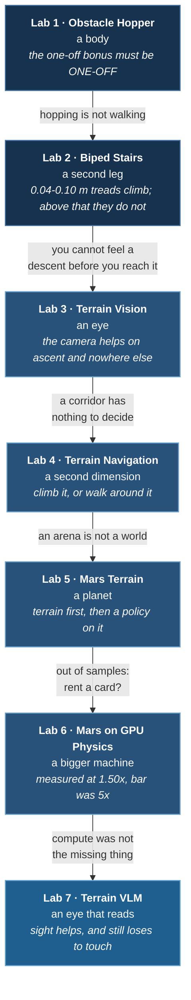
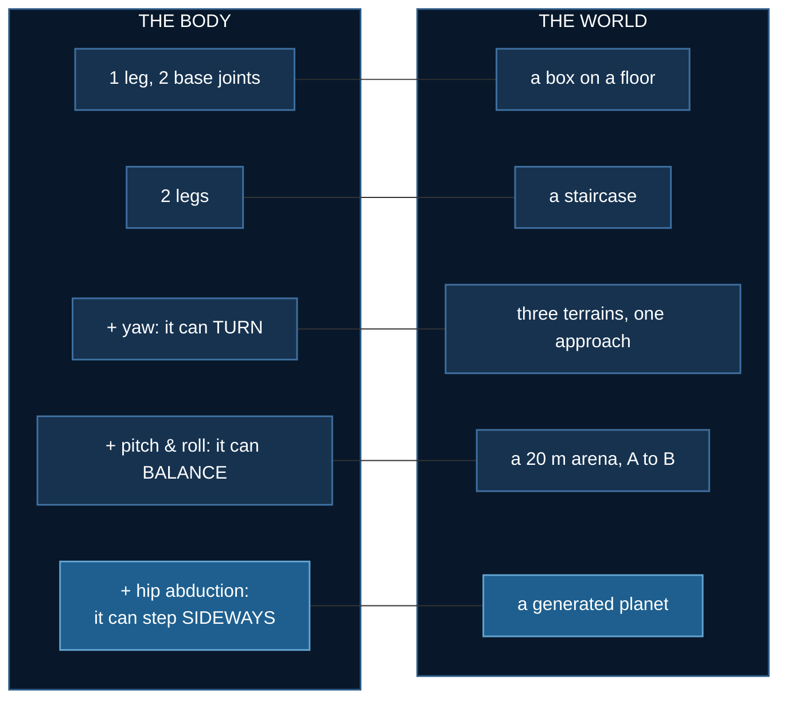

# Start Here: How These Labs Fit Together

## Abstract

Seven labs, read in order, are one argument. Each exists because the
previous one ran out of something: a body that could only hop ran out
of ground to hop over, two legs ran out of stairs they could climb, a
blind robot ran out of terrain it could feel, a corridor ran out of
decisions to make, a 20 m arena ran out of planet, and a planet ran
out of CPU — or seemed to, and a robot that learned terrain by
bumping into it ran out of excuses for never having looked. They are not
independent examples and the later ones depend on measurements made in
the earlier ones.

They also share a method, which matters more than the subject: **every
claim here is a number that could have come out the other way**, and
several of them did. Three labs on this page published a result that
was wrong and corrected it in public. The corrections are left in,
because the way those errors were found is the transferable part.

## The thread

| Lab | Adds | The measurement that carries forward |
|---|---|---|
| **[1 · Obstacle Hopper](./obstacle-hopper)** | a body | the one-off bonus must be **one-off**, or standing on the box beats crossing it |
| **[2 · Biped Stairs](./biped-stairs)** | a second leg | **0.04–0.10 m** treads climb reliably, above that they do not — every later lab's `STEP_MAX = 0.12` comes from here |
| **[3 · Terrain Vision](./terrain-vision)** | an eye | a depth camera helps on **ascent only**; descent is solved perfectly blind |
| **[4 · Terrain Navigation](./terrain-navigation)** | a second dimension | observation **width** alone destabilises a small policy, even carrying no information |
| **[5 · Mars Terrain](./mars-terrain)** | a planet | the robot discriminates obstacles **by contact**, not by seeing them |
| **[6 · Mars on GPU Physics](./mars-gpu-physics)** | a bigger machine | GPU physics is **1.50×** a 16-process CPU pool; the terrain is **not** why |
| **[7 · Terrain VLM](./terrain-vlm)** | an eye that reads | a VLM that sees scores **52.9%**; the robot that only feels scores **~75%** |

## What each lab had to go and get

The escalation is not "harder terrain". Each lab adds a *capability*,
and each capability exposes the next missing one.

Labs 1–4 deliberately **locked** the torso's pitch and roll. That was
correct for flat ground with discrete obstacles standing on it, and
fatal the moment the ground itself became uneven everywhere. Lab 5
measured the consequence: the locked body walks 9.8 m on a plane and
**0.6 m** at 2.6° of mean slope. The lock was right for four labs and
wrong for the fifth, which is the usual shape of an inherited
assumption.

## Three results that were published and then withdrawn

This is the part worth reading even if you never run any of it.

**Lab 3** reported that a depth camera took a robot from 12.5% to 79%
on a staircase. The comparison varied **two things at once**. Corrected,
the camera is real but smaller, and the thesis pointed the wrong way —
descent is the terrain a blind policy already handles perfectly.

**Lab 4** reported that a terrain-informed policy beat a blind one on
7 of 9 seeds, p = 0.022. The robot had been spawning at **twice its
start coordinates**: `rootx`/`rooty` are slide joints and the torso was
declared at the start point, so `reset()` writing the start into `qpos`
doubled it. Eighteen property tests passed throughout, because not one
compared the lab's own idea of position against MuJoCo's. A reader
noticed the robot standing still while its track reached the flag.

**Lab 5** reported that a robot could not be trained to cross Mars, on
the strength of six configurations all scoring 0%. The task had been
specified with routes **three times longer** than the robot could walk.
Six different interventions returning one identical number is the
signature of a wrong variable, and it took too long to read it that way.

## The method these labs share

| | |
|---|---|
| **Assert properties, not shapes** | every bug this course shipped ran fine and was quietly wrong; a shape assertion would have passed on all of them |
| **Watch a check fail before trusting it** | a check you have not seen reject bad input is not a check — four here shipped unable to fail |
| **A number is inseparable from its configuration** | lab 4's ranking spread is 0.041 at one epoch and 0.001 at forty; quoting one figure without the budget is a different claim, not a shorter one |
| **A plausible number is the worst failure value** | it is in range, it agrees with intuition, and it points at the wrong culprit |
| **Measure the machine before renting one** | "we need more compute" was answered by benchmarking: the GPU was 1.7× *slower*, and 3.9× was recovered free from a serial loop |

## Where it currently stops

Lab 7 ends unsolved, and deliberately so. The robot crosses open
Martian ground about one episode in seven, tells climbable landforms
from cliffs roughly 3:1 — **and a policy fed six constant zeros does
the same**, so that discrimination comes from having a body rather than
from perception. On a course where every route is forced to bend around
a blocker, nothing scores above zero.

Compute has been ruled out by measurement, as have observation width,
network size, curriculum and reward shaping. The remaining suspect is
the body plan itself: two legs on scree.

## Reading order

Start at **[Lab 1](./obstacle-hopper)** and go in order. The labs are
self-contained to run — each folder is its own `uv` project — but the
*arguments* are cumulative, and the later pages cite measurements made
in the earlier ones rather than repeating them.

If you only read one, read **[Lab 5](./mars-terrain)**: it contains the
whole arc in miniature, including two corrections and a negative result
stated as a boundary rather than a shrug.
