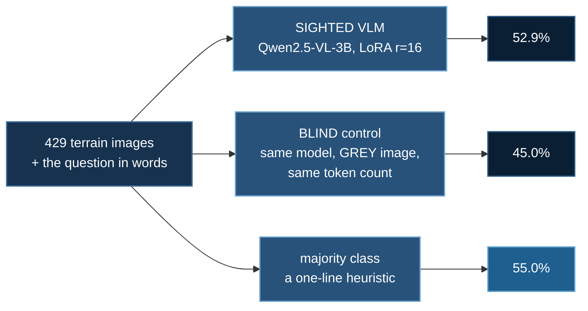
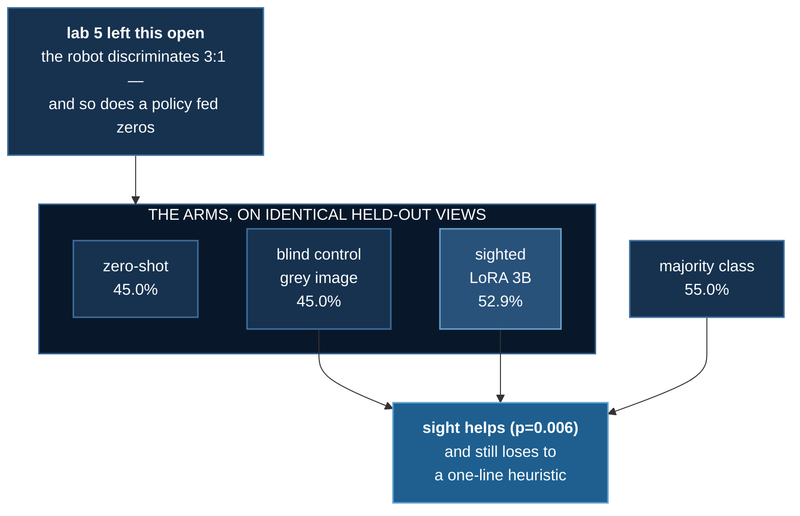

# Terrain VLM

<!--chain-->
:::info **Lab 7 of 10** in [Physical AI](./overview) — ten labs that build one argument.
← previous: [Mars on GPU Physics](./mars-gpu-physics) · next: [Long Traverse](./long-traverse) →
:::

:::info Reading this without a background in machine learning
The plain words boxes like this one carry the whole story; the technical
detail around them is there if you want it.

**The one line version:** we showed an AI that understands images and language a picture of the ground and asked it, in words, whether to climb over or walk around. It scores 52.9%. A one-line rule that ignores the picture entirely scores 55%.
:::

## Abstract

Lab 5 part 3 measured something uncomfortable. Its robot told climbable
landforms from impassable ones about **3:1** — and so did a policy fed
six constant zeros. The discrimination came from having a **body**, not
from perception: you learn a scarp is impassable by walking into one.

This lab gives a model eyes and asks whether that helps. A
vision-language model is fine-tuned on rendered Martian views whose
labels come from the terrain's own geometry, and scored against the
robot that never saw anything.

At this budget the answer is **no**. Seeing contributes something
measurable — and still loses to walking into things.

**Baseline:** three, because one would not be readable. Majority class
(always answer OVER) **55.0%**; a **blind control** with an identical
pipeline and a uniform grey image **45.0%**; lab 5's robot, by contact,
**~75%**.
**Budget:** Qwen2.5-VL-3B, LoRA r=16 (7.4 M trainable, 0.196%), 2
epochs over 1657 views, 208 steps, ~23 min on one RTX 3080 Ti Laptop
(11.5 GB of 16 GB). Scored on 429 views from **surfaces never seen in
training**.
**Falsifier:** a model that sees should beat lab 5's contact-only 3:1.
Result **52.9% — FAILS**.

## How this lab works

A vision-language model is shown the terrain ahead and asked, in words,
whether to go over or around. **Three baselines**, because one would not
have been readable.

Sight helps — McNemar **p = 0.006** against the blind arm — **and still
loses to the one-line heuristic.** Reporting only the first comparison
would have been a true sentence and a false impression. Meanwhile the
robot that only *feels* scores around 75%.

A working no-information control emits **one constant**: the blind arm
answered AROUND for all 429 items, which is what licenses the comparison.
A blind control with varied answers means information is leaking.

## The result

:::info In plain words
The model that can see the ground scores 52.9%. A one-line rule that always gives the same answer and never looks at the picture scores 55%. Seeing genuinely helps compared to a blindfolded version of the same model — and still loses to the rule.
:::

| arm | accuracy | 95% CI |
|---|---|---|
| zero-shot Qwen2.5-VL-3B | 45.0% | [40.3%, 49.7%] |
| **blind control** (LoRA, grey image) | 45.0% | [40.3%, 49.7%] |
| **sighted** (LoRA, real terrain) | **52.9%** | [48.2%, 57.6%] |
| majority class (always OVER) | 55.0% | — |
| lab 5's robot, by contact | ~75% | — |

Two tests, because they answer different questions:

- **Did the camera contribute?** Yes. On the same 429 paired items, 89
  flipped right and 55 flipped wrong — **McNemar exact p = 0.0058**.
- **Is the result good?** No. Against always answering OVER,
  **p = 0.82**. It does not beat a one-line heuristic, let alone the
  robot.

Both are true simultaneously. Reporting only the first would be the
kind of claim this course exists to avoid.

## The control, drawn

:::info In plain words
To prove the model is really using the picture, we ran it again with the picture replaced by a blank grey rectangle. If the score had stayed the same, the model was never looking.
:::

Each frame is one view neither model saw in training. Left badge is the
sighted arm's verdict, right is the blind control's — same
architecture, same training, same token count, a uniform grey image
instead of terrain.

The footer carries two different quantities deliberately. *This reel*
is the running tally over the ~80 frames shown and wanders by several
points; *full set* is the published result over all 429. A reader who
watched the reel settle on a number contradicting the page would be
right to distrust both.

## How you can tell the control worked

:::info In plain words
The blindfolded model gave the *same answer every single time* — all 429 of them. That is exactly what a model with no information should do, and it is what makes the comparison trustworthy. A blindfolded model that still varied its answers would mean information was leaking in somewhere.
:::

The blind arm answered **AROUND for all 429 items** — one constant, no
variation. That is exactly what a model with no information must do
under greedy decoding, and seeing it is what licenses the comparison.
A blind control producing *varied* answers would mean information was
leaking through the pipeline.

It also produced a coincidence worth naming, because it briefly looked
like a bug: the zero-shot model is **also** a constant-AROUND
predictor, so the two arms matched down to the per-landform
breakdown. Identical numbers from two different models normally means
one of them never ran. Here it is two models arriving independently at
the same degenerate strategy — checked by diffing the saved
predictions rather than assumed either way.

## Where the model loses

52.9% is one number covering two different behaviours, and the four
cells separate them. The largest is not a correct one: **147 views
(34.3%) are ground the robot could have walked straight over, refused.**
Against 55 (12.8%) in the opposite corner.

The two errors are **not symmetric in consequence**, which is worth
saying even though this lab scores them equally. Refusing passable
ground costs a detour; calling a scarp passable costs the rover. An
accuracy figure prices them the same and a real mission would not.

| landform | sighted | what the truth is |
|---|---|---|
| hill | 46.2% | almost always OVER |
| dune | 34.6% | mostly OVER |
| mesa | 71.3% | always AROUND |
| scarp | 72.2% | almost always AROUND |

The model is biased toward AROUND: good on blockers, bad on crossable
ground. It has learned *"Martian terrain looks impassable"* rather
than the difference between a smooth shoulder and a sharp one — which
is precisely the distinction lab 5's terrain was built to pose.

**The signal is there to be extracted.** A classifier given only the
landform's *name* scores **92.3%**, and the geometry defining the
label separates the classes cleanly. So this is a model failing to
read something it was shown, not an unlearnable task.

## Where the labels come from

Not from a human, and not from the landform's name — predicting the
name the generator chose would measure nothing. The label is the
fraction of a **ring at the landform's own radius** that a
step-limited gait cannot cross, the same measurement lab 5's
`classes_differ` was eventually forced into after an earlier version
averaged over a bounding box and reported mesas as 86% walkable.

Two choices that decide whether the dataset means anything:

- **Samples in the ambiguous middle are discarded**, not rounded to
  the nearest class — 46% of candidates. A label the oracle itself is
  unsure of is noise that later looks like a model ceiling.
- **The split is by surface, not by sample.** Two views of one surface
  share its landforms, so a sample-level split leaks the answer across
  the boundary and inflates validation accuracy for free.

The thresholds come from the measured distribution, and the first
attempt shows why that matters. It used round numbers — 0.45 and 0.10
— and 0.45 turned out to sit above the maximum a mesa ever reaches.
Every blocker fell into the discard band, and the generator produced
945 samples of which **100% were labelled OVER, including 207 scarps**.
It looked like a working dataset. The property check caught it.

## Why this is the first `07_physical_ai` lab that uses DeepSpeed

Because it is the first where sharding is load-bearing, and that was
checked rather than assumed. From `verify_arch.py`, weights plus
optimizer, per card:

| Qwen2.5-VL-7B | 1 card | 2 | 4 | 8 |
|---|---|---|---|---|
| LoRA r=16 | **15.3 GB** | 7.6 | 3.8 | 1.9 |
| full fine-tune | 119.7 GB | 59.9 | 29.9 | **15.0 GB** |

LoRA already fits one card, so running it under ZeRO-3 would shard
15.3 GB that needed no sharding. The LoRA arm therefore runs **plain
python with no launcher**, and `ds_config.json` is reserved for the
full fine-tune — the only regime here that cannot run any other way.

That restraint is inherited from measurement. Lab 5 found the GPU
**1.7× slower** for its policy update; lab 6 found GPU physics at
**1.50×** against a 5× bar and recommended not renting. Reaching for
ZeRO-3 because this is a DeepSpeed course would be the same error
pointing the other way.

The table is arithmetic over a config, so it is checked against the
code: `--build` instantiates the real module tree on torch's **meta
device** — no weights, no download — and compares. Derived 3.816 B
against an implementation reporting 3.755 B, **+1.6%**, reported rather
than quietly absorbed.

**And measured against reality:** the 3B LoRA arm used **11.5 GB**
where the table predicts 7.3 GB. The ~4 GB gap is activations, which
the table excludes and ZeRO-3 does not shard. That is the caveat the
table carries, now with a number on it.

## What is not here

The **full fine-tune of Qwen2.5-VL-7B under ZeRO-3 across 8 GPUs** is
implemented and registered, and has **not been run**. It needs
hardware this lab was developed on — one 16 GB laptop card — and
cannot provide. No number from it appears on this page, and none
should until someone runs it.

It is also the obvious next question. The signal is present, a 3B
adapter does not extract it, and whether capacity fixes that or the
framing is wrong is exactly what the untested arm would settle.

## Three things that cost time

- **`AutoModelForVision2Seq` does not exist in transformers 5.x** —
  it is `AutoModelForImageTextToText`. The *vanished symbol* class of
  API drift: it fails at import, before anything runs, so `compileall`
  never sees it.
- **torchvision is mandatory and must come from torch's index.**
  transformers routes Qwen2.5-VL's processor through
  `Qwen2VLVideoProcessor`, which hard-requires it even for still
  images. Mismatched, it fails with `operator torchvision::nms does
  not exist` — which reads like a torch bug and is not one.
- **Supervise the answer, not the prompt.** Masking only padding left
  the model learning to reproduce a 30-token instruction identical on
  every example: training loss **15.7**. Masking everything before the
  answer: **0.467**.

## What transfers

| | |
|---|---|
| **Build the control first** | the blind arm is not a robustness check, it is what makes 52.9% readable |
| **Two tests for two questions** | "did vision help" and "is it any good" have different answers here |
| **Labels from geometry, never from the generator's names** | otherwise you measure the name |
| **Split by surface, not by sample** | shared landforms leak the answer |
| **Check whether the hardware is needed** | the capacity table is why ZeRO-3 is here and why LoRA runs without it |
| **Never report the arm you did not run** | the 7B ZeRO-3 arm has no number on this page |

This is where the thread currently stops. Seven labs in, the robot
crosses open Martian ground about one episode in seven, tells cliffs
from hills roughly 3:1 by bumping into them — and the first model given
actual eyes does measurably use them and still cannot match it.
